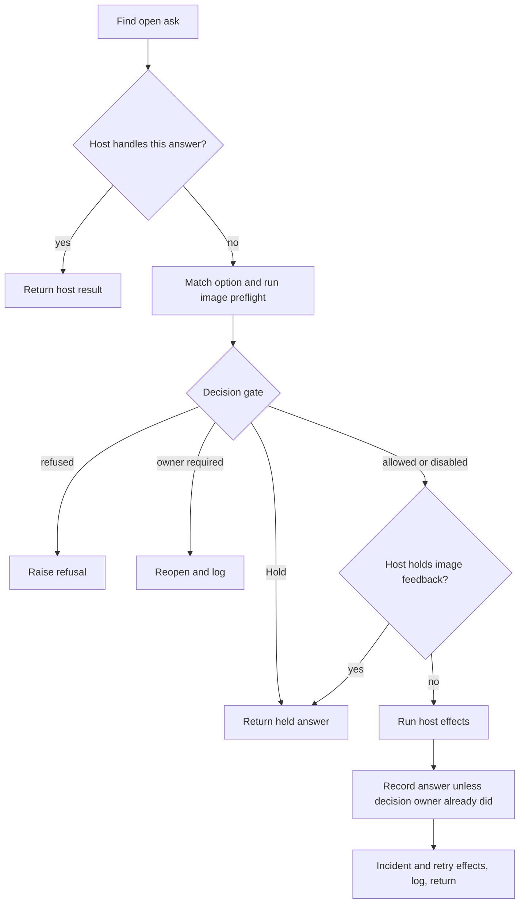

# Architecture

Pirillo Studio is the public core of a video studio: the code that plans, posts, checks and reports, with no owner's
values in it. An owner runs it from their own working studio (the host), which holds their settings, data, accounts
and mods. This page is the shape the core is ported into; `dev/queue.json` is the order.

## Layers

Three layers, and every package and queue item is in one:

- **Product** (`pirillo_studio/`): what runs a studio, the domains below. It never imports `dev/` (`dev/check.py
  product_imports`), and reaches the host only through `host.py` (`dev/check.py needs`).
- **Dev kit** (`dev/`): how anyone safely changes a studio: the checks, the landing gate (`dev/land.py`), the port
  tool, the queue and the loop charts. It is generic and ships beside the product as an optional kit; it may import
  the product, never the other way.
- **Team machine**: an owner's own build crew (who builds and reviews, how work is routed, their gates, ledgers and
  scores). It stays in the owner's working studio and never enters the core. A piece of it moves into the dev kit only
  once it is generic, as its own queue item with the owner's values removed.

Every queue item names its layer, `product` or `dev-kit`; `dev/check.py queue` refuses any other, so team work is
queued in the owner's studio. The Board is where the layers meet. Its product half is what the owner acts on: asks,
posts and the owner's turn; item 13 ports that, and panels in its backlog that show the team machine (agents, models,
lanes, runs) stay in the host. The loop charts, each queue item on its state, are the dev kit's: item 3 makes
`dev/` render them and the host puts them on its Board, so the product Board never imports them.

## Domains

One package per domain under `pirillo_studio/`, each with its tests beside it: `posting/` (the clock, its sends,
adapters, checks and calendar), `board/`, `research/`, `rendering/`, `audio/`, `growth/`. A domain module imports
other core modules and the standard library, never the host. Today's flat modules are posting except `settings.py`;
the 19 move into `posting/` in one rename landing once the clock is in (one `git mv`, one import edit per host
line).

## The boundary: one host context

Every ported function takes the host as its first argument, `s`, and reads `s.<name>`. Today `s` is the whole host
module, so the core may read any of its 31,000 lines and nobody can say what the core depends on.

The replacement keeps the call shape and narrows what crosses it:

- `pirillo_studio/host.py` declares `NEEDS`: every host name the core may read, grouped by what it is: the ledger
  (`load`, `save`, `Lock`, `log`, `assets`, `move`), paths (`DATA_DIR`, `BOARD`, `content_dir`), the clock (`now`,
  `parse`, `tz`), the adapter registry (`ADAPTERS`), and **callbacks**, host code the core still calls because its
  domain is not ported yet. A callback leaves `NEEDS` when its domain lands here; the list's length is the
  migration's remaining coupling, readable in one file.
- `host.View(module)` is the context: attribute reads go to the live host (so a test's patch is seen) and a name not
  in `NEEDS` raises `AttributeError` naming it. Building one checks that the host has every `NEEDS` name and raises
  naming the missing ones, so a rarely run send path never meets a missing name on a live post. The host builds it
  in one place, `core()`, and passes it wherever it passes `sys.modules[__name__]` today. `dev/check.py needs` keeps
  the list exact both ways: every `s.<name>` read under `pirillo_studio/` is in `NEEDS`, and every entry is read.
- The core never hands `s` to host code, and imports no host module: host code that needs the host is a one-line
  host callback that supplies itself (`approval_opened(a, path, cfg)`), and the one host module still imported is
  declared in `HOST_IMPORTS` and counted as debt. `dev/check.py needs` refuses both.
- The owner's values reach the core only as data at run time: the merged settings `cfg` (`settings.merge(DEFAULTS,
  studio.json, rules.json)`) passed to every entry point, and whatever the ledger and the named paths hold. No owner
  value appears in core source; `dev/check.py private` refuses one.
- Nothing changes all at once: a View answers every name a module already reads, so today's `s`-modules keep working
  and a host call site switches from `sys.modules[__name__]` to `core()` when it is next touched. The clock passes
  `s` down to the rest of posting, so porting it puts all of posting behind the View in one step.
- The end state, and the release bar: `NEEDS` minus callbacks is the public host interface (ledger, paths, clock,
  adapters, plus `cfg`), small and documented. Release needs zero callbacks and a minimal starter host in the core's
  examples that runs the core through that interface alone. The callback count is the port's progress number.
- Forwarders are debt with an exit: each is deleted when its last host caller moves to the core, and new host code
  calls the core through `core()`, never a forwarder.

## How a domain ports

`dev/port.py move <host file> <names...> --to <core module>` moves the exact source of whole sections (functions,
constants, classes) and mechanically rewrites only what crossing the boundary needs: each host global becomes
`s.<name>` (added to `NEEDS`), each moved function gains `s` first, and the host keeps one-line forwarders so
callers are untouched. It refuses, and lists for a hand line, anything it cannot resolve statically: a name it
cannot find, a host module the core would import, a global the moved code writes, a name local in one scope and host
in another, `getattr` with a computed name, `globals()`, any `sys.modules` lookup but `sys.modules[__name__]`,
`exec` and `eval`. A move adds no behaviour: its proof is the existing tests of those names passing before and
after, and its review checks that the diff is the mover's output plus the few hand lines it names. `dev/port.py
land` lands the core half through `dev/land.py` (with the queue state flip) and then the host half through the
host's own landing, citing the core commit, and prints the callback count. One item, one review, one commit per
repo.

Later, as a domain settles, its `s.<callback>` reads become proper arguments or move with their domain; that is
ordinary refactoring inside the core, done when the code is next worked on, never a sweep.

### Board ask writes (item 13, seam 3)

`board/asks.py` owns option parsing, permission/state transitions and matching an answered question.
`board/writes.py` owns filing an ask, recording the action carried out and idempotently delivering committed image
rejection events to their append-only mirror. The ledger remains authoritative; its host lock serializes writes.
The acted validator has one Core home; words without an option never prove that an option ran.

Owner identity, decision adapters, team/question and image/title policy, path validation and image/digest effects
remain explicit host callbacks. Existing Core readers are called directly. The host keeps command dispatch,
locked save, stage echo, pending-run tracking and withdrawal effects. Free text is feedback, never permission.
The host forwarders call this pair live. Cards, turn projection, the content contract and backlog outcomes remain open.

