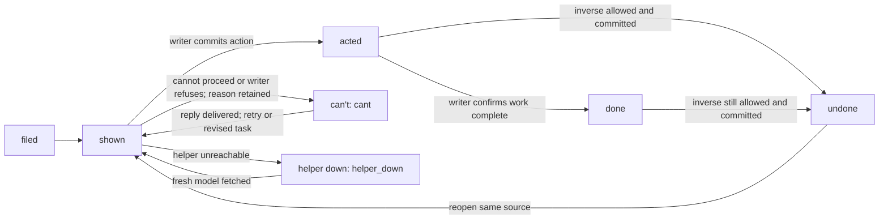
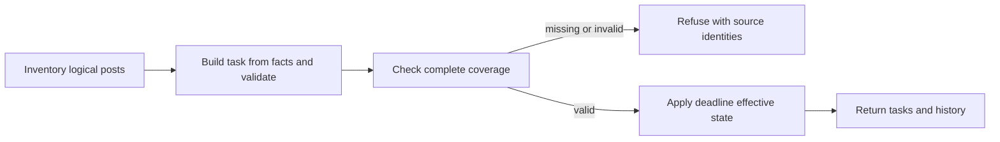

# Board task model

Draft for the owner to read, queue item 13 seam 4. This is the rebuild contract, not an implementation or a claim
that today's writers satisfy it. Inputs are the host's ledger, content files and task sources; outputs are one
JSON task per logical item and recorded actions returned to its source. The page never assembles another model.

## 1. One task shape

```json
{
  "id": "ask:sample:rev1",
  "kind": "ask",
  "what": "Approve the proposed words",
  "why": "The post waits for this decision",
  "source": {"record": "asks:sample", "filed_by": "editor", "related": ["post:sample"]},
  "judge": {"type": "words", "href": "/board/content/sample/rev1"},
  "actions": [{"verb": "approve", "label": "Approve", "undo": {"verb": "undo-approve", "until": null, "why": "Until the writer starts sending"}}],
  "cant": {"words": "", "goes_to": "editor"},
  "loop": "shown"
}
```

- `id`: opaque unique task/revision identity, stable across placement and refresh; changed actionable content gets a
  new revision identity so an old click cannot approve new content. `source.record` keeps continuity in history.
- `kind`: semantic category from the table below, never permission to choose a different renderer.
- `what`: the work or decision, in the owner's words, not an internal command or source path.
- `why`: why this is needed and what waits on it; failures and undo limits are explained here too.
- `source`: canonical record key, filing role and related record keys; all aliases and platform rows have exactly
  one task owner. It identifies the existing writer and reply recipient on the server, never a client-chosen path.
- `judge`: `type` is `image`, `video`, `words` or `file`; `href` is a model-produced, served URL to the exact content
  being judged. Words resolve to readable text, not a filesystem name. Audio uses `file` with playback where supported.
- `actions`: ordered available `{verb, label, undo}` entries, first the single primary action. The server resolves
  opaque verbs to validated writer operations. Navigation and copying are links/content utilities, not mutations.
- `actions[].undo`: inverse verb, nullable UTC expiry (`until`, null means state-dependent), and readable limit
  (`why`). While allowed, the inverse remains on the card and day's history. No advertised inverse may be a no-op.
  Once an irreversible external effect occurs, retain the action receipt and explain why reversal is unavailable;
  undoing a local Posted mark must not claim to delete a published post.
- `cant`: editable `words` plus the source's `goes_to` recipient; always offered, even for a to-do. Submitting it
  records the exact words and delivers them to that recipient without granting approval or marking work complete.
- `loop`: `filed`, `shown`, `acted`, `cant`, `undone` or `done`. These are task states, distinct from source-specific
  send/run states and from the page's `helper_down` connection state.

One judge is the minimum shape. A multi-platform post, original/candidate comparison, multiple ask attachments,
steps and editable copy cannot be silently reduced to one image or concealed in generated markup. **Required spec
extension:** `judge.parts`, an ordered list of `{type, href, label, role}` using the same four types, where `role`
identifies content, original, candidate, source, steps or destination. The primary judge remains inline; all parts
are available on the same card. Each unique steps URL appears once. This generic extension applies to every kind,
not a special layout. The owner must review it with this draft before implementation.

The history retains source identity, action receipt, words, time and undo eligibility. Terminal items remain
searchable; completion does not erase them. Read-only progress is part of the same task, not a second request.
A writer without an inverse or a reply recipient is an unmet rebuild requirement, never a reason to omit controls.

## 2. Task loop



`acted` is a durable receipt, not proof of completion: answering a question that starts work stays there until its
writer records the result. A direct Done may commit acted and done together. Refusal changes no approved content;
its reason stays visible on the open task. `cant` records the owner's inability separately from writer refusal in
the receipt. Undo is recorded, not deletion of history. Helper down is a page state from any displayed task state,
not a ledger mutation; it disables writes and labels any retained display unavailable until a successful refresh.
Each end has a contract below; retries must not duplicate a writer effect or deliver a reply twice.

A task with a deadline is drawn from its effective state at read time, never only from its stored one: past its
deadline it shows its timeout outcome, labeled as the deadline's and not the owner's choice, offers no answer, and a
timeout that needs no run closes it as done. A decision that gates another task closes with that task (skipped or
done) rather than outliving it. Neither depends on a feature switch being on.

## 3. Today's kinds and their destinations

Evidence: host `tools/board_c.py` (`ROUTES`, `ROW_KIND`, `TURN_KIND`, `gather`, `model`, `_finish`),
`tools/board_data.py` (`groups`, `model`, `action`), `tools/board_unified.py` (`model`), `tools/board_v5a.py`
(`queue`, `ready_videos`, `approve_video`, `complete_card`), and `tools/studio.py` (`your_turn`, `b5_*`,
`board_v5`, `board_v4`, helper POST dispatch). Core `board/asks.py` supplies reads; `board/writes.py` supplies
`ask_add`, `ask_acted`, `check_acted` and rejection-event synchronization, not a second card model.

In this table ledger keys come from the host data directory's `content.json` (legacy `_content.json`); they are logical inputs, not public URLs. Writer names refer to today's host unless prefixed
`board/`. A dash means no direct mutation today, not permission to omit the new task contract. Post actions use
`ok_from_board` (Approve), `pass_from_board` (Skip/restore), `mark_posted`/`unmark_posted` (Posted/undo), and
`edit_post` (Save words), only where eligible. Image controls use `image_redo_from_board`,
`board_restyle_request`/`board_data.command` and `board_data.action` (Ask for one). These preserve existing approval
and effect gates; a generic API does not authorize an external send by itself.

| Kind today | Source | Thing judged | Verbs today → writer | Mapping / disagreement |
|---|---|---|---|---|
| video (ready draft) | videos/assets and release files | video and release | Approve → `board_v5a.approve_video` → host `approve_video` | One video task; release and cuts need judge.parts. Not identical to an individual long post. |
| long post / Full video | video assets | full cut and copy | Eligible post actions above | video judge; unified uses per-platform IDs, C groups them. |
| vertical post / Full vertical | video assets | vertical cut and copy | Eligible post actions | video judge, variants in parts. |
| short post / Short variants | video assets | short cut and copy | Eligible post actions | video judge, one logical cut across platforms. |
| text post / Article | video assets | words and stills | Post and image actions | words judge with parts; v5a content review calls these Text post regardless of original type. |
| story post | storyposts and story documents | words and image | Post and image actions | One post across platforms; unified groups approvals separately from calendar rows. |
| tip post | tip assets | tip words | Post actions | Same source as tip idea after acceptance; no duplicate open task. |
| vault post | vault-generated storyposts | words and still | Post and image actions | Preserve option-to-post relation, not a second approval. |
| digest / roundup Story | storyposts, digests preview | roundup words and still | Post and image actions | C recognizes roundup IDs; unified calls this Text. Same post owns its image approval. |
| poll | polls | question and choices | Approve/Skip → `ok_from_board`/`pass_from_board`; Posted/undo | words judge; C calls waiting polls poll idea, unified Poll decision. |
| audio post / Audio | video assets or external feed rows | audio and copy | Eligible post actions | file judge; C excludes feed-only rows absent from its ledger inventory, unified types them Audio. Explicit inventory exclusion required, never silent loss. |
| image post / Image | image assets | still and copy | Post and image actions | image judge with words part. |
| approval (ok, story, poll) | approval eligibility over assets/storyposts/polls | exact post content | Approve/Skip → post writers | Facet of its post in C; separate inbox item in unified; v5a suppresses these turn entries for grouped posts. Merge by source. |
| hand post (own) | hand-method assets/storyposts | copy, file, destination, steps | Posted/undo → `mark_posted`/`unmark_posted` | C post facet; board_data emits separate manual task. Keep one post and its actions. |
| stuck post | blocked asset rows | blocked content and reason | Signed in → helper signins write; Posted → `mark_posted` | Post facet; never approve merely because a sign-in was acknowledged. |
| failed post | failed asset rows | content and error | Existing post controls where eligible | C post facet; unified generic Task. Reply goes to source owner, recovery stays with writer. |
| ask, including to-do | asks, docs/files, steps | question, options and attachments | Answer → `ask_answer`; Done → `board_data.action` → answer + `board/writes.ask_acted`; Redo → image writer | words/image/video/file as applicable; C embeds forms, replaced by data. To-do still has can't box. |
| story idea (pick) | brief stories and story choices | headline, rationale, source | Want/Bank/Skip → `idea_decide`; unified Want/Don't want → `pick_from_board` | Same source identity; choice remains in history and links to resulting post. |
| vault option | vault options, next5 files | copy and still | Want → `ok_from_board`; Skip → `weekend_change`; unified also schedule/earlier/later/save/move/remove → `weekend_change` | C individual options; unified can group a day into one choice card. Needs parts and opaque option verbs, not dropped queue editing. |
| poll idea | polls before OK | question and choices | Want/Skip → `ok_from_board`/`pass_from_board` | Same poll task transitions, not another card. |
| tip idea | tips assets, tips.md | tip words | Want/Skip → `ok_from_board`/`pass_from_board` | Same task becomes tip post; preserve copy. |
| idea (video) | next_ideas / next5, saved ideas | title and take | Want/Bank/Skip/Story → `idea_decide`; save toggle → `star_idea` | words judge; C Ideas lane, older views separate idea lists. |
| banked idea | saved ideas file | retained title/take | Want/Skip/Story → `idea_decide`; Unbank → `star_idea` | Same logical idea, retained state; bank is not completion. |
| doing | answered asks and run evidence | answer and recorded progress | No new approval; result link | loop acted until actual completion; C timeline item, older answered/history view. |
| image redo | image_redo_pending, asks, post image requests | rejected image, notes, replacement | Redo → `image_redo_from_board`; later approval via originating writer | Same source task, no approval of rejected bytes while work runs. C can emit a crew item if no ask owns it. |
| task | your_turn entries below, cards | instruction and attached evidence | Done → `board_data.action` or `complete_card`; reply → `board_tasks.board_post` | Generic category, expanded below so no source disappears. |
| crew task | cards, truth/kept/late entries and run evidence | report or blocker | Reply → `board_tasks.board_post`; Done for cards → `complete_card` | C host Studio lane; non-owner team panels stay in host, not product task sources. Owner-directed work still maps. |

The generic task category includes each source below. The default judge is words; referenced documents, folders,
files and destination links use judge.parts. `board_data.clearable` adds Done via `board_data.action` to ask-to-do,
card, wake, review, pin, token, signin, stray, thumbs, refresh and share; older models lack several of these Done
controls. All get the shared can't route in the rebuild. Later/Bring back uses `later_set` where eligible today.

| Task source kind | Source / thing judged | Verbs today → writer | Mapping / disagreement |
|---|---|---|---|
| thumbs | assets, find_thumbs/find_shots results / missing thumbnails or photos | Open folder; Done where clearable | File supply is the real prerequisite, dismissing a notice is not supplying it. |
| review | video.review_note and Review.md / review result | See posts, Open review; Done where clearable | Review document is judge, posts are related sources. |
| pin | video.missed_pin / missed date | See posts; Done where clearable | Date change remains the owning scheduling writer's action. |
| posting-hold | hold.asks / hold reason | Read task; no release writer attached | Needs a spec change: declare hold provenance and validated release/inverse before exposing a release verb; C TURN_KIND has no route. |
| youtube-manual | youtube_manual_work / manual handoff | Handoff steps, Read task | One task tied to its post; direct steps part, not a duplicate steps link. |
| signin | signins and forthcoming assets / connection needed | Signed in → helper writes signins | Writer checks connection later; acknowledgement is not success proof. |
| token | board_facts.ages / expiring credentials | Read task; Done where clearable | Never expose credentials; expiry reason and renewal instructions only. |
| card:meta-live-page | configured page and missing credential / connection instructions | v5a Done → complete_card | Needs a spec change: synthetic source has no led.cards record, so current completion refuses. Give it a real source writer, not fabricated completion. |
| wake | wake_error / wake failure | Read task; Done where clearable | Owner repair or can't reply; completion must distinguish dismissed notice from repair. |
| stray | strays / tab left open | I closed it → helper removes stray and logs | Rebuild retains an inverse receipt; removed ledger row alone is insufficient. |
| refresh | refreshes, thumbnail brief and folder / replacement thumbnail | Open brief/folder; Done where clearable | File judge with instructions and output relation. |
| card | live_cards over cards / source's instructions | Open, Done → complete_card → card_cmd; Reply → board_tasks.board_post | One source-owned task; actionable lines about an existing post attach there in C. |
| truth | _board_truth_facts / contradictory Board fact | Tell source owner → truth_from_board | Host operational report; product task only if owner action is required. |
| kept | retained unapproved storyposts / outstanding review | Read task | Attach progress to its post; C crew task, unified Task. |
| late | board_data.writer_owes, article receipt / missing work | Read task | Host crew responsibility; source recipient remains accountable. |
| story:tips-empty | tips_starved / missing next tips | Read task | Needs a spec change: v5a suppresses story sources, but this has no post to own it. Explicit supply task, not a lost approval. |
| unpackaged plugin changes (v4 only) | plugin_stale / pending package | No action; next run packages | Host-only operational notice; no product task unless owner intervention is filed. |
| share (legacy consumer) | share action row with post ID and URL / post to share | Shared → mark_posted; undo → unmark_posted | No current your_turn producer found; retain as mapped legacy input, not an invented active task. |

Legacy `board_v4` independently constructs `need`, `pins` and `anytime` cards: missing source photos and
thumbnails map to thumbs; review note to review; missed date to pin; awaiting OK to approval; manual/TikTok draft
to hand post; blocked/handoff/check to stuck post; token, wake, signin, stray, refresh, card and ask to their rows
above. Its ask only links to the newer Board. Its calendar Full video, Text post and Short map to the corresponding
post kinds. Its unpackaged-plugin notice is the additional host-only row above. These are aliases with the same
source and writer, not extra tasks. `b5_ask_form`, `b5_ask_media` and `b5_answered` supply the newer
controls/history; their embedded forms must become model data, preserving the same source identity.

Additional host-only surfaces (agent/run/crew panels including Growth's Studio actions, drawn by b5_act_row, whose drop/restore/retry verbs reach board_data.action → growth_tasks.change and no page calls; schedules; services) are not product tasks merely because they
appear on the Board. Their models and settings stay with the host; any work they file for the owner uses this task
shape. Unknown active sources fail coverage with their identity and reason, never disappear into a catch-all.

Inventory searches (then reads of the matching function ranges):

```sh
rg -n '^def |^ROUTES|^ROW_KIND|^TURN_KIND' tools/board_c.py tools/board_data.py tools/board_unified.py tools/board_v5a.py
rg -n 'def (b5_|board_v5|board_v4|your_turn)|def do_POST' tools/studio.py
rg -n 'add\(|need\(|src|self.path ==' tools/board_v5a.py tools/board_unified.py tools/studio.py
rg -n '^def ' pirillo_studio/board/*.py
```

### Posts reader (seams 6 and 9, first family)

`board/posts.py` consumes one host-supplied adapter. `records(source)` inventories one canonical key and raw
record per logical post, coalescing platform aliases and retaining history. `describe(key, record)` supplies raw
`kind`, `platforms`, `status` (one state or a list across platforms), `words`, `file` (path/URL or null),
`scheduled_at` (UTC or null), `error`, `blocker`, `filed_by` and `related`. Optional `content_identity` carries
file hashes or size/mtime read by the host; optional `history` retains source receipts unchanged.

The model produces the explanation, facets, actions and exact-content URL
`/board/content/<quoted source key>/<content hash>`. Words, file identity and platforms determine that hash;
the full raw facts also bind the task ID. The API in seam 7 serves this route. Local paths never become browser
links. Post kinds and image controls follow section 3; approval, hand, stuck and failed remain facets.

A failed or stuck post has no send deadline: its controls stay shown after its scheduled time.
Otherwise a scheduled hand post has deadline outcome `missed`, with `run: false`. An unapproved automatic post
is held with no send deadline, matching the posting clock's `due` approval gate and `scheduling.stale` rescheduling;
its approval stays available. Other scheduled posts have outcome `send`, with `run: true`, awaiting the send
writer's receipt. No schedule means no deadline. No grace is added.
Poll and tip ideas are pre-selection facets of these same posts: planned, unapproved rows offer Want/Skip,
with the same source key, revision-bound ID basis and unchanged copy after selection; no second card or send deadline.
Actions name section 3's host writers. Approval reversal names `ok_post` for video assets or `story_ok` for story
kinds, with `args: {undo: true}`; Skip reversal names `pass_from_board` with the same undo argument. Save words
restores the saved words through `edit_post`. Posted uses `unmark_posted` and never deletes published content.
Image redo and Signed in (`helper.signins`) have no restoration writer today; poll approval also has no inverse
in `poll_ok`. These controls carry `undo.writer: null` and an explicit `undo.unmet` rebuild requirement, never
a second redo or a fake reversal. The API must refuse these inverses until their writers exist. This reader
neither executes nor authorizes writers. Source snapshots, stale-click refusal and receipts belong to seam 7.

`read(adapter, source, now)` validates the complete inventory with `model.coverage`, refuses partial success and
returns `model.effective` tasks, including terminal history. `coverage(adapter, source, now)` reports
`{ok,state,next_action,detail}` with source/task counts and every unplaced key and reason. Coverage runs against
copies; it never writes the source. The reader's path is:



`test_posts.py` covers the reader portions of section 5 tests 1 through 5, 9 and 11: serialized task content,
primary action and recipient, writer/inverse declarations, coverage, revision identity, retained history and
post-owned image approval. It also checks hand-post timeout closure and fail-closed source reads. It does not
claim URL serving, delivery, writer undo, browser refresh, search UI or rendering acceptance.

`model.read` and `model.inventory` hold the family-independent path above; each family reader passes its `task`.

### Asks reader (seam 7)

`board/ask_tasks.py` consumes one host adapter: `records(source)` yields every ask, open or not, keyed
`ask:<id>`; `describe(key, record)` supplies `what`, `about`, `options` (each with a `label`), `docs`, `files`,
`steps` (a path or null), `state` (`open`, `answered` or `withdrawn`), `todo` (bool, the host's own to-do test),
`acted` (bool), `deadline` (UTC or null),
`default_on_timeout`, `filed_by`, `blocks`, `related` and `recommendation`, with optional `content_identity` (each
path's size and mtime, or that it is a folder or gone) and `history` (answer, earlier answers, acted, withdrawal).
Words, options, paths and identities determine the content hash; the full raw facts bind the task ID.

The judge is the first file (typed by extension: image, video, else file), else the words; further files are
content parts, documents source parts, and the steps one steps part, a document equal to the steps never linked
twice. An option is an answer action carrying its label (`ask_answer`); a to-do's one action is Done (`board_data.action`, answer
and `ask_acted`); any other ask without options answers in words. No owner writer
takes an answer back today, so every answer's undo is `unmet`. A decision ask (`deadline` with its
`default_on_timeout`) closes at its deadline as acted until `decisions.expire` records the default; an ask's `by`
alone is a due time and never closes it. Answered and not acted is `acted`; acted or withdrawn is `done`.
A host's adapter refuses an open ask whose document or file is gone; a closed ask keeps its record without it.
`test_ask_tasks.py` covers section 5 tests 1, 2, 4 and 12 for asks; a decision's `gates` link to the post or
video it decides waits on the API seam, which owns cross-family keys.

### Ideas reader (seam 8)

`board/ideas.py` consumes `records(source)` keyed by the host's idea identity and `describe(key, record)`
with `kind` (`video` or `story`), `what`, `why`, `outlet`, `sources` (URL and label), `saved`, `wanted`,
`skipped`, `converted_to` (key or null), `filed_by`, `related` and optional `history`. Title/take or
headline/why/outlet stay in the owner's words. Words and source links bind the served words judge and
source parts; all raw facts bind the task ID. Shared `model.read` refuses partial coverage and
`model.inventory` names each unplaced record. The host merges its newest video offers, today's stories, saved rows and story picks.

Want it, Bank, Story (video only) and Skip declare `idea_decide` actions. Bank's inverse is
`star_idea(key, False)` (Unbank); Unbank saves again. Want and Skip reversal remain unmet writers.
Story's inverse uses `story_pick(converted_to, None)` from the action receipt: it clears the conversion
receipt and pick only, preserves the brief, and refuses once the post is on the Board. Conversion or
Want is acted across days from its durable receipt; Skip and let-go receipts are done. A saved idea stays shown in the Bank, including a previously skipped idea;
conversion takes precedence. Poll and tip ideas remain facets of their posts, not extra cards; the Posts reader now covers those
facets (seam 9). Vault options have their own reader (seam 10); tasks are next. `test_ideas.py` checks the shared read and coverage paths.

### Vault options reader (seam 10)

`board/vault.py` follows the shared reader flowchart above. One host adapter inventories ledger options by day
and number, coalesces their next5 brief aliases, and preserves generated storypost relations. Brief positions
supply option numbers; a ledger option owns its retained words and decisions. Current briefs take precedence
over the same day's archive. Brief-only options remain held until the host's intake writer records them.
`describe` supplies `what`, `why`, `words` (all platform copy), `file` (still path/URL or null), `state`,
`deadline` (UTC or null), `converted_to` (post source key or null), `filed_by`, `related`, and optional
`content_identity` and `history`. The host retains legacy card picks and sibling closure, validates conversion
identities, and gives dated options their next local midnight deadline; rolling weekend options have none.

Each option is a revision-bound `vault option` task with served copy and still parts. Want declares
`ok_from_board(ids=[key])`; Skip declares `weekend_change(vid=key, action="remove")`. The opaque schedule,
earlier, later, save, move and remove verbs declare the same option writer and their corresponding action.
Values and dispatch validation belong to the API seam. These declarations neither execute nor authorize writers.
Want and schedule already approve the generated posts: a picked or converted option is acted, relates to its
storypost task and has no further approval actions. Removed, skipped and expired options remain terminal history.

The existing option writers have no genuine inverse. Save loses distinct platform words; moving or swapping
queue slots can affect other options, sweep can change more records, and an edge swap can be a no-op. Every
option action therefore declares `undo.writer: null` and a named unmet restoration writer, never a misleading
opposite action. `read` refuses partial coverage; `coverage` names every unplaced option. Captured media identities
can replace filesystem reads during copied-source coverage; missing active media remains named and unplaced.
`test_vault.py` checks serialized tasks, revisions, conversion, writer declarations, deadlines and refusals.
Next: tasks; the API and page follow.

## 4. API and writer boundary

`GET /board.json` returns `{ "tasks": [...], "generated_at": "2030-01-01T12:00:00Z" }`. It reads a coherent source
snapshot, includes retained answered/done tasks for search and history, and reports generation time in UTC. The
model owns grouping, eligible verbs, all hrefs and coverage. The page fetches on load, focus and after an action;
no regenerated HTML is needed. Unreadable required sources fail the request visibly rather than returning an empty
or deceptively fresh Board. No GET changes source state.

`POST /act {"id": "ask:sample:rev1", "verb": "approve", "words": ""}` returns
`{"ok": true, "state": "acted", "next_action": "refresh", "detail": "Decision recorded; work is pending"}`.
`state` is the resulting task loop state; `next_action` is `refresh`, `correct` or `retry`, never a shell command.
A refused action returns `ok:false`, its current state, the next step and a specific reason in `detail`; unknown IDs,
stale revisions, unavailable undo and unsupported verbs cannot succeed. Transport/authentication errors use an
appropriate non-success HTTP status and the same response envelope where possible.

The helper validates origin/authentication, ID/revision, verb eligibility and words before calling the owning
writer under its existing lock. Only explicit approving verbs approve. `cant` requires nonempty words and sends
them to the server-resolved recipient; “reject” or “try again” never implies approval. Verbs for options, edits and
undo are opaque server-issued operations, with edited text in `words`; the client cannot choose a writer, recipient,
path or image hash. Media revisions are bound to the task identity. Repeated identical requests return the recorded
result without repeating an effect. Concurrent edits refuse stale actions rather than overwrite the new source.
Undo calls the source's inverse under the same checks; no generic handler bypasses decisions or effects gates.

## 5. Named contract tests for the rebuild

These are acceptance specifications, not new tests shipped by this document. Each numbered line corresponds to
one expectation in Working #1680, including its three later additions.

1. `test_inline_judge_and_model_links`: image, video and words are visible on the card; every file opens; all URLs
   come from the model. Multi-part content uses the shared parts contract without per-kind page URL construction.
2. `test_primary_action_and_cant_delivery`: every actionable card has its Approve or Done equivalent and a
   “Can't do it? Say why” box; the exact submitted words reach the filing role once. A to-do does not lose its box.
3. `test_undo_from_card_and_day_history`: every advertised mutation can be reversed from either place while its
   writer allows; after that limit the receipt explains why, without claiming an external effect was reversed.
4. `test_open_source_coverage_once`: all open asks, posts, ideas, to-dos and stories map exactly once. Missing,
   duplicate and unknown sources fail coverage, including synthetic warnings and post-attached image asks.
5. `test_refresh_on_load_and_focus`: changed source state appears on load/focus without rebuilding Board.html;
   stale revision clicks refuse and refresh. Completing or answering retains searchable history.
6. `test_helper_down_is_explicit`: failed fetch/write shows helper down, disables actions and does not masquerade
   as a current successful Board; reconnect requires a fresh model.
7. `test_phone_has_same_task_contract`: phone width preserves judge, all actions, reply, undo and history with
   usable controls; no clipped required content or separate mobile task model.
8. `test_approved_look_preserved`: the page keeps Board C's approved visual treatment; compare desktop and phone
   captures side by side. Placement may change; a new look needs the owner's choice. Code cannot approve taste.
9. `test_search_answered_done_and_words_history`: search/filter includes answered and done items and the owner's
   recorded words across days, with original source and action context preserved.
10. `test_links_resolve_at_published_location`: images, documents and steps open from the final served location,
    including tick/staged builds and symlinked roots. A failed link check refuses replacement and retains the last
    good Board; do not check relative URLs against the temporary staging folder or refuse not-yet-created targets.
11. `test_image_approval_belongs_to_post`: the exact image is visible on its post's sole card with its approval;
    never a detached ask. Redo withholds approval of rejected bytes and returns the replacement to the same source.
12. `test_todo_primary_and_named_links`: one primary action, secondary links named for their destination/content;
    no “Open in Localhost” and no doubled steps link.

Flow ends also require `test_filed_shown` (valid source appears), `test_acted_receipt` (committed action retains
receipt), `test_cant_or_refusal_stays_open` (reason and recipient without false completion), `test_undone_reopens`
(inverse recorded), `test_done_requires_writer_result` (actual result, not a click or queued job), and the helper-down
contract above. `test_negative_answer_never_approves` checks reject/redo/not-this/try-again before positive approval.
These are future implementation obligations, not evidence this draft has run them.

Live check: `python3 tools/board_contract.py run --out /tmp/board-api.json --layout api`

This is the host rebuild's acceptance command from #1680, run on a copy of actual data with real media after the API
layout exists; it is not a runnable proof of this documentation seam. The host lead owns that later implementation
and live check. Owner use for a day and an on-Board acknowledgement remain the product acceptance step.

## 6. Failings this contract ends

- Working #1680: several renderers independently build controls, so a steps link appears twice, a to-do loses its
  answer box, and image approval becomes a detached question. One model, shared actions and source coverage end
  that class; tests 2, 4, 11 and 12 enforce the observable requirements.
- Working #1680: local links were built from a staging folder, one `../` too deep. The earlier symlink-only diagnosis
  and proposed dead-link guard were insufficient; the guard was withdrawn because it rejected valid builds. Core
  `housekeeping.tick_board` already drafts beside its destination, guarded by `TickBoardLinkBase`. Preserve that
  guarantee in the new served-URL model and test 10; this draft does not claim a new fix to that landed defect.
- Working #1680: secondary links say “Open in Localhost” instead of what opens. Model-supplied meaningful labels
  and the single-primary-action contract replace labels guessed from hostnames.
- Working #1158 (item 13 backlog): `test_1158_pm_pick_compresses_spacing_and_hands_every_browser_platform_to_the_publisher`
  shows a late vault pick must preserve same-day deadlines and platform handoff. Board schedule/approve verbs must
  retain that writer guarantee and display its result, never implement their own scheduling math. Transport policy
  remains the posting domain's, not a copied browser requirement in this spec.

The other item 13 backlog subjects are not established by the inspected Board code/tests; no titles or promised
fixes are invented here. Their host records must be reconciled by the lead before the rebuild claims the full item.

## 7. Legibility the rebuild fixes

Measured on 2026-10-24 on the legacy Board page, which carries Board C's treatment, in a browser render: computed
styles read per element and an automated design lint, both against the page's own dark tokens (`--bg` #0b0d10,
`--rail` #0f1215, `--panel` #13171c), not an assumed white page. The floors are the house design system's: text
contrast at least WCAG AA 4.5:1, section titles 16px/600 in sentence case, labels 13 to 14px, no text uppercased by
style. Each row is a defect the new page must not carry over (the owner, 2026-10-24: the rebuild fixes these six).
Contrast is accessibility and holds unconditionally. Sentence case, larger titles and labels, and a new badge ink
change the treatment, so under test 8 they are shown side by side with today's page and adopted once the owner
picks them, never by code alone; the palette roles, type families and placement stay.

| Finding | Measured today | Floor it breaks | The rebuild's target |
| --- | --- | --- | --- |
| Faint text token | `--faint` #5c646d is 3.2:1 on page, 3.1:1 on rail, 3.0:1 on panel; it carries visible text such as item counts and the search key hint | AA 4.5:1 | Every token that carries text is at least 4.5:1 on every surface it is drawn on; a token too faint for that is used only for borders and rules |
| Count badge (`.rail .n`) | white on `--red` #ff453a at 10.5px is 3.4:1 | AA 4.5:1 | Badge text at least 4.5:1 on its fill (`--bg` ink on that red is 5.7:1) and at least 13px |
| Group headers in caps (`.gh`) | notes of 150 to 240 characters set in 11.5px uppercase; post titles shown in caps | no text uppercased by style | A group header is a short sentence-case title styled as a section title; its note is body text under it; post titles in sentence case |
| Section titles in caps (`.side h2`, `.insp h3`, `.sech`, `.lat summary`) | 11.5px tracked uppercase over 13px labels, so the title is smaller than what it heads | titles 16px/600 sentence case | Section titles 16px/600 sentence case, larger than every label under them |
| Kind labels (`.kd`, `.lb`) | the kind tag (Story, Short, Vault and the rest) is 10.5px uppercase, in 183 places on the page | labels 13 to 14px | Kind labels 13 to 14px in sentence case, still in the dim text token (`--dim` #8f98a1, 6.1:1 on panel) |
| Small meta text (`.legend`, `.pin small`, `.wk small`) | 11.5px in the dim token | labels 13 to 14px | Meta text 13 to 14px; dim colour only where it is at least 4.5:1 |

`test_text_meets_design_floors`: on desktop and phone captures of the new page, every visible, enabled text node's
contrast against the solid background it is drawn on is at least 4.5:1 (text over an image or gradient is measured
against its own backing plate, which the page must draw). Once the owner has picked the treatment under test 8, it
also asserts that treatment: elements the page marks as labels (kind tags, badges, meta lines) are 13 to 14px,
section titles 16px/600 and never smaller than the labels they head, and no element has an uppercase text
transform. Like section 5, this names an acceptance test for the rebuild; this document does not ship it.
