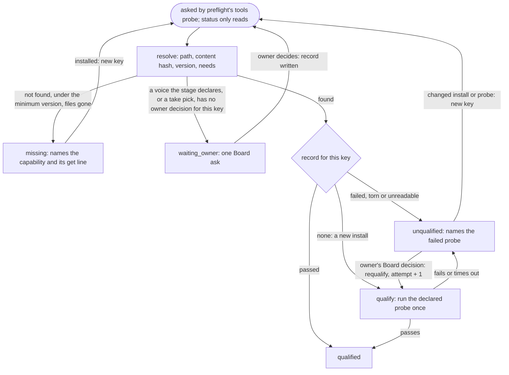

# Capabilities and the selected voice

Draft for the owner to read, queue item 5 seam 3. This is a rebuild contract, not an implementation or a claim that
the host already meets it. Before a stage of `plain` or `shorts-only` runs, the [spine](spine.md) engine needs two
answers this domain gives: is every tool, model, guide and account the stage declares present and qualified on this
machine, and has the owner chosen the voice the stage speaks or writes in. Paths are relative to the video, as in
spine.md; machine and studio records live where the core host boundary puts its state.

**Boundary with preflight, decided on evidence.** [preflight.md](preflight.md) (item 6) owns the per-stage tools
probe and its blocked result, and needs "each executable's resolved version, each model's presence. The configured
one only." The host has no single answer to give it: four modules keep their own ffmpeg search lists and `cutstack.py
need` reads PATH (section 4),
`runtime.doctor` prints `MISSING` and never refuses, `asr.py` and `encoder.py` swap what they cannot run, and two
tools install packages mid-run. So item 5 does not shrink to voice: it owns the declared capability registry and
one qualification record per capability; preflight's tools probe calls `capability(id)`, and `qualify(id)` once for a
current key with no record, and nothing else. Item 5 runs no media, input or disk probe.

**C1 scope, from `tools/stages.json` `rows` and `recipes`.** Neither recipe synthesizes a narration. `plain` speaks
in a synthesized voice only through a voice patch: a slip on the owner's tape replaced by a take of their cloned
voice, which the owner picks by ear (cutting.md `patches`; `voicepatch.py` stays the host maker's tool through C1).
`plain` loads the writing guide at `overlays`, `copy` and `text` (`text-plan` carries none); `shorts-only` writes only
at `copy`, with the social-copy guide.
So C1 needs: the speech selection a patch cites, the owner's take pick as an audio judgment that never clears on its
own, and the writing selection. Speech synthesis itself, narration and every other voice use are out of C1 scope.

## 1. What it produces, as data

The declaration, recipe data beside the stages (spine.md section 1), validated by the spine's recipe validator:

```json
{
  "capabilities_version": "1",
  "capabilities": {
    "ffmpeg": {"kind": "executable", "find": "ffmpeg", "version": {"args": ["-version"], "min": "7.0"},
               "qualify": "encode-sample", "get": "install ffmpeg on the studio runtime path"},
    "encoder:h264-hardware": {"kind": "encoder", "needs": ["ffmpeg"], "codec": "h264_videotoolbox",
                              "qualify": "encode-sample", "get": "use an ffmpeg built with the hardware encoder"},
    "asr:<engine>/<model>": {"kind": "model", "runtime": "python", "package": "<engine package>",
                             "weights": "<model id>", "qualify": "transcribe-fixture",
                             "get": "install the engine in the studio runtime and place the model's weights"},
    "guide:writing-voice": {"kind": "guide", "find": "<guide folder>", "qualify": "present",
                            "get": "install the writing-voice guide where the makers load guides"},
    "account:<platform>": {"kind": "account", "routes": "settings platforms.<platform>", "qualify": "present",
                           "get": "save the platform's key through the posting sign-in"},
    "tts:<engine>/<model>": {"kind": "model", "runtime": "python", "package": "<engine package>",
                             "weights": "<model id>", "qualify": "speak-fixture", "get": "install the speech engine"}
  }
}
```

- `capabilities_version`: changes when the schema or a probe's logic changes; part of every key.
- `capabilities` key: the capability ID a stage's `tools` list names (preflight.md's spec extension).
- `kind`: `executable`, `encoder`, `model`, `guide` or `account`; it selects the resolver and the allowed probes.
- `find`, `runtime`, `package`, `weights`, `routes`: what to resolve, on the one search path the host passes in.
- `needs`: capabilities that must be qualified first; an encoder needs its ffmpeg.
- `version.min`: the lowest version accepted; under it is `missing`, never a warning.
- `qualify`: the one named probe that proves the capability works here; probes are core code, versioned. An
  executable that only reads (`ffprobe`) qualifies `present`: resolving it already ran its version call.
- `get`: one line a person acts on when it is missing. The product never installs or downloads.
- An `account` is presence and token life only: its key is present and younger than the platform's token life,
  the setting `platforms.<platform>.token_days` (item 12). Whether posting works is posting's receipt (item 11),
  never a probe here, so a revoked key shows at the first send and its receipt, not as a stale pass.

**Probe workloads (the lead's decision, 2026-10-23).** A probe's workload is host data, the setting
`capabilities.<probe>` passed through the adapter, refused when missing or invalid and bound into the key with the
record's `probe.workload`: `encode-sample` its frame size, rate and seconds. A `model` entry's `run` is its engine's
args after the resolved runtime. `speak-fixture` runs them on the setting's fixture sentence (`{text}`) to a temporary
file (`{out}`) under the time limit and passes only when that file decodes as audio longer than the setting's
`min_seconds`, measured by the qualified ffmpeg the entry `needs`. `transcribe-fixture` runs them on the fixture audio
file the setting names with its sha256 (`{audio}`) and passes only when the setting's expected words appear in order in
the engine's output.

The qualification record, one file per capability, `capabilities/<id>.json` in the machine's state:

```json
{
  "capability": "encoder:h264-hardware", "capabilities_version": "1", "key": "sha256:7c1e...",
  "at": "2026-10-22T18:00:00Z",
  "ok": false, "state": "unqualified", "next_action": "the owner checks the encoder; draft and masters stay blocked",
  "detail": "encode-sample: the encoder refused a 2 s 3840x2160 sample",
  "resolved": {"path": "<runtime>/bin/ffmpeg", "sha256": "sha256:51aa...", "version": "7.1"},
  "needs": {"ffmpeg": "sha256:0e3b..."},
  "probe": {"name": "encode-sample", "version": "1", "ok": false, "seconds": 2.4,
            "detail": "exit 187; decode of the sample read 0 of 60 frames"},
  "attempt": 1, "requalify": null
}
```

- `key`: sha256 over the declaration entry, `capabilities_version`, the resolved content hash (binary, weights or
  guide files), version, probe name and version, and each `needs` record's key. A new install is a new key.
- `at`: when the probe ran; evidence, never the freshness rule.
- `ok`, `state`, `next_action`, `detail`: the house status shape. `state` is `qualified`, `missing`, `unqualified`
  or `waiting_owner`; `ok` is true only for `qualified`.
- `resolved`: what was found; an account's is the key's presence, saved date and token life, never its value.
- `needs`: the key of each prerequisite record at the time of the probe.
- `probe`: the probe's own result, its time and its words; a timeout or an exception is a failed probe.
- `attempt`, `requalify`: how many times this key was probed, and the owner's Board decision that asked for the
  latest re-run (`<Board task id>@<revision>`), or null for the first.

The voice selection record, one per studio, `voice.json` beside the studio's settings:

```json
{
  "key": "sha256:a41f...",
  "speech": {"state": "selected", "voice": "voices/<id>", "profile_sha256": "sha256:3d90...",
             "engine": "tts:<engine>/<model>", "decision": "<Board task id>@<revision>", "at": "2026-10-20T09:00:00Z"},
  "writing": {"state": "selected", "guide": "guide:writing-voice", "guide_sha256": "sha256:19c4...",
              "decision": "<Board task id>@<revision>", "at": "2026-10-20T09:00:00Z"}
}
```

- `key`: sha256 over both parts; a patch record and a copy record cite it, so a changed voice makes them stale.
- `speech`, `writing`: `state` is `selected` or `none` (the owner chose no synthesized voice: a patch is never
  offered). No part means the owner has not chosen yet.
- `voice`, `profile_sha256`: the voice folder and its profile (model, reference read, sampling) by content; a
  missing field refuses, never a default. Voice tuning is paused: the selected profile is the shipped baseline.
- `engine`: the speech capability the profile runs on; `guide`, `guide_sha256`: the writing guide by content.
- `decision`: the owner's Board decision this part was written from ([the Board model](board.md)).

## 2. The API

Future core APIs; no interface is implemented in this seam. Each returns or writes the house status shape.

| Call | Reads | Writes |
|---|---|---|
| `capability(id) -> status` | The declaration, the host's search path (configuration), the resolved item's hash and version, its record | Nothing, ever: it never probes. Called by preflight's tools probe on every call; cheap (a stat, a hash cached by path, size, inode and change time, as preflight.md does, and a version call) |
| `qualify(id) -> record` | The same, then runs the declared probe once under its time limit | `capabilities/<id>.json` for the key, beside then renamed. Same key: returns the record, runs nothing. Called only by preflight's tools probe, for a current key with no record |
| `requalify(id, decision) -> record` | A failed record for the current key and the owner's Board decision asking for a re-run (a machine fixed outside any install the key sees) | The record again with `attempt` + 1 and `requalify` set; refuses with no decision, a stale revision or a passed record |
| `voice(part, cites=None) -> status` | `voice.json`, the selected files' hashes, the engine's or guide's `capability`; for a patch, its owner decision | Nothing |
| `select_voice(part, choice, decision) -> record` | The owner's decision and its revision ([board.md](board.md)) | `voice.json`, beside then renamed; refuses with no decision or a stale revision |
| `status() -> [status]` | Every declared capability and both voice parts | Nothing; it never probes. A key with no record shows `unqualified`, "qualify <id>". The host's machine status command prints it |

- `capability` is `missing` when the item does not resolve, is under `version.min`, a weight or guide file is
  absent or a `needs` entry is missing; `unqualified` when its record failed, is torn or unreadable, or a `needs`
  entry is unqualified; `qualified` only on a passed record for the current key. A current key with no record is
  `unqualified` with `next_action` "qualify <id>": preflight's tools probe calls `qualify` once for it (a new
  install). A key whose record failed is probed again only on a new key or the owner's `requalify`; its Board ask
  is the one for that key, with the probe's words.
- `voice` is `waiting_owner` when a stage declares that part and the owner has not chosen, or when `cites` is a patch
  whose take has no owner decision bound to the take's audio hash and the current speech key; one Board ask per
  key, `kind: ask`, `source.filed_by: capabilities`, a served `judge` (the voices, or the patch previews against the
  original line), each action undoable until a stage reads the record. It is `missing` or `unqualified` when the
  chosen voice's files or its engine are.
- Idempotent: two calls, or a call after a crash at any point, reach one record per key; two `qualify` calls for one
  key write equal records, so per-file rename needs no shared lock. Each capability has its own file: no writer
  waits on another.
- Never: installs, downloads or upgrades; substitutes another engine, encoder, model or guide; reads a secret's
  value; treats an unreadable declaration, record, setting or voice file as a pass; or writes a judgment. A
  ranking, a recognizer or a maker's command is evidence for the owner, never the owner's pick.

**Audio judgment never auto-clears.** Every C1 judgment of sound a person makes is one of two kinds, and neither has
an automatic path to passed: a check's listening row is a [QC](qc.md) `manual` entry (`manual-pending` until its
judge records it, returning there when its key changes; item 15), and the owner's take pick is the `voice` owner
decision above, read by cutting's `patches` check (item 17). A qualified recognizer is the judge's evidence only.

## 3. One answer's path

The four ends are the only states the code writes. `resolve` and `qualify` are steps inside one call.



In preflight's result, `missing` and `unqualified` are `blocked` naming the capability, its `get` line or its probe;
`waiting_owner` is the spine's `waiting_owner` with the Board ask as its evidence. `status()` and `capability` stop at
`rec`: with no record they answer `unqualified` and never take the `probe` step. Nothing expensive starts on any
end but `qualified`.

## 4. The host's pieces and their replacements

Paths are relative to the host at `c538a030ee6c596d3f7742e7a17bdc76ee2a9e96`. This inventory is not permission to
copy its code. Stages are the spine's stage IDs; "none" means no video stage.

| Host piece | What it does; stage | Replacement |
|---|---|---|
| `pirillo_studio/runtime.py doctor`, `ENV_PACKAGES`, `MCP_PACKAGE` (core, seam 2) | Prints venv, speech engine, yt-dlp, MCP SDK, ffmpeg and model cache; `--fix` installs yt-dlp and the MCP SDK and builds a Linux venv; never refuses; none | `status()`; installs leave the product (`get` lines). The MCP SDK is team transport: out of C1 scope (team machinery) |
| `tools/studio.py doctor` forwarder, `doctor` command and usage, `MAC_ENV_NOTE` | Host CLI over the above; the note is the owner's machine text | A thin adapter over `status()`; the note becomes host data in a `get` line |
| `studio.py spotlight_lines`, setting `spotlight_exclude` | Folders the indexer must skip; none | Out of C1 scope: machine upkeep, not a stage's capability; stays host beside the status |
| `tools/env.sh` | Builds the runtime PATH (venv, a worktree's main env, Homebrew under launchd), `HF_HOME`, `TORCH_HOME`; a missing venv warns and goes on | The host adapter that passes the one search path in; a missing runtime is `missing`, never the system Python |
| `tools/requirements-linux.txt` | Packages for the host's Linux CI runner | Out of C1 scope: team CI |
| `studio.py _bin` (posting `_probe_secs`), `fit.py` finder, `image_crop.py`, `textstill.py` finders | Each its own ffmpeg or ffprobe install list; the bare name when none is found | `capability("ffmpeg")`. The four lists disagree. `fit.py` goes with posting's TikTok route rebuild; image ones are out of C1 scope (images) |
| `tools/cutstack.py need` | ffmpeg, ffprobe on PATH; media | Preflight's tools probe (item 6) over `capability` |
| `draft_preflight.py` runtime block | Records ffmpeg and ffprobe paths; arc, draft | Item 6 maps it; its provenance reads the record's `resolved` |
| `tools/asr.py configured`, `STUDIO_SPEECH` | `speech` engine and model from settings, else the default; unreadable or unknown is the default, "said nowhere"; the environment override picks the engine for one run; media | Item 12 setting `speech` naming `asr:<engine>/<model>`; unreadable refuses. It has no `settings-keys.json` row today: a disagreement |
| `asr.py unavailable`, `_importable`, `_mlx_dir` | Engine importable and weights on disk; any import error counts as absent; media, masters | The `model` resolver and `transcribe-fixture` probe; an error is `unqualified` with its words |
| `asr.py for_transcript` fallback | Swaps the configured engine with one printed line; media | Swap deleted with item 6's switch (listed there); here the configured one is `missing` or `unqualified` |
| `asr.py for_hearback` | Refuses when the transcript's engine cannot run here; masters | Agrees; item 15's `heard` asks `capability` for the recorded engine |
| `tools/encoder.py has_hardware` | Hardware encoder listed by `ffmpeg -encoders`, once a run, any error means no; draft, masters | `encoder:<codec>` qualified by encoding and decoding a sample, not by a listing |
| `encoder.py engine` | Unqualified or unset hardware falls back to x264 with a printed line; draft, masters | Item 14 chooses through `delivery.encoder` (item 12); an unqualified choice blocks; the swap is item 14's row |
| `tools/ffrun.py` | Stops an ffmpeg release that hangs at its own exit and runs it once more; every render | Item 14's runtime. Probes run under a time limit, so such a release is `unqualified` naming its probe |
| `tools/voice.py prepared_audio` model check | The approved denoise model present, keyed by weight hashes, refuses without one; draft, masters | Agrees with this contract; becomes a `model` record. The chain is item 14's |
| `tools/archive.py` yt-dlp and node finders; doctor's yt-dlp install | Old-video clips; overlays | Capabilities of the run that declares them; no install |
| `tools/callouts.py` tesseract `which` | Text boxes on a page still; overlays | `executable` capability of that run; its install hint is the `get` line |
| `tools/stop_slop.py find_node`, `STUDIO_NODE` | Node for the prose gate: override, PATH, then ten install locations; overlays, copy, text | `executable:node` on the one search path; the override becomes configuration (item 12) |
| `tools/stages.json` row `skills` | Guides outside the plugin a maker loads (writing voice, prose gate, social copy); overlays, copy, text | Stage `tools` entries `guide:<name>`, qualified `present` by content hash |
| `tools/check_plugin.py OTHER_SKILLS` | Names those guides; never checks they are installed | The guide resolver |
| `stages.json` row `model`, `agent`; `crew_tools.json`; `agents.py BIN`; `watcher.py`, `bridge_runtime/jobs.py` finders | Which model and tools a role runs with; team | Out of C1 scope: the team registry (`data/lanes.json`) and the spine's role resolution |
| `studio.py key`, `keychain`, `KEY_SERVICE`, `STUDIO_FAKE_KEYS` | One stored secret per platform, never printed; a copy of the studio gets none; posting | `account:<platform>`: presence and saved date; the value stays the posting adapter's |
| `studio.py key_age_days`, `TOKEN_DAYS`; `services.py saved_days`, `posting_keys` | Key age against token life; which accounts the configured routes need; posting | The account resolver reads `platforms` (item 12) and age; renewal stays in `pirillo_studio/tokens.py` |
| `studio.py YT_SIGNIN`; `services.py catalog` (#1388) | A sign-in ask; the services tab | A missing account is one Board ask carrying its `get` line; the catalog is team status, out of C1 scope |
| `tools/voicepatch.py profile_of`, `engine`, `PROFILE_REL` | The cloned voice from a fixed folder; sampling and reference names default when absent; overlays (fix) | `voice("speech")`: the folder and profile hash the owner chose; a missing field refuses |
| `voicepatch.py ensure_mlx_audio`, `install_cmd`, `--install` | Installs the speech package during a run | `tts:<engine>/<model>` capability; never an install in a stage. Disagrees with `ReadOnlyDoctor`'s guard |
| `voicepatch.py generate`, ranking, `--pick` | Makes, ranks and previews takes for the owner's ear; `--pick` records whatever take it is told | The maker tool stays host through C1 (cutting.md); the pick is the owner decision `voice(..., cites)` checks |
| `voicepatch.py join_problem`; checklist `qc.voicepatch.join-clear` | A join inside a sound refuses | Item 17's `patches` (cutting.md) |
| content-pipeline `SKILL.md`, the slip-on-tape ask | Always offers a patch in the cloned voice | Offered only when `voice("speech")` is selected and qualified; otherwise the ask says why |
| Agent files (writer, packager, checker-copy, community, strategist), the writing-voice and prose-gate guides | Makers load the writing guide; copy, text | Makers load the guide `voice("writing")` names; non-C1 roles out of C1 scope |
| `tools/prose_pack.py FILES` | The writing guide packed for another model; articles | Out of C1 scope: articles |
| `tools/speech.py` (`CLONE_VOICES`, `CLONE_PYTHON`), `say_many.py`, the voice folder's `say.py` | Studio-wide cloned speech, the shipped baseline | Out of C1 scope: podcast and other recipes; their rebuild reads the same speech selection |
| `tools/narration.py` patch pieces, `--draft` | Narration, a rough for the owner's ear | Out of C1 scope: the animated-explainer recipe |
| `tools/podcast/voice.py`, `podcast/clone_gen.py` | The podcast announcer's voice, disclosed on air | Out of C1 scope: podcast |
| `voice.py` winner and legacy chains | Processing of the recorded voice, not a chosen voice | Item 14 (rendering.md) |
| Checklist `shorts.listen` (checker), `qc.splice.rendered`, `qc.archive.silent` (by hand) | Listening rows on the arc, draft and masters | QC `manual` entries (item 15); never auto |
| `tools/hear.py` flags; `qc.hear.*` | Hear-back flags on delivered files; masters | QC's `heard`; a flag clears only by a manual row (item 15) |
| `tools/job.py` lines 68-157: `HOME`, `STUDIO`, `CONTENT`, `ROOT`, `WORKDIR`, `FINAL`, `RECORDS`, `DATA`, `CACHE`, `CUTSTACK_JOB`, the old `_work`, `_data` and `Final` layouts, `places.record_dirs`, `JOB_FILE`, `record()` | Where a video's folders and records are; every stage | Item 37: the spine's video folder and records paths; the old layouts are not read |
| `job.py _load` (225-241) | Refuses a pending source join (`source-join.pending.json`); exits on a missing or invalid `job.json`; every stage | The spine's malformed-input refusal (spine.md) and preflight's inputs probe (item 6), which owns the pending join |
| `job.py _log_run`, `_still_running`, `_write_running`; `timing.log`, `running.json` | Run timing and which run is live; every stage | Item 37: the spine's `records/spine.json` |
| `job.py rules`, `ruled_in`, `rule_live`, `rule_dated`, `gate_note` (573-705, `rules` at 583) | Dated rules and their gate notes; every stage | Item 12 (settings and rules as data) |
| `tools/facts.py heard`; `qc.quotes.audio` | Chat quotes against the sound, else put to a person's ear | Out of C1 scope: `plain` has no chat |

Tests read for what they guard: `test_env.StudioEnvironment` (a worktree silently used the system Python),
`test_env.ReadOnlyDoctor` (no install in a read-only check), `test_studio.SpeechEngine` (one engine for transcript
and hear-back, stand-ins only), `test_cut_rules.OneEncoder` (one encoder home, hardware failure made on x264),
`test_stop_slop.StopSlop` (node lookup order), `test_studio.VoicePatchTool`, `VoicePatchJoinClear`,
`VoicePatchSaidAfter` and `VoicePatchPlainCut` (patch making, joins and play-through: items 17 and 14),
`test_voice_winner.WinningVoiceOutput` (item 14), `test_speech.SpeechOutput` and
`test_studio.PodcastNotesInHisVoice` (out of C1 scope).

Inventory searches: `rg -n "def (doctor|spotlight_lines|have_|available|unavailable)|MAC_ENV_NOTE|shutil\.which|which\("
studio/tools --glob '!test_*'`, `rg -n "say\.py" studio`, `rg -n "voicepatch|\"patch\"|CLONE_VOICES|profile\.json"
studio/tools --glob '!test_*'`, `rg -n -i "auto.?clear|audio judgment|ear|listen" studio/tools --glob '!test_*'`,
the checklist rows with `by: hand` or a listening `how`, `rg -n -i "speech|voice|capabilit"
studio/data/settings-keys.json`, the `stages.json` rows' `skills` and `model`, `rg -n -i
"say\.py|voicepatch|stop.slop|doctor|cloned|voice" studio/plugin/pirillo-studio`, `rg -n "^class
\w*(Doctor|Env|Speech|Encoder|Voice|StopSlop)" studio/tools/test_*.py`, `rg -n "#[0-9]{2,4}\b|toolreq|defect"` on
the named files, and `rg -n "item 5|voice|patch" core/docs`; then bounded reads (`studio.py` by `grep -n` ranges).

## 5. Owner expectations as contract tests

Obligations for the build seam, not tests written or run by this change. Each inspects the written records, the
Board asks and a fake tool's call log, never a command's own message.

1. `test_qualified_capability_passes` (end: qualified): a resolved item with a passed record for its key is
   `qualified`; a second call runs no probe; preflight's tools probe reads that answer and nothing else.
2. `test_missing_names_how_to_get_it` (end: missing): absent, under `version.min`, weights or guide gone, or a
   missing `needs` entry each give `missing` with the ID and its `get` line; the fake installer's log stays empty.
3. `test_failed_probe_is_unqualified` (end: unqualified): a failing, timed-out or raising probe, and a torn or
   unreadable record, give `unqualified` naming the probe; no other engine, encoder, model or guide is used.
4. `test_new_install_requalifies_once`: a changed binary, weights, version, probe or `capabilities_version` is a
   new key whose old pass is not read; preflight's tools probe calls `qualify` once, `capability` and `status` never;
   a failed key is probed again only by `requalify` with a current owner decision, which bumps `attempt`.
5. `test_voice_waits_on_owner` (end: waiting_owner): a stage declaring a voice part with no choice yields
   `waiting_owner` and one Board ask per key, also after a crash; `select_voice` without a current decision refuses;
   `none` offers no patch.
6. `test_take_pick_is_the_owners` (end: waiting_owner): a patch with no owner decision bound to its take's audio
   hash and the speech key is `waiting_owner`; a top ranking, a recognizer pass or a maker's pick never clears it;
   new take bytes or a new voice reopen it.
7. `test_listening_rows_never_auto_clear`: every C1 listening row is a QC `manual` entry; with every auto check
   passed and no row recorded, the verdict is `waiting_manual`, never passed.
8. `test_unreadable_is_never_a_pass`: a malformed declaration, setting, record or `voice.json` refuses naming its
   location; `ok` is true only for `qualified` or a selected, qualified voice.
9. `test_secrets_are_never_read`: an account answer holds presence, saved date and token life only, and runs no
   posting call; the value is in no record,
   log or ask.
10. `test_needs_follow_declarations`: the same registry under `shorts-only` asks for no speech voice, and `plain`
    asks for one only when a patch is cited; neither reads the recipe name.
11. `test_crash_reaches_one_record`: killed mid-probe or mid-write, a rerun leaves one well-formed record per key;
    two concurrent `qualify` calls write equal records.
12. `test_status_is_read_only`: `status()` writes and installs nothing and agrees with each `capability` and `voice`.
13. `test_off_is_unchanged`: with the switch off, host command outputs and files are byte-identical on the same
    fixture; on, preflight's tools probe and the machine status read only these answers.

Tests 1, 2, 3, 5 and 6 cover the ends qualified, missing, unqualified and waiting_owner.

Live check: `python3 tools/capabilities_contract.py run --stages media,draft,masters,copy,short --out "$CAPABILITIES_PROOF"`

The proposed host acceptance command for the build seam, not an existing executable. The Mac lead runs it on the
owner's machine against its real installs, read only, then reads each `capabilities/<id>.json` against the tool's
own version output, and the voice record against the owner's last decision on the Board.

## 6. One switch, then delete

The single host setting is `studio.json` `capabilities`, a boolean, initially false. On, preflight's tools probe,
the machine status command and the slip-on-tape ask read the core answers, and a voice patch is accepted only with
the owner's decision; on cannot fall back to the host's lookups on any error. Off keeps the host path byte for byte.
It ships with or after `preflight` (preflight.md section 6) is on: the tools probe is this domain's caller.

Deleted in the switch-and-delete landing, each once its contract test covers it: `pirillo_studio/runtime.py`
(`doctor`, `ENV_PACKAGES`, `MCP_PACKAGE`) and the host's forwarder, import and `MAC_ENV_NOTE` (now a `get` line),
the `doctor` command's install branches; `studio.py _bin`; `asr.py configured`'s silent default, `unavailable`,
`_importable` and `_mlx_dir`; `encoder.py has_hardware`; `stop_slop.py find_node`'s install list and `STUDIO_NODE`;
`callouts.py`'s tesseract lookup; `voicepatch.py ensure_mlx_audio`, `install_cmd`, `--install` and `profile_of`'s
defaults; `env.sh`'s warn-and-continue line; `test_env.ReadOnlyDoctor`, the availability cases of
`test_studio.SpeechEngine`, the `has_hardware` cases of `test_cut_rules.OneEncoder` and the lookup cases of
`test_stop_slop.StopSlop`. The setting `speech` gains its `settings-keys.json` row through item 12. `spotlight_lines`
and `spotlight_exclude` stay host. The `asr.py` swap goes with item 6, the encoder swap with item 14, listening rows
with item 15. Out-of-scope users (`speech.py`, `narration.py`, podcast, images) keep their lookups until their own
rebuild. Once both C1 videos run on the core, the switch and the old C1 path are removed together.

## 7. Failings this contract ends

- Host #283, defect `0978588352bc8e87b655644c767cb47190e4a10d`, in `test_env.StudioEnvironment`: a worktree silently
  used the system Python. `env.sh` still warns and goes on. Contract 2: a missing runtime is `missing`.
- `test_env.ReadOnlyDoctor`'s guard: a read-only check installed packages; `voicepatch.py --install` and
  `ensure_mlx_audio` still install inside a run. Contract 2: nothing installs.
- `asr.py configured` turns an unreadable or unknown setting into the default "said nowhere", and `for_transcript`
  swaps engines; `encoder.py` makes a refused hardware encode on x264, a mix its own comment measured showing 345
  of 597 frames wrong in one decoder. No issue IDs are named by these sources; contracts 3 and 8 end the pattern.
- `encoder.py has_hardware` takes a listed encoder as a working one; `ffrun.py` records an ffmpeg release that
  never exits. Contract 3: qualification runs the work, under a time limit.
- Host #1388, in `services.py catalog`: whether a platform is up is its last sign-in and its key. Contract 9 keeps
  that answer to presence and age.
- Tool request `bb214f5214bd`, in `test_studio.VoicePatchPlainCut`: a plain render dropped an owner-asked patch
  (item 17 owns the play-through). Its take was recorded by `--pick` with no owner record. Contract 6.
- Four ffmpeg lists, `cutstack.py need`'s PATH, `stop_slop.py`'s ten locations and `check_plugin.py`'s unchecked guide names disagree on what
  is installed. Contract 1: one resolver, one record.

This seam changes no runtime behavior. Item 5 stays `building` through the build, the switch and the delete.
