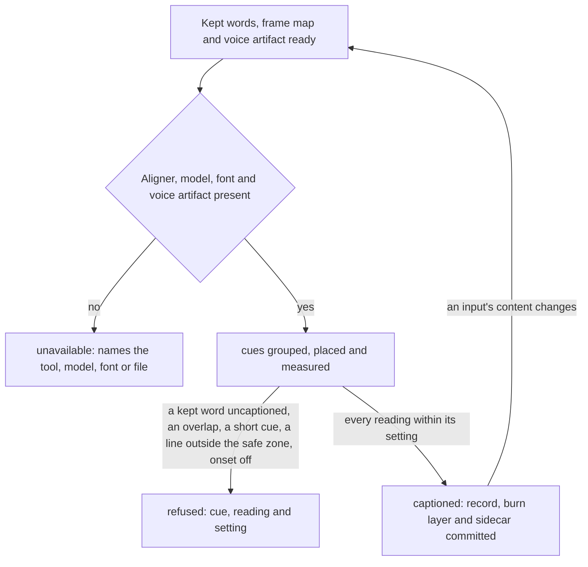

# Captions: kept words to timed cues

Draft for the owner to read, queue item 18 seam 1. This is a rebuild contract, not implemented behavior.
The [spine](spine.md) runs stages declared as recipe data; captions makes one cue record per rendered output.
A check declares its inputs, never a recipe name. C1 covers only `plain` and `shorts-only`.
Item 17 ([cutting](cutting.md)) owns which words are kept, their order, cuts, flips and the cold open.
Item 14 ([rendering](rendering.md)) owns the voice artifact cues are aligned to, the burn and the measured file.
Item 18 owns what lies between: words on the output's clock, aligned to its sound, grouped into cues, placed
in the safe zone, and written as the burn layer and the `.srt` sidecar. Copy that goes out beside a post (social
captions, titles, chapters' words) is item 39's; the posting clock (item 11, already in this repository) uploads
the sidecar. The [input preflight](preflight.md) runs first; its probes are not restated here.

## 1. A cue record is data

One record per output at `records/captions/<output-id>.json`, where `<output-id>` is rendering's (`arc`, `draft`,
`long`, `vertical`, `short-<id>`). Paths are relative to the video; hashes are abbreviated, values illustrative.

```json
{
  "output": "short:excerpt-a",
  "key": "sha256:9c41...",
  "words": "records/words.json",
  "words_sha256": "sha256:12ab...",
  "kept": "records/cut_plan2.json#spans",
  "plan_sha256": "sha256:77aa...",
  "clock": "records/render/short-excerpt-a.json#frame_map",
  "voice": "records/render/short-excerpt-a-voice.wav",
  "voice_sha256": "sha256:5e0f...",
  "settings": "captions.settings#tall",
  "aligner": {"model": "captions.settings#aligner", "version": "sha256:0b7d..."},
  "cues": [
    {"id": "c1", "start_s": 0.42, "end_s": 1.31, "words": ["w118", "w119", "w120"], "lines": ["SO HERE'S", "THE THING"],
     "breaks_at": null, "band": "bottom", "width_px": 702, "lit": [[0.42, 0.66], [0.66, 0.98], [0.98, 1.31]]}
  ],
  "held": ["w131"],
  "uncaptioned": [],
  "burn": {"file": "records/captions/short-excerpt-a.ass", "sha256": "sha256:aa31..."},
  "sidecar": {"file": "Shorts/excerpt-a.srt", "sha256": "sha256:bb42..."},
  "readings": {"min_cue_s": 0.89, "max_onset_off_s": 0.07, "overlaps": 0, "outside_safe": 0},
  "state": "captioned"
}
```

- `output`: rendering's output identity; one record per output, never one shared across wide, tall and shorts.
- `key`: SHA-256 of the normalized request, every input's content, aligner version and resolved settings.
- `words`, `words_sha256`: item 6's transcript with stable word IDs; the only source of caption text.
- `kept`, `plan_sha256`: item 17's settled spans (`cut_plan2.json`), or `null` for an owner-made short;
  which words are shown is exactly the kept word IDs in story order, never re-decided here.
- `clock`: rendering's cumulative frame map for this output; words move to the output clock through it,
  including the cold open, flips, the tease bridge and a short's pieces, never by a second remap.
- `voice`, `voice_sha256`: rendering's voice artifact for this exact output; alignment reads only this sound.
- `settings`: the named profile in `captions.settings` (`wide` for the sidecar-only arc, draft and long cut,
  `tall` for the burned full vertical and shorts); style, safe zone, line limits, cue pause, minimum cue and onset tolerance live there once.
- `aligner`: the forced aligner named by a setting and the hash of the model actually loaded.
- `cues[]`: in order; `start_s`/`end_s` on the output clock; `words` the word IDs shown; `lines` the text as
  broken; `breaks_at` the cut or flip a cue ends on; `band` its placement; `width_px` the widest line as measured
  in the burn font with outline and shadow; `lit` each word's lit interval for the highlight.
- `held`: words whose times were set by hand (`held` or `retimed` in item 17's plan); alignment keeps their times.
- `uncaptioned`: kept word IDs no cue shows, each with its reason; any entry refuses (section 3).
- `burn`: the subtitle layer rendering burns into tall outputs; `null` for arc, draft, long and an owner-made short.
- `sidecar`: the `.srt` beside the delivered file, written from these same cues; never a second grouping.
- `readings`: the measured facts the check compares to named settings; a missing reading is absent, never zero.
- `state`: `captioned`, `refused` or `unavailable` (section 3); stale is computed from `key`, never stored.

For `shorts-only`, the owner made the short: `kept` is `null`, words are item 6's transcript of the supplied file
(spine.md's `short` stage writes `records/words.json`; with rendering's one-file-per-short change it becomes
`records/words-<id>.json`, made by item 6's transcriber before `cues` is called; captions never transcribes),
`clock` is the file's own, and the voice is rendering's extraction of its unchanged sound. Captions writes the
sidecar only; nothing is burned into his file. A short he burned captions into himself declares
`"burn": "supplied"` in its job and gets a sidecar for the platforms that take one, with no placement check.

**Required spine.md interface change**, joining rendering's: each stage that renders (`arc`, `draft`, `masters`,
`short`) declares `captions.settings` and the aligner model as external inputs, and gains
`records/captions/<output-id>.json` and that output's `.srt` sidecar as outputs (`Draft/arc.srt`, `Draft/draft.srt`;
for `masters` and `short`, `YouTube/main.srt`, `Vertical/main.srt` and `Shorts/<id>.srt` through the final
manifest); only tall outputs (`vertical`, `short-<id>` the renderer cut) also gain the `.ass` burn layer. The arc and
draft burn nothing: the host carries their captions as a sidecar only (`draft.py`), so rendering.md's sentence
that arc and draft cues are burned is corrected in this change. The `short` stage's
`records/words.json` becomes `records/words-<id>.json`, one per short, an output of that stage like rendering's,
and the shorts-only `copy` stage's `records/words.json` input becomes the per-short words reached through the
final manifest's members, so every producer still resolves. The order inside
a stage is rendering's voice preparation, then `cues`, then rendering's burn and measure. The owner reviews this
with spine.md and rendering.md before any is built.

`captions.settings` is the proposed single owner, supplied by the settings domain (item 5). The safe zone is one
value in it (`safe_tall`), read by rendering for cards and the excerpt context line; neither restates it.
At the switch it absorbs the host values section 4 names; this document defines no replacement numbers.

## 2. The engine calls one API

| Function | Reads | Writes and answer |
|---|---|---|
| `cues(video, output) -> record` | Words, kept spans, the output's frame map and voice artifact, settings, aligner | The cue record and its burn layer, beside then renamed; returns the current record on an unchanged key. |
| `sidecar(record) -> path` | A `captioned` record | The `.srt` for that output from the record's cues, beside then renamed; idempotent by content. |
| `check(record) -> {ok, state, next_action, detail}` | The record, current input hashes and settings | No writes. Names the cue, the reading, its value and the setting with its owner; item 15 reads this result. |

`cues` aligns each kept word to the output's own voice (held words keep their times), joins split tokens the
transcriber cut apart, reads numbers as said, groups words into cues by the profile's pause, sentence end, word,
character and measured-width limits, ends every cue at a cut or flip, places each cue in one band clear of the
picture's declared elements inside `safe_tall`, and measures what it made. It never changes words, timing
decisions, media or the plan. A missing input, model or font raises by name; there is no default style, no
fallback to transcript times when alignment fails, and no clamp that shrinks a cue to fit: a cue that cannot meet
the minimum without overlapping the next refuses. A crash leaves no record or sidecar that passes for finished:
work files sit beside their destinations, the record is committed last, and a reader requires both to match.

## 3. From kept words to captions



`refused` and `unavailable` are ends for this call; the spine routes `refused` to the owner of the fault (a
missing or unsaid kept word to item 17, a reading outside its setting to captions, a measured file to item 14).
`captioned` means usable by rendering and the manifest, not checked by QC; item 15 judges the delivered file.
A record whose `key` no longer matches its inputs is stale by construction and is made again, never patched.

## 4. Host steps and checks, and their replacements

Sources are host-relative; the cutstack plugin's `scripts/` entries are links to the same `tools/` files.
Stages use spine IDs. The last column is the new owner. Host checks are evidence of requirements, not code to copy.

| Host location | Step/check and stage | Replacement or boundary |
|---|---|---|
| `stages.json` finisher draft/youtube/delivered | Captions made inside draft, master and tall renders | `cues` inside `arc`, `draft`, `masters`; no caption stage of its own. |
| `stages.json` shorts-only | Owner's short; its `.srt` comes from `final_manifest.json` (`publish.py` manifest) | `short` stage: `cues` on the supplied sound, sidecar only. |
| `cutstack.py DEFAULTS` `cap_*`, `hl_color`, `safe_9x16` | House tall style, line limits, highlight and the "one definition" safe zone | `captions.settings#tall` and `safe_tall`; the values move once. |
| `cutstack.py CUE_PAUSE`, `CUE_PAUSE_RULE`, `SENT_END` | A pause or sentence end closes a cue; dated rule `cue-pause` | Grouping by the profile's pause; the dated rule ends at the switch. |
| `cutstack.py caption_timing`, `CAPTION_EDGES_RULE` | Held or retimed words keep hand times; rule `caption-edges` (#46) | `held` in the record; contract 2. |
| `cutstack.py align_to_voice`; `aligner.py align/_snap_onsets/_sanitize/_same_twice` | One forced alignment against the file's own voice; onset snap; minimum step; `captions-same` | `cues` alignment on rendering's voice artifact; aligner constants and the `STUDIO_ALIGN_*` environment overrides become settings. |
| `aligner.py say_number/spoken`, rule `align-numbers` | Numbers aligned as spoken | `cues`; contract 6. |
| `cutstack.py caption_words` | Applies `caption_fixes.json` onsets; no caller | Deleted at the switch; dead code. |
| `cutstack.py remap_words/drop_unsaid` | Words onto the cut clock by midpoint; patch words spread by letters | Item 17 owns kept/unsaid; rendering's frame map moves them; patch words come from the patch record. |
| `cutstack.py join_split_words`, `CLITICS` | Glue transcriber splits (units, domains, clitics, grouped thousands) | `cues`; contract 6. Duplicates `qc.py run_split_continuations`, which becomes item 15 reading this record. |
| `cutstack.py group_cues` | Line breaking by words, characters, measured width, pause, cut breaks; a min-duration floor that can shrink a cue to 0.02 s | `cues` grouping; the shrink becomes a refusal (contract 3). |
| `cutstack.py check_no_overlap` | Exit on an overlap over a literal 0.011 s | `readings.overlaps`; tolerance named in settings. |
| `cutstack.py ass_header/_highlight_lines/write_ass` | The burn layer, per-word highlight, escaping, headline windows cut out | `burn` from the record; headline windows are cards (item 17's plan, rendering's burn). |
| `cutstack.py write_srt` | Sidecar with its own literal limits (42 characters, 12 words, 6 s, 0.8 s) and orphan folding with no character re-check | `sidecar` from the same cues; one set of limits per profile (contract 5). |
| `cutstack.py _render_srt/cmd_captions/style_from`; `grind.py _write_master_srt` | Sidecars written without the file end or cut breaks | One `sidecar`; every sidecar has the output's end and breaks. |
| `publish.py kept_words/youtube_srt/timeline_map` | Long cut sidecar on the published clock (cold open, story order, flip and bridge breaks) | `cues` for `long` on rendering's frame map; no second clock. |
| `draft.py` captions (`youtube_srt` on the draft's own frames, copied beside the arc and draft, `retire_other_names` keeping the `.srt`) | Arc and draft sidecars, never burned | `cues` and `sidecar` for `arc` and `draft`; rendering places the file pair. |
| `stages.json` copy and text-plan reads (`YouTube/*.srt`); `wordcopy.py sentences/words/build` | Social copy and text posts built from the published sidecar | Item 39, reading the sidecar the final manifest names (or this record), never a file glob. |
| `publish.py` sidecar placement, rename, manifest `srt` | `.srt` beside each delivered file | Spine's final manifest lists the sidecar; item 39 names release files. |
| `vburn.py ZONE/CAP_BOTTOM/CAP/_measure` | Burned tall position and width; `CAP_BOTTOM` disagrees with `cap_margin_v`'s stated baseline | `safe_tall` and the profile; one baseline. |
| `vburn.py clip_words/caption_words/flip_shift/cold_s` | Words onto each clip's and the flip's clock; end from a frame count at a literal 30 fps | Rendering's frame map; no fps literal. |
| `vburn.py captions_from/cut_captions/stamp_captions/_cues/captions_fresh/captions_report` | Content stamp beside the `.srt` for tall kinds, else cut again and compare cue by cue | The record's `key`; stale by construction for every output (contract 7). |
| `vburn.py snap_onsets/voice_env/_quiet_runs` | An older energy onset snap; no caller | Deleted at the switch; dead code. |
| `vburn.py plan_burn` caption part | Per clip: sidecar, stamp, burn layer, context line | Rendering burns `burn`; the context line is rendering's, placed against `safe_tall`. |
| `short_context.py write_ass` | Excerpt context line, lifting captions by its own offset | Rendering's context layer; captions place clear of it by declared element, not an offset. |
| `callouts.py clip_callouts` cap top | Recomputes vburn's caption top | Rendering reads the record's bands; the copy goes. |
| `render_audio_measure.py caption_measure`; `render_measure.py` | Cue onset against the nearest energy rise, numbers only | `readings.max_onset_off_s` from an independent measure; rendering's audio readings supply energy. |
| `preflight.py srt_cues/captions_for/caption_sources`, `captions.fresh` | `.srt` present, has cues, inside the file, newer than plan and words by file time | Record and sidecar hashes; file times never decide freshness. Item 15 reads `check`. |
| `studio.py` per-stage `*.srt` pick (drops an `.srt` older than its mp4) | Which sidecar a verdict reads | The manifest names it; no time comparison. |
| `qc.py run_cue_short` (`CUE_MIN`) | Cue length; draft, final | Item 15 catalog entry reading this record; the minimum is this profile's setting. |
| `qc.py run_cue_timing/cue_misses` and `run_burned_timing/burned_cue_misses` (stage `full`) | Cue against independent transcription; burned cue text off frames | out of C1 scope: stage `full` is the animated-explainer recipe's (rendering.md marks the same rows). |
| `qc.py run_render_caption_onsets`, `run_chapters`, `run_delivered_names`, `heard_stale` | Onset note; chapter near a cue; `.srt` beside each file; heard words against the sidecar | Item 15 (chapters' words are item 39's). |
| `hear.py read_srt`, `DRIFT_MAX` | Cue against aligner words; `qa.md` says drift is about zero by construction (same model) | Item 15; an independent recognizer, never the aligner checking itself. |
| `check_sheet_vertical.py`; `check_sheet.py` caption times | Overlap sheets from the burn layer; glyph bounds unmeasured | Rendering's output evidence reads the record's bands; glyph width is measured here (contract 4). |
| `studio.py captions_due/CAPTIONS_READ`, `done --captions timed:<n>` | A YouTube upload with an `.srt` read back in the Subtitles editor | Posting (item 11) and release (item 39); captions supplies the sidecar and its hash. |
| `pirillo_studio/youtube_posts.py yt_extras` | API caption upload; a failure goes to the row's `missed` | Already in this repository (item 11); unchanged here. It has no test of its own: item 11's. |
| `checklist.json` `qc.captions.*`, `qc.render.caption-onsets`, `qc.sheet.overlap`, `qc.captions.said`, `qc.vertical.captions-clear`, `qc.shorts.context`, `qc.release.names` | Caption rows run by the scripts above or by a checker | Item 15 catalog entries reading this record. |
| `checklist.json` gate rows `captions.one-height`, `vertical.captions-clear`, `captions.bookends-beanie`, `craft.safe-tall` | One caption height per scene, clear of the picture; `vertical.captions-clear` duplicates `qc.vertical.captions-clear` | One placement rule in `cues` (contract 4); item 15 keeps one row. |
| `craft_check.py SAFE_TALL` | A hand copy of `safe_9x16` | Deleted; reads `safe_tall`. |
| `data/rules.json` `captions-same`, `cue-pause`, `caption-edges`, `align-numbers`, `captions.split-continuations`, `qc.render.caption-onsets`, `captions.one-height`, `vertical.captions-clear`, `captions.bookends-beanie` (and `qc.captions.burned-timing`, out of C1 scope) | Dated rules that warn before their date | The rules are the contracts; dated warnings for replaced paths end at the switch. |
| `captions.py`; `capzone.py`; `explainer_shorts.py` caption block; `assemble.py` safe captions | Narration-clock captions, element-aware bands, explainer short bands; `captions.py` pins inside the bottom exclusion, and `capzone.py` hard-codes a margin only its output meets | out of C1 scope: the animated-explainer recipe. Its element-aware band placement is the model for `cues` placement. |
| `cutstack/references/verticals.md`, `qa.md`, `landmines.md`, `cut.md`, `render.md`, `render-measurements.md` caption sections | One aligner, no overlap, one place, safe zone, one height, clear of faces and numbers | Contracts 1 to 6. The unverified platform-overlay note in `verticals.md` stays the owner's to confirm. |

Tests that record the failures, not a suite to copy: `test_studio.CuePause`, `HeldCaptionWords`, `FinalsFixes`,
`FinisherRenders`, `VoicePatchPlainCut`, `Preflight` (caption rows), `CaptionsReadBack`; `test_proof_captions`,
`test_caption_edges`, `test_short_context`, `test_render_audio_measure`, `test_check_sheet_vertical`,
`test_transcribe_recovery`. Explainer tests (`NarrationCaptions`, `Assemble`, `test_capzone.CaptionSafeZone`,
`test_capzone_review.SafeCaptionReview`, `test_explainer_shorts`, `test_issue67_captions`) stay until their recipe
switches.

## 5. What the owner expects, as named contract tests

These are required build-seam tests, not tests added or claimed run by this document.

1. `test_every_kept_word_is_captioned_once`: every kept word ID appears in exactly one cue, in story order; no
   removed or unsaid word appears; a kept repeated phrase the transcript lost refuses naming the span (#147).
2. `test_cues_follow_the_delivered_sound`: on a fixture with a voice patch, a J-cut lead and a cold open, each
   cue starts within the onset setting of its first word in that output's voice; held words keep their times.
3. `test_cues_never_overlap_or_shrink`: no two cues overlap beyond the named tolerance; every cue meets the
   profile minimum; one that cannot refuses (flowchart refused end), never shortened to fit.
4. `test_lines_fit_inside_the_safe_zone`: widths measured in the burn font with outline and shadow stay inside
   `safe_tall`; each scene keeps one band clear of declared faces, numbers and cards; a line too wide refuses.
5. `test_sidecar_and_burn_are_the_same_cues`: the `.srt` and the burn layer for an output carry identical cue
   times and words; one set of limits per profile; every cue ends inside the file and at each cut or flip.
6. `test_words_read_as_said`: split units, domains, clitics and grouped thousands are joined; numbers are timed
   as spoken; the text is the transcript's, never reworded.
7. `test_unchanged_inputs_reuse_the_record`: a second call on the same content writes nothing; changing the
   plan, a word, the voice, a setting or the aligner makes the record stale and a new one differs only there.
8. `test_missing_aligner_is_unavailable`: flowchart unavailable end; no model, font or voice artifact gives
   `unavailable` naming it; no fallback to transcript times; `check` is never ok.
9. `test_refusal_names_cue_reading_and_setting`: flowchart refused end; each refusal names the cue, the reading,
   its value and the setting with its owner, and routes a kept-word miss to item 17.
10. `test_crash_leaves_nothing_finished`: kill between burn layer, sidecar and record; no reader sees a passing
    record or sidecar; a rerun completes once.
11. `test_owner_short_keeps_its_media`: flowchart captioned end for `short`: the supplied file's bytes are
    unchanged, its sidecar aligns to its own sound, nothing is ever burned into it, and `"burn": "supplied"`
    skips placement.
12. `test_switch_off_is_unchanged`: with the host switch off a committed fixture gives byte-identical sidecars
    and burns; on, every C1 output calls this API and never the replaced host writer on an error.

Live check: `python3 tools/captions_contract.py run --video "$VIDEO_FOLDER" --out "$CAPTION_PROOF"`

Proposed acceptance command for the build seam, not an existing executable. The Mac lead supplies the owner's
chosen real video folder and a separate evidence folder. Make every C1 output's record and sidecar into evidence
only, check contracts 1 to 5 on them, then a second unchanged call showing nothing written. The owner reads the
tall sheet; measurements do not prove taste.

## 6. One switch, then delete

The host's sole switch is `studio.json` `captions`, initially false, turned on with `rendering`: rendering's burn
reads this record, so neither switches alone. With it on, C1 arc, draft, masters and short outputs call `cues` and
`sidecar`; off preserves the host path byte for byte; on cannot fall back.

The switch-and-delete landing removes, for C1 paths: `cutstack.py` caption code (`DEFAULTS` caption keys,
`CUE_PAUSE*`, `caption_timing`, `align_to_voice`, `caption_words`, `join_split_words`, `group_cues`,
`check_no_overlap`, `ass_header`, `_highlight_lines`, `write_ass`, `write_srt`, `_render_srt`, `cmd_captions`),
`aligner.py` once no other caller remains, `grind.py _write_master_srt`, `publish.py youtube_srt/timeline_map`,
`vburn.py` caption functions and constants, `callouts.py`'s caption-top copy, `craft_check.py SAFE_TALL`, the
caption rows of `preflight.py`, and the C1 `rules.json` caption rules above. Tests split by owning domain; the
explainer recipe keeps its own copy until it switches, as a branch, never a fallback from this API.

## 7. Failings this contract ends

- #147 (closed; its caption half not on the host's main): a kept repeated phrase missing from word timings
  and captions. Contract 1 refuses an uncaptioned kept word; finding the restart itself is item 17's.
- `group_cues` shrinks a cue to as little as 0.02 s to avoid overlap, below every minimum the host names.
  Contract 3 refuses instead. No issue is named in the source.
- Four minimum cue lengths (`cap_min_dur`, `write_srt`'s literal, `captions.py MIN_CUE`, `qc.py CUE_MIN`) and four
  onset tolerances (`captions.py ONSET_S`, `hear.py DRIFT_MAX`, `qc.py CUE_OFF`, `caption_measure`'s window).
  One profile setting each; contracts 2, 3 and 5.
- The safe zone has one stated definition and five copies or offsets (`craft_check.py`, `vburn.py`, `callouts.py`,
  `short_context.py`, `capzone.py`), with `vburn`'s baseline disagreeing with the default's comment. Contract 4.
- The sidecar folds short cues past its own character limit, and some sidecars are written without the file end
  or cut breaks. Contract 5.
- The long cut's sidecar freshness is judged by file times only, tall ones by a content stamp. Contract 7.
- `hear.py` compares cues to the same aligner that made them, so drift is zero by construction (`qa.md`).
  Item 15 uses an independent recognizer; this domain records the aligner it used.
- Rule `caption-edges` (#46) records held words drifting from their hand times; contract 2 holds it without a
  dated rule. The burned-caption check (#67) runs only at the explainer's `full` stage: out of C1 scope.

Backlog issue #147 is the one this item fixes once; the restart detection itself is item 17's (cutting.md).
This seam changes no runtime behavior. Item 18 remains `building` through implementation, live proof and deletion.
