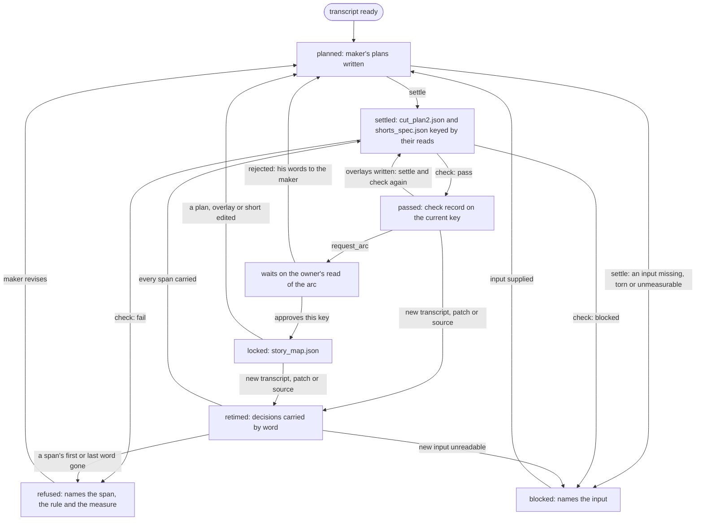

# Cutting: from the transcript to the locked cut

Draft for the owner to read, queue item 17 seam 1. This is a rebuild contract, not an implementation or a claim that
the host already meets it. Cutting owns the decisions: which of his words are kept, in what order, how each cut
enters, which cards and bed the cut asks for, which moments become shorts, and the lock. It writes plans, never
media. Rendering (item 14) turns a locked plan into files; the transcript itself is media in
(item 6). Its stages are recipe data the [spine](spine.md) engine runs, and its checks declare what they read,
never which recipe. The [preflight](preflight.md) runs before the expensive work around it (`plan` stage's
analysis, the arc render); its probes are not restated here. C1 covers `plain`: the spine's `plan`, `overlays`
(cards, the bed brief and the shorts plan; callouts' facts are research's), `arc` (as a request to render), `locked` and retime. `shorts-only`
declares no cutting stage: its `short` stage reads the owner's finished short (spine.md section 1), so cutting
gives it nothing. Paths are relative to the video, as in spine.md.

## 1. What cutting produces, as data

The maker's plan, `records/cut_plan.json` (intent, in words), and the settled plan, `records/cut_plan2.json`
(the same decisions with measured edges, written by code). One complete example for a short plain video; every total
is this example's own, and kept plus removed tile its whole source:

```json
{
  "video": "records/job.json", "plan_version": "1", "key": "sha256:a3c9...",
  "made_from": {"records/cut_plan.json": "sha256:4e10...", "records/words.json": "sha256:9a07...",
    "source.mp4": "sha256:51c2...", "records/job.json": "sha256:2d44...", "records/patches/p1.json": "sha256:0b7e..."},
  "source_duration_s": 242.00, "output_duration_s": 124.52,
  "spans": [
    {"id": "s1", "order": 1, "src": [212.36, 238.90], "words": ["w0412", "w0477"], "enter": "open", "shot": "med",
     "edges": {"head_lead_s": 0.06, "tail_s": 0.31}},
    {"id": "s2", "order": 2, "src": [14.02, 61.75], "words": ["w0009", "w0121"], "enter": "jump", "shot": "close",
     "edges": {"head_lead_s": 0.06, "tail_s": 0.22}, "hide_picture": true,
     "patch": {"record": "records/patches/p1.json", "sha": "sha256:0b7e...", "words": ["p1w0", "p1w2"]}},
    {"id": "s3", "order": 3, "src": [61.75, 90.10], "words": ["w0122", "w0190"], "enter": "jcut", "shot": "wide",
     "lead_s": 0.20, "lead_from": "motion onset", "edges": {"head_lead_s": 0.06, "tail_s": 0.40}},
    {"id": "s4", "order": 4, "src": [90.10, 97.40], "words": ["w0191", "w0203"], "enter": "push", "shot": "med",
     "push": {"to": "close", "s": 5.0}, "edges": {"head_lead_s": 0.06, "tail_s": 0.25}},
    {"id": "s5", "order": 5, "src": [97.40, 98.05], "words": [], "enter": "pop", "shot": "face",
     "expression": {"after_word": "w0203", "seen": "laughs"}},
    {"id": "s6", "order": 6, "src": [98.05, 112.00], "words": ["w0204", "w0236"], "enter": "jump", "shot": "close",
     "edges": {"head_lead_s": 0.06, "tail_s": 8.0}}
  ],
  "removed": [
    {"src": [0.00, 14.02], "words": [], "why": "silence"},
    {"src": [112.00, 140.02], "words": ["w0237", "w0259"], "why": "tangent"},
    {"src": [140.02, 141.10], "words": ["w0260"], "why": "filler"},
    {"src": [141.10, 204.10], "words": ["w0261", "w0397"], "why": "recap"},
    {"src": [204.10, 212.36], "words": ["w0398", "w0411"], "why": "false_start", "kept_take": "s1"},
    {"src": [238.90, 242.00], "words": [], "why": "silence"}
  ],
  "named": [{"at_src": 61.75, "rule": "edges", "why": "mid-sentence splice read aloud, reads as one sentence"}],
  "cold_open": {"span": "s3", "words": ["w0150", "w0166"]},
  "end_hold_s": 8.0
}
```

Kept: 26.54 + 47.73 + 28.35 + 7.30 + 0.65 + 13.95 = 124.52 s; removed: 117.48 s; together the 242.00 s source.

- `video`, `plan_version`: the job record and the plan schema; no recipe name appears.
- `made_from`: content hashes of every input `settle` reads: the maker's plan, the transcript, the source, the job
  (its voice-over marks) and each patch record. `key` is sha256 over them, the settle settings' revision and
  `plan_version`. Same key, same settled plan; any of them changed is a new key.
- `source_duration_s`, `output_duration_s`: measured source length (item 6's probe) and the kept length.
- `spans`: kept source time. `id` is stable across edits and retimes; `order` is story order (tape order is a fine
  answer); `src` is in and out in source seconds on the measured clock; `enter` is how the span comes in: `open`
  (order 1 only), `jump` (a hard cut), `jcut` (his voice leads the picture by `lead_s`, taken from `lead_from`),
  `push` (a slow push, `push.to` and `push.s`), `pop` (a held face); `shot` is the size asked for (wide, med, close,
  face, mouth), a request whose crop is rendering's; `patch` is a voice patch in the owner's cloned voice (its record, hash and own
  words) played in place of the tape's words; `hide_picture` marks a span whose picture must never show (a patch's
  borrowed words, or a part the job marks voice-over). Two variants, validated as such:
  - a speech span has `words` (its first and last kept word ID in item 6's transcript, its identity on retime) and
    `edges`: `src` opens its head lead before the first word's sound and closes its tail's air after the last word,
    both measured by `settle`, and holds no removed word. The last span in story order closes on `end_hold_s`.
  - an expression span (`enter: pop`) has `words: []` and `expression`: it holds no transcript word, comes next in
    story order after the span ending on `after_word`, `seen` is what the face does, and its hold is its `src` length.
- `removed`: every dropped stretch with its `why` (`false_start`, `flub`, `filler`, `repeat`, `tangent`, `recap`,
  `silence`) and, for a retake, the later span that kept it. Kept plus removed tile the source.
- `named`: the one place a flag is excused: the rule, where, and his or the maker's reason. No reason, no excuse.
- `cold_open`: the tease, as kept words inside one span; rendering builds it.
- `end_hold_s`: the maker's ask for how long the last span rolls after its last word.

The `overlays` stage writes the spine's declared overlay outputs, each keyed to the plan it was made on:

```json
{"plan": "sha256:a3c9...", "cards": [{"id": "c1", "kind": "instruction", "anchor": ["w0122", "w0130"], "text": "<his words>"},
  {"id": "c2", "kind": "cover", "covers": "s2", "text": "<the patched words>"}]}
{"plan": "sha256:a3c9...", "request": "chiptune bed under the whole cut", "tempo_from": "words_per_s"}
```

- `records/overlay_plan.json` `cards`: full-screen cards anchored to kept word IDs, never to time; a `cover` card
  covers a `hide_picture` span end to end.
- `records/bed.json`: the bed brief as a request; its levels, gaps, notes and mix are rendering's settings (item 14,
  today `bed.py`), never restated here.
- `records/callouts_plan.json` is the same stage's output, but its facts are the research's (item 16); cutting checks
  only that its anchors are kept word IDs.

The maker's shorts plan, `records/shorts_plan.json`, and the settled one `settle` writes, `records/shorts_spec.json`:

```json
{
  "plan": "sha256:a3c9...", "made_from": {"records/shorts_plan.json": "sha256:5c18..."}, "key": "sha256:7f20...",
  "shorts": [
    {"id": "00-full-vertical", "full": true, "point": "<the whole story, tall>"},
    {"id": "01", "point": "<one sentence: what this short proves>", "spans": [["w0412", "w0477"], ["w0122", "w0166"]],
     "opens_on": "w0412", "ends_on": "w0166", "stands_alone": {"context": "<the line that names the subject>"},
     "pieces": [[212.42, 225.48], [226.31, 238.84], [61.81, 75.80]]}
  ]
}
```

- `plan`: the settled plan's `key` it was made on; `made_from`, `key` as the cut plan's; a new plan key re-settles.
- Every short has `id` and `point` (why it is there, one sentence). Two variants:
  - the full vertical (`full: true`, exactly one): every span in story order; no `spans`, `pieces`, `opens_on`,
    `ends_on` or `stands_alone`, because it opens and ends as the long cut does.
  - a short: `spans` are word-ID ranges, each inside one kept span, never seconds; `opens_on` and `ends_on` are its
    first and last word; `stands_alone` is `context` (a line the render pins) or `opens_on_subject`; `pieces` are
    written by `settle`, never the maker: each range split at his pauses, its head and tail trimmed to their pads and
    any piece under the shortest dropped, by the shorts settings (today `shorts.py GAP_CUT, PAD, HEAD_PAD, TAIL_PAD`).

The locked record, `records/story_map.json` (the spine's `locked` output):

```json
{"plan": "sha256:a3c9...", "check": "sha256:e81b...", "arc_decision": "records/arc_decision.json#sha256:c1d0...",
 "reads": {"records/overlay_plan.json": "sha256:9d02...", "records/bed.json": "sha256:41aa...",
           "records/callouts_plan.json": "sha256:63f5...", "records/shorts_spec.json": "sha256:7f20..."},
 "blocks": [{"spans": ["s1"], "why": "hook"}, {"spans": ["s2", "s3", "s4", "s5", "s6"], "why": "story"}],
 "tail": "s6", "locked_at": "2026-10-22T20:00:00Z"}
```

- `plan`, `check`, `arc_decision`, `reads`: the exact revisions the owner approved and the passing check record over
  them, the shorts plan included; a change to any reopens the lock.
- `blocks`: story blocks in order, each a list of span IDs with its job in one word.
- `tail`: the last span (its hold is the plan's `end_hold_s`). `locked_at`: evidence, never the freshness rule.

Rendering (item 14) reads `spans` (`src`, `order`, `enter`, `lead_s`, `shot`, `push`, `expression`, `patch`,
`hide_picture`), `cold_open`, `end_hold_s`, `overlay_plan.json`, `bed.json`, `shorts_spec.json` (`pieces`, `point`,
`stands_alone`, `full`) and `story_map.json`. It never reads `removed`, `named`, `made_from` or the maker's plans,
and it never changes a plan: a render that cannot honour an entry fails naming the span, back to here.

**Required spine.md interface change** (spine.md section 1's stage list): `plan` gains the inputs `source.mp4`,
`records/job.json` and `records/patches/`; `overlays` gains the output `records/shorts_plan.json`; `locked` gains the
inputs `records/overlay_plan.json`, `records/bed.json`, `records/callouts_plan.json` and `records/shorts_spec.json`;
`cut-plan` reads also the source audio, job and patch records, and `overlay-plan` also words and both shorts plans.
The owner reviews this change with spine.md before either is built.

## 2. The API

Future core APIs, none implemented in this seam. Each reads declared inputs through the core host boundary, is keyed
by their content, writes atomically under the video's single writer, and reaches one record twice or after a crash.

| Call | Reads | Writes | Judgment or code |
|---|---|---|---|
| maker (the `plan` stage's registered role) | `records/words.json`, `records/probe.json`, the source | `records/cut_plan.json`: spans by word ID, order, `enter`, `shot`, removed with why, named, cold open, end hold | Judgment: an agent picks and orders |
| `settle(video) -> key` | everything in `made_from`; at `overlays`, also the shorts plan and the words | `records/cut_plan2.json`, `records/paper.md`; `records/shorts_spec.json` when a shorts plan exists | Code: moves each edge into measured quiet, never into a word, a head its lead before his first sound, a tail its air after the last word, never through a breath; measures J-cut leads from motion; writes the kept words in story order for the paper read; settles each short's `pieces` |
| `check(video) -> {ok, state, next_action, detail}` | every read each check below declares, as present | `records/checks/cut.json`: `key` over all their hashes and the check settings' revision, `reads`, `state`, one result per check | Code: `state` is `pass`, `fail` (names the span, the rule and the measure) or `blocked` (names the missing or unreadable input, or the check that could not run) |
| maker (the `overlays` stage) | the settled plan, the story review | `records/overlay_plan.json`, `records/bed.json`, `records/shorts_plan.json` | Judgment: which cards, which bed, which moments stand alone |
| `request_arc(video)` | the check record, every file it names | nothing of its own; the spine runs `arc` (item 14 renders) | Code: recomputes the check key from the files now on disk; refuses unless it equals the record's, the state is `pass` and the reads cover the arc's cutting-owned inputs (`cut_plan2.json`, `overlay_plan.json`, `bed.json`, the shorts plan); the other arc inputs (the source, `faces.json`, `callouts_plan.json`) are the spine's to keep fresh from the stage's declared inputs (spine.md section 2) |
| `lock(video)` | the owner's approved arc decision, the check record, every file it names | `records/story_map.json` | Code: refuses unless the decision names the arc rendered from the current plan key and the recomputed check key passes over the overlay, bed, callouts and settled shorts plans |
| `retime(video)` | a new transcript, voice patch or source revision, the last settled plan | a new `cut_plan2.json` and `records/retime.json` (spans moved, spans touched) | Code: carries every decision by word ID, settles edges again, re-checks; never re-judges |

The checks, each declaring its reads (spine.md section 1); thresholds are settings in the core's configuration,
one home each, never restated in this spec:

- `own-words`: section 1's span variants; no invented time; spans plus removed tile the source; no span is under
  the shortest shot. Reads plan, words.
- `edges`: no edge enters a word; each head's lead and each tail's air in their window, in measured quiet against
  one room floor; no breath kept at a splice. One measure shared by `settle` and `check`, so the maker and the
  checker cannot disagree on quiet. Reads plan, words, source audio.
- `takes`: no false start, repeat, stumble or filler survives inside a span unless `named`; the later take wins.
  One detector, one set of windows. Reads plan, words.
- `jcuts`: a lead within its frame bounds, inside the outgoing take, no word inside the extension unless seen, not
  on the opening span, enough incoming picture after it, the lead from measured motion. Reads plan, words, source.
- `shots`: neighbouring spans never share a size except through a named jump; a pop holds within its limit and
  only after a finished line; pushes never adjacent. Reads plan.
- `cards`: each card's and callout's anchor words are kept, in one span; every `hide_picture` span has a `cover`
  card over its whole length. Reads plan, words, job, overlay and callouts plans.
- `patches`: each patch record exists, matches its hash, rate and sample count, ends its take at its own end, and
  joins clear of the tape on both sides, and its take has the owner's pick (`voice("speech", cites)`,
  [capabilities.md](capabilities.md)). Reads plan, patch records, the voice record.
- `cold-open`: its words sit inside one span and one shot, never in a J-cut's held frames. Reads plan.
- `shorts`: section 1's variants; every range inside kept spans by word, a short opens on a word with no backward
  reference unless `stands_alone` names it, ends on its payoff word, and its settled length sits in the shorts band.
  Reads both shorts plans, plan, words.
- `locked-cut` (the spine's check on `locked`): the lock names the current plan, check key, reads and decision.

Never: writes, moves or re-encodes the source or any owner file; reads the recipe name; turns an unreadable plan,
transcript or measure into a pass, an empty list or a default (an unknown frame rate or duration is item 6's broken
media, never a constant); keeps a second copy of a threshold; excuses a flag outside `named`.

## 3. One cut's path



`passed`, `refused` and `blocked` are the check record's `pass`, `fail` and `blocked`. `waits on the owner` is the
spine's `waiting_owner`, its task in [the Board model](board.md); the paper read is the story editor's check on the
`paper` stage between `passed` and the overlays, not a cutting state. An edited locked plan reopens only the spans
it touches: the new settle keeps every untouched span's `id`, `src` and check result, the owner's next task shows the
touched spans, and approval of the new key locks again.

## 4. The host's cut checks and their replacements

Paths are relative to the host at `66289db1353f982298b6b71612d8087bca881820`. Stages are host stages. This
inventory is not permission to copy its code. "Here: X" is a check or field in sections 1 and 2.

| Host check | What it decides; stage | Replacement |
|---|---|---|
| `tools/cutstack.py cmd_plan` | First plan from words: drops fillers, splits on pauses, pads, a duration fallback past the last word (inline literal, `cutstack.py` line 513); plan | The maker's plan plus `settle`; duration from item 6's probe, no fallback |
| `cutstack.py _select, parse_ranges` | A bad, reversed or out-of-range keep stops; plan | Here: `own-words` |
| `cutstack.py plan_patch, patch_wav` | A voice patch must exist, match its rate, length and sha; plan, retime | Here: `patches` |
| `cutstack.py remap_words, unsaid, drop_unsaid` | Which words are kept (midpoint in take); an unreadable `unsaid.json` is empty; draft, final | Kept words are the spans' word IDs (captions, item 18); unsaid words are `removed` entries, an unreadable list blocks |
| `cutstack.py FILLERS_HARD`, `tools/fillers.py place, merge, find` | Two filler lists that disagree (one has hmm, the other er and ah); transcribed | Fillers are item 6's transcript words; here: `takes` reads one list |
| `tools/refine.py snap, trim_ends, acoustic_edges, sound_heads` | Edges into quiet, heads at the sound, tails, a take under an inline length reverts, an unknown frame rate becomes an inline constant (line 674); plan | Here: `settle`; unknown rate is item 6's broken media |
| `refine.py pin_cuts, absorb, apply_pins, head_at` | Merge short gaps, hold pins within reach, a pin it cannot hold is only printed; plan, retime | Pins become maker spans; a span `settle` cannot honour is `refused`, never printed |
| `refine.py check_sound, check_words` | A kept word loses sound or a removed word comes back deeper than an inline limit stops; shallower is listed; plan | Here: `edges` and `own-words`, both refuse |
| `refine.py mid_sentence_report` | Lists mid-sentence splices in `cut_review.json`; plan | Here: `edges`; a mid-sentence splice passes only through `named` |
| `refine.py apply_patches` | The take holding a patch ends at its end; run-on becomes its own take; plan | Here: `settle` and `patches` |
| `refine.py hold_expressions, own_expression` | A take end moves to an expression's sound end; plan | Here: `pop` spans and `shots` |
| `refine.py shot_windows, fit_heads, punch_crop, check_tiling` | Shot rotation, holds, head fit, punch crop, windows tile takes; a failed refit becomes wide; plan | Sizes are `shot` requests checked by `shots`; crop and head fit are rendering geometry (item 14), which fails naming the span, never widens silently |
| `refine.py plan_mark`, `tools/studio.py check_refined` | The plan hash computed twice; with no stamp, freshness by file age; plan to retime | Here: `made_from` and `key`, one hash; no age fallback |
| `tools/splice_check.py Env` | Room floor per band from a low percentile of the usable tape, refusing when too little is usable (inline literals at `splice_check.py:171`); arc, locked | Here: `edges`' one floor. Disagrees with `refine.py room_floor` (its own inline percentile at `refine.py:617`, no usable-tape guard; `refine.py SOUND_DB` sits below `splice_check.py SOUND_DB`, which names refine's `HEAD_DB` as its twin), so the maker can call quiet what the checker calls sound |
| `splice_check.py tail, head, end_before_inhale` | Tail clip, slow, sound, breath; head clip, sound, early, slow; arc, locked, retime | Here: `edges` |
| `splice_check.py check` early-under-cover and rule switches | A flag becomes a note under a cover or before a dated rule; arc | Here: one result, no dated note mode; a cover is a `named` entry |
| `splice_check.py repeats, stumbles, stumble_flags, false_starts, opens_its_piece, stretched, dropped_start, under_word, uncovered, set_off, word_apart` | Repeats, stumbles, false starts, heard restarts, uncovered and set-off fillers, outtakes; arc, draft | Here: `takes`. Three false-start detectors disagree, each with its own gap: `splice_check.py FS_GAP, FS_PAUSE`, `tools/paper.py false_starts` (`paper.py FS_GAP`) and `tools/qc.py run_last_take` (`qc.py FALSE_GAP`); one detector replaces all three |
| `splice_check.py collapsed_stumbles` (read by `tools/hear.py`) | Heard twice, kept once, on the render; draft, final | Item 14: rendered-audio measure |
| `splice_check.py rapid_framing` | A window under the shortest shot with size changes at both ends; arc | Here: `shots` |
| `splice_check.py picture_cuts` | J-cut holds apply only to `cut_plan2.json`; a read error judges every head as a hard cut; arc | Here: one plan file; unreadable blocks |
| `splice_check.py name_patched, explain_sound_pins` | Names flags inside a patch; drops advice for held pins; arc | Here: `edges` and `takes` judge a patched span by the patch's words; pin advice ends with pins |
| `splice_check.py main`, `data/splice_beats.json` | A flag excused by a beat with a `why`; exit 1 on an open flag; arc, locked, retime | Here: `named`. Disagrees with `tools/retention.py named_gap_beats`, which excuses only UNCOVERED or PAUSE inside kept spans |
| `tools/jcut.py parse, marks_of, resolve, good_or_stop` | J-cut marks resolved against splices; refused leads stop grind, vplan, publish; plan to final | Here: `jcuts`, before any render. Disagrees with `tools/take_ends.py named` (any jcut over 0 passes) |
| `jcut.py motion, judge, need_frames` | Motion onset, suggests a J-cut, trim or cover; arc, locked | Here: `jcuts` (lead from motion); `settle` measures it |
| `jcut.py _inputs` | Reads `cut_plan2.json`, silently falls back to `cut_plan.json`; ignores unsaid words; arc | Here: the settled plan only; missing blocks |
| `jcut.py built_main, seam` | Head early, flash, frame twice, picture late on the built file; draft, final | Item 14: built-file measure |
| `tools/take_ends.py named, held_face_problem, scan, judge, main` | Expression hold limits (held-face rule), a mid-thought or at-rest face refuses; contact sheet; plan, arc | Here: `shots` (pop hold, after a finished line). The sheet is a look for the reader, item 14 |
| `tools/kept_relisten.py review, before_render` | Fresh ASR per kept span; an incomplete pass stops the render; falls back to `cut_plan.json`; draft | Item 6: a second transcript is media in; disagreement becomes a `retime` input; no plan fallback |
| `tools/remap.py to_src, to_out` | Carries shorts and chapter times across a recut; a deleted take snaps to the nearest instant; retime | Here: `retime` by word ID; a lost word is `refused`, never snapped |
| `tools/cutaway_timing.py fades, check` | Card fades against reading time; warns before a dated rule; overlays, draft | Item 14: card rendering. Its fade cap differs from `filters` by up to a frame |
| `tools/draft.py paper_gate, plan_gate, stumble_gate` | Asks studio for the paper read, plan verdict, stumbles before arc or draft; no studio skips; arc, draft | Spine stage dependencies; here: `takes` passes before `request_arc` |
| `draft.py draft_gate` | Gate mode; no studio gives None, a bad answer warn; draft | Ends: no warn mode |
| `draft.py overlays` | Arc stills, foil when a cut hides something, `shorts.py --check`; arc, draft | Here: `cards`, `shorts`; stills and foil are item 14 |
| `draft.py measured` plan flash shots | Shots under the shortest from the plan, after the render; draft | Here: `own-words` (shortest span), before the render |
| `tools/draft_preflight.py` plan steps (shorts, framing, J-cut picture, archive) | Plan consumers before the draft; framing runs only if `cut_plan.json` exists yet reads `cut_plan2.json`; the J-cut step never checks the file exists; draft | Here: `check` before `request_arc`; the runtime and disk parts are [preflight.md](preflight.md); archive is out of C1 scope |
| `tools/shorts.py main, story pieces, pieces bounds, check_src_matches, word-edge check, band` | Short pieces from the spec, bounds, words match the pieces, word edges, a length band (inline literal, line 312) only printed; draft | Here: `shorts` (spans by word, the band refuses) |
| `shorts.py tighten` (lines 238-261) | Splits pieces at pauses (`GAP_CUT`, `PAD`), trims heads and tails (`HEAD_PAD`, `TAIL_PAD`), drops short pieces (inline literal); kept material decided at render time; draft | Here: `settle` writes each short's `pieces` before lock, from the shorts settings; frame snapping stays item 14 |
| `shorts.py` cold open and story flip | Vertical cold open inserted, flip after a block; draft | Item 14 (vertical render) from `cold_open` and `blocks` |
| `tools/standalone_open.py resolve_spans, check_standalone_open` | Pieces resolve, opening has no backward reference; warn before a dated rule; draft | Here: `shorts`; manual copy row `qc.shorts.standalone` goes, the check refuses |
| `tools/short_context.py write_ass` | Context line fits the safe area; final | Item 14 (burned line); the `context` text is here |
| `tools/studio.py check_shorts, check_shorts_src` | Full vertical, title and point, context; re-maps pieces; `except Exception: pass` makes an error a pass; overlays, retime | Here: `shorts`; an error blocks. Duplicates `shorts.py` and `vplan.py`'s refusal |
| `tools/studio.py MILESTONES, MEANS` | Which checks each editor milestone runs (retime: refined, splice, story, chat); plan to retime | Spine: each stage's declared checks |
| `studio.py check_splice`, `_earlier_plan_segments` | On a retime before any arc, only flags at moved seams count, by its own tolerances; segments from five fallback sources; retime | Here: `retime.json` names touched spans; checks re-run on those only, by `id`; one source, the last settled plan |
| `studio.py check_motion` | MOTION flags pass when the check "could not run"; arc, locked | Here: `jcuts`; could not run is `blocked` |
| `studio.py check_pushes`, `job.json pushes` | Pushes in source seconds; overlays | Here: `push` spans and `shots` |
| `tools/story.py CLEAN, COMPLETE, INTACT, FRAMED, COHERENT, CALLBACK, on_grid, write` | Seams, coverage, overlays across seams, same shot across a seam unless `jumps_named`, back references, callbacks; writes the story map; plan | Here: `own-words`, `shots` (one named list), `cards`; coherence and callbacks are the story editor's `paper-read` (spine.md). `--off` deletes the map its docstring says is never deleted |
| `tools/plan_check.py return, flash, short, sliver, frame, motion, expression` | Card returns, flashes, slivers, card-cut, motion, expressions; exit 2 on a missing plan; plan, draft | Here: `cards`, `own-words`, `jcuts`, `shots`; frame-level flags are item 14 |
| `plan_check.py cold_open_flags` | Reframe and stale cold open; plan | Here: `cold-open` |
| `plan_check.py proof, chat, picture_changes` | Callout proofs, chat drops, picture changes; plan, draft | Out of C1 scope: plain has no chat; callout proof is research; picture changes item 14 |
| `tools/paper.py plan_name, kept_words, mark, prompts, dropped` | Paper of the kept words; falls back to `cut_plan.json`; a source clock that falls back to 1; plan | Here: `settle` writes `paper.md` from the settled plan; the read is the story editor's |
| `tools/qc.py _splice, run_splice, run_splice_false_start, run_splice_outtake` | Runs splice_check as QC rows; named flags excluded; arc, draft | Here: `edges`, `takes`; item 15 reads this check's record, not a second run |
| `qc.py _built, run_heads_built, run_seam_flash, run_seam_frames` | Built-file heads and seams; draft | Item 14 |
| `qc.py find_picture_changes, run_same_size` | Same-size cuts less `jumps_named`; draft | Here: `shots`. Duplicates `story.py FRAMED` with other snaps (inline literals at `qc.py` lines 694 and 697 against `story.py JUMP_SNAP`) |
| `qc.py run_midroll_floor` | Output length between `qc.py MIDROLL_NEAR` and `MIDROLL_S` is a note, with no clock conform; plan | Here: `output_duration_s` on the measured clock; the note is the packager's |
| `qc.py run_last_take` | Last take and false-start misses; plan | Here: `takes` (one detector) |
| `qc.py run_narration_false_start` | Narration false starts; draft | Out of C1 scope: narration recipes |
| `tools/job.py framing` | A non-4K source with no crop windows exits; all | Item 14 input contract (preflight.md names it) |
| `job.py video_end` | Master length from frames, else the plan's output scaled; `plan_check` scales twice; draft | Here: `output_duration_s`, one clock; master length is item 14 |
| `job.py splice_frame, _end_hold, src_fps` | Head frame round-up, end hold window and default (`job.py _end_hold`, `END_HOLD`), measured rate written to the job; all | Frame snapping item 14; here: `end_hold_s` set by the maker, no default; the rate is item 6's record |
| `tools/publish.py` cold-open picker | One take, a splice, a framing change or J-cut held frames refuse; tail air warn or refuse by date; youtube | Here: `cold-open`, before the render; building the tease is item 14 |
| `publish.py master_edits, short_shots` | Picture-change frames from the plan, J-cut moves the edit; draft, final | Item 14 |
| `jcut.py MIN_AFTER` at three sites: `jcut.resolve` (`jcut.py` line 275), `tools/picture_frames.py jcut_group_errors` (line 250 imports it; from `grind.py`), `tools/vplan.py` J-cut assignment (line 532) | One minimum of incoming frames, three behaviours: resolve refuses the lead at the plan, picture_frames exits at the master build (also when no picture group exists), vplan silently cuts the vertical piece straight; plan, final, verticals | Here: `jcuts` applies the one setting once, before any render; item 14 reads its verdict and never drops a J-cut silently |
| `tools/retention.py named_gap_beats, shorts_audit, named_why` | Kept silence excused by a beat; a short's point and opening word; retention | Here: `named`, `shorts`; the attention and cadence audit is item 15 |
| `tools/instruct.py` card words | A card whose words are in no kept span refuses; overlays | Here: `cards` |
| `tools/anchor.py --bind, --resolve, --check` | Overlays anchored to phrases, resolved after a recut; overlays, retime | Here: anchors are word IDs; `retime` carries them |
| `tools/bed.py` brief | `bed.json` is the brief; notes and mix measured; overlays, draft | Here: `bed` as a request; notes, mix and lock item 14 |
| `tools/voicepatch.py his_join, valley_at, join_problem, said_after` | Makes a patch from a take in the owner's cloned voice; a join that is not clear refuses; fix | The maker's tool that writes a patch record (an input here); `join_problem` becomes `patches` |
| `tools/vo_cover.py spans, uncovered, hides, cover` | Every frame of a VO part or patch must sit under a card, else the render stops; arc, draft | Here: `hide_picture` and `cards`, before the render; burning the card is item 14. No `cut_plan2.json` gives an empty list today; here it blocks |
| Plan readers that decide nothing: `grind, vrender, vhold, vburn, vaudio, foil, broll, card_cover, sheet, check_sheet*, hear, anchor, archive, overlay_tables, callouts, regrade, wardrobe, fcpxml, facts, wordcopy, preflight, refresh, status, recipe_never` | Read the plan to render, measure, map times, publish or show freshness; draft to final | Item 14 or 15 read the declared plan fields above; B-roll, archive, wardrobe and FCPXML are out of C1 scope (plain renders none of them) |
| `tools/stages.json` editor rows `transcribed, plan, overlays, arc, locked, fix, retime` | Briefs, gates (`draft --check`), waits; checker-plans waits on `cut_plan.json`, not the plan everything reads | Spine stages `plan`, `overlays`, `arc`, `locked`; `fix` and `retime` rerun `plan` (spine.md) |
| `tools/checklist.json qc.splice.*, qc.story.framed, qc.plan-check.flags, qc.cut.*, qc.shorts.*` | Rows run by the scripts above or by hand; arc to final | The checks here; manual rows `qc.splice.rendered, named, beat-no-reaction` become `named`; the `qc.shorts` opening, clean-end and context rows item 14; `qc.cut.gag-twice, fragment-open` `takes` and `paper-read` |
| `plugin/pirillo-studio/skills/cutstack/SKILL.md`, `references/cut.md, overlays.md, verticals.md, music.md` | The editor's rules: spine first, last take wins, ends, judder, framing, pushes, J-cut from motion, held object, shorts stand alone, bed brief; plan to locked | The maker's brief for the `plan` and `overlays` stages; every rule a tool enforces is a check here; prose-only rules (ramble pass, editorial pass, shorts' hook) stay judgment, read by `paper-read` |
| `cut.md` retention rules (the claim early, land and stop, dead air by `retention.py DEAD_AIR`) | Retention audit; plan, arc | Item 15 check catalog, reading this plan |
| `references/cut.md` hold-ups, `job.json holdups` | No cut between pointer and reveal; plan | Out of C1 scope: needs a frame read; a maker judgment today, a check when item 14 measures objects |

Tests read for what they guard: `test_splice_floor` (`CensoredFloor`, `GatedRoom`, `TailBeforeInhale`), `test_cut_rules`
(`JCuts`, `JCutMotion`, `HeldFaceRule`, `SilentExpression`, `NamedJumps`, `PlanCheck`, `StorySpliceEnd`,
`ShotWindows`, `ArcStills`), `test_jcut_frame_grid.StoryGridJCut`, `test_jcut_remedy`, `test_refine_windows`
(`AutomaticTail`), `test_shorts_only`, `test_cutaway_timing`, `test_draft_preflight`, `test_draft_check`, and in
`test_studio` (by `grep -n` only) `SpliceCheck`, `HeardFalseStart`, `DoneMeans`, `PreArcRetimeMovedSeams`,
`ShortsSpecSrcCheck`, `ShortsStandaloneOpeningCheck`, `RefineOwnCut`, `RefinePins`, `HeadAtTheSound`, `ShortRemap`.

Inventory searches: `rg -n "cut_plan|splice|jcut|keep_spans|shorts_spec|retime" studio/tools --glob '!test_*'`,
`rg -n "^def |^class |^    def "` on each named file, `rg -n "stumble|false.start|flub|story_map|standalone"
studio/tools`, `rg -n "def check_shorts|def check_splice|def check_motion|def check_refined|MILESTONES|could not run"
studio/tools/studio.py` (then ranges), `rg -n "^class " studio/tools/test_*.py`, `rg -n "#[0-9]{2,4}\b|toolreq|defect:|ledger:"`
on the named files and their tests, `rg -n "#59\b|#38\b" studio`, and the editor's references by heading.

## 5. Owner expectations as contract tests

Obligations for the build seam, not tests written or run by this change. Each inspects the written records, never
a command's own message.

1. `test_every_kept_word_is_his` (end: locked): every speech span starts and ends on transcript words; every
   expression span (`enter: pop`) has `words: []`, it holds no transcript word and comes next in story order
   after the span ending on its `expression.after_word`; spans plus removed
   tile the source, and the kept words in story order equal the paper's words.
2. `test_story_order_is_the_plan_order`: rendering's reading of `spans` by `order` gives the maker's order; tape
   order and a moved block both pass; a block moved from its payoff is the story editor's read, not reordered here.
3. `test_no_false_start_or_flub_survives` (end: refused): a planted false start, repeat, stumble and kept filler
   inside a span are each refused naming the span and rule; a `named` entry with a why excuses one, without a why none.
4. `test_jcut_never_clips_a_word` (end: refused): a lead that would carry a word into the extension, sit on the
   opening span, or leave too little incoming picture refuses before any render; one minimum, one verdict.
5. `test_edges_sit_in_quiet`: no edge enters a word; heads lead his first sound within the window; no breath is
   kept at a splice; `settle` and `check` read the same floor, so a settled plan never fails `edges`.
6. `test_unreadable_never_passes` (end: blocked): a missing or torn plan, transcript or measure, and a
   check that could not run, give `blocked` naming it; no fallback file, no default length or rate.
7. `test_owner_wait_then_lock` (end: waits on the owner, then locked): a passing plan requests the arc and waits;
   approval of the current key writes `story_map.json`; an approval of an older key refuses; a rejection returns
   his words to the maker.
8. `test_edit_after_lock_reopens_only_what_it_touches`: changing one span after lock keeps every other span's
   `id`, `src` and check result; the lock is void; the owner's next task lists only the touched spans.
9. `test_retime_keeps_his_decisions` (end: retimed back to plan): a new transcript shifted and re-split keeps
   every span's order, `enter`, `shot`, cards, shorts and named entries by word ID; only edges move.
10. `test_retime_that_loses_a_word_refuses` (end: refused): a span whose first or last word is gone refuses naming
    that span; nothing snaps to the nearest instant.
11. `test_a_hidden_picture_is_covered_and_a_pop_holds_its_limit`: a patched or voice-over span with no cover
    card over its whole length refuses before any render; a patch whose hash, rate or length differs refuses; a
    face pop held past its limit, unpunched, or after an unfinished line refuses.
12. `test_a_short_stands_alone`: a short opening on a backward reference with no `context` refuses; one whose
    settled `pieces` fall outside its band refuses; one whose words left the kept spans refuses; exactly one full
    vertical, with a `point`; `pieces` split at his pauses are written before lock, never by the render.
13. `test_never_changes_owner_files`: for every end, every file outside `records/` hashes the same before and after.
14. `test_same_inputs_same_plan`: two `settle` calls, or one after a crash mid-write, give one byte-identical
    `cut_plan2.json` for the key; a changed input or `plan_version` gives a new key and re-checks.
17. `test_a_stale_pass_is_refused`: after a pass, changing the job, a patch record, the overlay, bed or callouts
    plan, or either shorts plan makes `request_arc` and `lock` refuse the old check record until `check` runs again.
15. `test_checks_never_read_recipe`: each check given only its declared reads gives the same verdict under plain
    and under any other recipe data.
16. `test_off_is_unchanged`: with the switch off, host outputs and written files are byte-identical on the same
    fixture; on, the C1 editor stages call the core and no host check above that it replaces runs.

Tests 1, 3, 6, 7 and 9 cover the ends locked, refused, blocked, waits on the owner and retimed back to plan.

Live check: `python3 tools/cutting_contract.py run --video "$VIDEO_FOLDER" --out "$CUTTING_PROOF"`

The proposed host acceptance command for the build seam, not an existing executable. The owner picks a real plain
video folder; the Mac lead supplies it and an evidence folder, runs `settle` and `check` against the real source
and transcript, writing records only into the evidence folder, then a retime on a fresh transcript, and inspects `cut_plan2.json`, the check record
and `retime.json` against the owner's last approved cut.

## 6. One switch, then delete

The single host setting is `studio.json` `cutting`, a boolean, initially false. On, the host's editor stages
`plan`, `overlays` (cards, bed brief, shorts plan), `arc` (the request), `locked` and `retime` for a plain video call
the core's `settle`, `check`, `request_arc`, `lock` and `retime` through the spine's `run`; on cannot fall back to
the host on any error. Off keeps the host path byte for byte. It ships with or after `spine` (spine.md section 6)
is on for the same video, and a video stays on one cutter from plan to lock.

Deleted in the switch-and-delete landing, each once its contract test covers it: `cutstack.py cmd_plan`,
`_select`, `parse_ranges` and its filler list; `refine.py` (whole: settle replaces it); `splice_check.py` except
`collapsed_stumbles` and the cold-open measures until item 14 takes them; `jcut.py parse, marks_of, resolve,
good_or_stop, motion, judge, _inputs`; `take_ends.py named, held_face_problem, scan, judge`; `remap.py`; `story.py`;
`paper.py false_starts` and its plan fallback; `plan_check.py` rows mapped here; `standalone_open.py`;
`shorts.py check_src_matches`, its band and `tighten`; `draft.py paper_gate, plan_gate, stumble_gate`;
`draft_preflight.py`'s plan steps; `studio.py check_refined, check_splice, _earlier_plan_segments, check_motion,
check_shorts, check_shorts_src, check_pushes` and the editor `MILESTONES`/`MEANS` entries; `qc.py _splice,
run_splice*, run_last_take, find_picture_changes, run_same_size`; `picture_frames.jcut_group_errors`;
`retention.named_gap_beats`; `instruct.py`'s card-words refusal; `cutstack.py plan_patch`, `vo_cover.py`; `data/splice_beats.json`, `job.json jumps_named`,
`jcut_named`, `jcuts` and `pushes` (become plan entries); the checklist rows mapped above; and their tests
(`test_splice_floor`, `test_jcut_frame_grid`, `test_jcut_remedy`, `test_refine_windows`, the mapped classes in
`test_cut_rules` and `test_studio`). Their thresholds move as one settings group in the core's configuration;
every host copy goes in the same landing. Fillers stay in item 6; `voicepatch.py` stays the maker's tool; narration, chat and hold-up
code stay until their own rebuild, isolated from the C1 call graph. Once a plain video runs on the core from plan
to lock, the switch and the old path are removed together.

## 7. Failings this contract ends

- Working #59, recorded in `data/model-trials.jsonl` and `test_cut_rules.HeldFaceRule` (`toolreq:9a2a935a8fd5`):
  long or unpunched named reactions were accepted; that record says it landed in the host as `00fef255`. Here the
  pop's hold is one `shots` limit with no legacy limit beside it (contract 11).
- Working #38: the host source names it only as a handoff (`fixtures/board_c/2026-10-09-live.json`), not its
  subject. Read at the switch.
- `toolreq 577babc91d59`, `test_splice_floor.TailBeforeInhale`: the arc kept a breath at splices over and over;
  `refine.py` cut behind the inhale and `splice_check.py` excused it. One shared measure (contract 5).
- `ledger:MUSE-FLOOR-R1`, `test_splice_floor.CensoredFloor`: a gated room's floor was mis-measured. Same contract.
- `ledger:MUSE-ARC-FRAMES-R1`, `test_jcut_frame_grid.StoryGridJCut`: the story grid moved a source splice. Spans
  are fixed in source time; frame snapping is rendering's and cannot move a span (contract 14).
- `ledger:MUSE-MOTION-REMEDY-R1`, `test_jcut_remedy`, and `toolreq 0b055ebfe72f` in `test_cut_rules`: the picture
  cut before his first sound. Leads come from measured motion and are judged before any render (contract 4).
- `toolreq:8fc2dad17df9`: a restart was confused with a held word. One `takes` detector (contract 3) replaces the
  three that disagree.
- `toolreq:a7d9e4106924`, `test_studio.PreArcRetimeMovedSeams`, and `toolreq:2ba469c94954`,
  `ShortsSpecSrcCheck`: a retime judged flags by its own tolerances, and a short's words drifted from its pieces.
  Retime by word ID, touched spans named (contracts 8 to 10).
- Host #1757 and `toolreq 46cbc9230a09` in `test_vo_cover.VoicePatchNeverSeen`, `toolreq a15b7125ccfd` in
  `VoTakeNeverSeen`, `tool request bb214f5214bd` in `test_studio.VoicePatchPlainCut`: a patch played his picture
  under borrowed words, a VO take showed in the arc, and a plain render dropped a patch. Patches and covers are
  plan entries checked before the render (contract 11).
- `toolreq:f114dda6c6dc`, `ColdOpenSplice`: a tease crossed a splice. `cold-open` before the render.
- At this host baseline, `check_shorts`' `except Exception: pass`, `check_motion`'s pass on "could not run",
  `jcut._inputs`' and `paper.py`'s plan fallbacks, `refine.py`'s frame-rate fallback and `draft_preflight.py`'s
  framing step reading a file it did not test: no issue IDs are named by these sources. Contract 6 ends the class.

This seam changes no runtime behavior. Item 17 stays `building` through the build, the switch and the delete.
