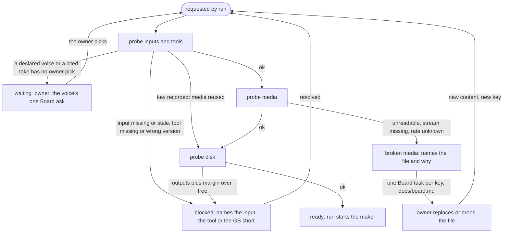

# Media and disk preflight

Draft for the owner to read, queue item 6 seam 1. This is a rebuild contract, not an implementation or a claim that
the host already meets it. A preflight is a check the [spine](spine.md) engine runs inside `run(video, stage)`
before it starts a stage's maker: it reads what the stage declares, never which recipe it belongs to, and answers
whether the expensive work can finish. C1 covers the stages of `plain` and `shorts-only` that analyse or render
media: `media` (transcription), `plan` (cut analysis), `arc`, `draft`, `masters` (final, vertical, shorts) and
`short`. Paths are relative to the video, as in spine.md.

## 1. What a preflight answers, as data

Before analysis (plain `media`: the transcript, the probe and the faces from the source):

```json
{
  "video": "records/job.json", "stage": "media", "recipe_revision": "sha256:3b1f...",
  "key": "sha256:9a07...", "at": "2026-10-22T18:00:00Z", "preflight_version": "1",
  "ok": true, "state": "ready", "next_action": "run media", "detail": "4 probes passed",
  "probes": [
    {"probe": "inputs", "inputs": ["source.mp4", "records/job.json"],
     "ok": true, "state": "ready", "next_action": null,
     "detail": {"source.mp4": "sha256:51c2...", "records/job.json": "sha256:0d4e..."}},
    {"probe": "tools", "inputs": ["ffprobe", "ffmpeg", "asr:<engine>/<model>"], "ok": true, "state": "ready",
     "next_action": null, "detail": {"ffprobe": "7.1", "ffmpeg": "7.1", "asr:<engine>/<model>": "model present"}},
    {"probe": "media", "inputs": ["source.mp4"], "ok": true, "state": "ready", "next_action": null,
     "detail": {"container": "mov,mp4", "streams": {"video": 1, "audio": 1}, "duration_s": 1312.48,
                "fps_measured": 30.0686, "fps_tagged": "30/1", "audio_rate_hz": 48000,
                "width": 3840, "height": 2160, "packets_read": "all", "decoded": ["0-2s", "655-657s", "1310-1312s"]}},
    {"probe": "disk", "inputs": ["records/words.json", "records/probe.json", "records/faces.json"],
     "ok": true, "state": "ready", "next_action": null,
     "detail": {"volumes": [{"volume": "work", "need_gb": 0.1, "margin_gb": 40, "free_gb": 212.4}]}}
  ],
  "blocks": []
}
```

Before a render (plain `draft`), blocked by the disk:

```json
{
  "video": "records/job.json", "stage": "draft", "recipe_revision": "sha256:3b1f...",
  "key": "sha256:c4d2...", "at": "2026-10-22T19:10:00Z", "preflight_version": "1",
  "ok": false, "state": "blocked", "next_action": "free 9.6 GB on the work volume, then run draft again",
  "detail": "disk: work volume has 33.0 GB free; draft needs 2.6 GB plus the 40 GB margin",
  "probes": [
    {"probe": "inputs", "inputs": ["source.mp4", "records/cut_plan2.json", "records/story_map.json",
     "records/overlay_plan.json", "records/bed.json", "records/faces.json", "records/callouts_plan.json"],
     "ok": true, "state": "ready", "next_action": null, "detail": {"records/cut_plan2.json": "sha256:77aa..."}},
    {"probe": "tools", "inputs": ["ffmpeg", "ffprobe"], "ok": true, "state": "ready", "next_action": null,
     "detail": {"ffmpeg": "7.1", "ffprobe": "7.1"}},
    {"probe": "media", "inputs": ["source.mp4"], "ok": true, "state": "ready", "next_action": null,
     "detail": "reused: same source content as the media stage's probe"},
    {"probe": "disk", "inputs": ["Draft/draft.mp4", "records/draft_review.json", "records/vplan.json"],
     "ok": false, "state": "blocked", "next_action": "free 9.6 GB on the work volume",
     "detail": {"volumes": [{"volume": "work", "need_gb": 2.6, "margin_gb": 40, "free_gb": 33.0}]}}
  ],
  "blocks": [{"probe": "disk", "what": "work volume", "short_gb": 9.6}]
}
```

- `video`, `stage`: the video's job record and the spine stage ID; no recipe name appears anywhere in the result.
- `recipe_revision`: the validated recipe data the stage's declaration came from (spine.md section 2).
- `key`: sha256 over stage ID, recipe revision, each declared input's content hash, the probe tools' versions and
  `preflight_version`. Same key, same media answer; the disk and tools are read again (section 2).
- `at`: when this attempt measured; evidence, never the freshness rule.
- `preflight_version`: changes when a probe's logic changes, so an old answer cannot stand for a new probe.
- `ok`, `state`, `next_action`, `detail`: the house status shape. `state` is `ready`, `blocked` or `broken`;
  `ok` is true only for `ready`; `next_action` names who does what; `detail` is one line a person reads.
- `probes`: one row per probe, in the fixed order inputs, tools, media, disk. Tools come before media because the
  media probe runs a tool: a missing or broken probe tool is `blocked` naming the tool, never broken media. A probe
  after a stop is `not_reached`, never passed.
- `probe` `inputs`: the declared stage inputs (inputs, media), declared stage outputs (disk) or the tools the
  stage's registered run declares (tools).
- `probe` `inputs` `detail`: each declared input's content hash. Missing, unreadable or older than the record its
  producer last passed (spine.md freshness, by content) blocks with the path.
- `probe` `media` `detail`: container; stream counts by kind against what the stage needs (a video and an audio
  stream for footage); duration; frame rate measured from packet timestamps beside the tagged rate; audio sample
  rate; frame size; every packet demuxed; a decode at start, middle and end of each stream. An unknown value is
  broken media, never a default.
- `probe` `disk` `detail`: per volume holding a declared output, the bytes the stage's outputs need, the margin
  and what is free. Outputs on two volumes are summed per volume, not on the emptier one.
- `probe` `tools` `detail`: each executable's resolved version, each model's presence. The configured one only.
- `blocks`: what stops the stage, each with its file, tool or gigabytes. Empty when ready.

## 2. The API

`preflight(video, stage) -> result` is a future core API; no interface is implemented in this seam.

Reads:

- the stage's declared `inputs` and `outputs` from the validated recipe data (spine.md section 1), through the core
  host boundary; never the recipe name, never the job's recipe field;
- the media itself through one probe tool (ffprobe, run through the host's registered tool adapter), read only;
- the size each declared media output needs: its rendering domain declares bytes per second of its kind (item 14
  owns those numbers), times the probed duration, plus the scratch the stage's registered run declares. A declared
  media output with no size declaration is blocked naming it, never sized as zero;
- the margin: the host's one setting `studio.json` `disk.render_floor_gb`, passed in as configuration;
- the tools the stage's registered run declares (executables, the transcription engine and model).

**Spec extension** (built by item 6 seam 3a; spine.md section 1): each non-owner stage that reads or writes media
gains `tools`, the capability ids its run needs (`["ffmpeg", "ffprobe"]`; an `asr:<engine>/<model>` id waits on item 5),
`size`, a map from each media output path to `{"bytes_per_s": <n>}` of the probed duration, and `scratch_gb`. The
engine passes the stage here with each sized output as `{"path", "size"}`. The spine's recipe validator owns the fields
and refuses a stage writing media without them; the rendering domain (item 14) owns the numbers.

Writes one record, `records/ready/<stage>.json`, keyed by `key`, atomically (temp file and rename) under the
video's single writer, and the spine's `records/spine.json` references it by hash as the stage attempt's evidence. The host's
`preflight/<stage>.json` is its post-render delivered-file report, a different thing kept apart until item 15
replaces it. Idempotent: two calls, or a call after a crash at any point, reach the one record for that key. The
media probe, the expensive one, is not re-run while the key is unchanged; the disk probe (a filesystem call) and the
tools probe (versions and presence) are read on every call, because free space and installs are not an input's
content and cost milliseconds, except the first probe of a new key (`qualify`, below). The tools probe is `capability(id)` per declared tool, and `qualify(id)` once for a
current key with no record (item 5, [capabilities.md](capabilities.md)); a cited voice patch also asks
`voice("speech", cites)` for a stage declaring `voice:speech` (`cites`, the patch's take and original, passed by the
spine), so a take with no owner pick is `waiting_owner`, the voice API's own Board ask its evidence. A source's content hash is cached against its path,
size, inode and change time; any change re-hashes (shortcut: stat identity stands for content between runs; upgrade
to a full re-hash if a tool is found that rewrites a file and keeps all four).

Never: runs the stage's work, writes or moves a declared input or anything outside `records/ready/`, deletes a file
to make room, swaps a missing tool or model for another, or turns an unreadable value into a pass. A broken result
files the owner's Board task (section 3) once per key; the task is the Board's record, not a second preflight state.

## 3. One preflight's path

The four ends are the only states the code writes. Probe boxes are steps inside one call.



In the spine's `records/spine.json` a broken result is `waiting_owner` (spine.md section 3) with this task as its evidence; a
blocked result is the spine's `blocked`. A broken result's task follows [the Board model](board.md): stable `id`
from the key, `kind: ask`, `loop: filed`, `source.filed_by: preflight` (the reply recipient), `what` (which
file is broken), `why` (the probe's words: which stream, which value, where the decode failed), `source.record`
pointing at `records/ready/<stage>.json`, a served `judge` of the file's probe detail, actions to replace the file or
drop the video (each undoable until the stage runs), `cant.words` and `cant.goes_to`. The same key never files a
second task. Blocked is the spine's blocked state with its resolver named in `next_action` (the producing stage
for a missing input, the host for a tool or the disk); it files no owner task. Either becomes the stage's current
record, so `next` names it, even over an earlier failed attempt; an attempt recorded but not yet started (a crash
before its maker began) asks preflight again on resume and keeps its operation key, and only a started attempt
skips it.

## 4. The host's checks and their replacements

Paths are relative to the host at `87af91f833dd8476a0f80c0a0b3e8cefdf72ff78`. Before/after is against the
expensive work it guards. This inventory is not permission to copy its code.

| Host check | What it decides; stage | Before or after | Replacement |
|---|---|---|---|
| `tools/job.py room, _floor, free_gb` | Free GB under `disk.render_floor_gb` stops a video-writing script; every render | Before, but a fixed floor, not the stage's need | Disk probe: outputs' size plus that floor as margin. Disagrees with the probe: an unreadable setting or disk returns None and the render runs |
| `room()` callers `grind, foil, publish, vrender, vjoin, vburn, vaudio, draft, source_join, archive` | Same floor at each script's start; masters, draft, short, media (join) | Before each script, not before the stage | One disk probe per stage; the callers' lines go |
| `room()` callers `broll, explainer, tableau, assemble` | Same floor; B-roll and animation | Before | Out of C1 scope: plain renders no B-roll, animation is another recipe |
| `job.py _floor CUTSTACK_DISK_FLOOR_GB` | Environment override of the floor for tests | n/a | Contract tests pass the margin as configuration; override deleted |
| `job.py SRC` and `source_moved_to` | Source path; a moved source is found in its new folder | Before | The job's one declared source input; a mover updates it. Missing is blocked naming the path |
| `job.py measure_fps, src_fps` | Frame rate from packet timestamps, written into `job.json`; every stage | At first use, inside a render | Media probe's `fps_measured`, in the record. Writing the job file ends |
| `job.py source_probe` | Frame size, pixel format, colour, cached by path, size, mtime; every render | At first use | Media probe detail; the same stat-identity cache, now behind a content hash |
| `job.py framing` | A non-4K source without crop windows stops; draft, masters | At render start | Out of preflight: a cut-plan input contract (item 17) |
| `job.py video_end` | Master length from packets, else cut plan; a stale master by mtime | During | Out of preflight: rendering reads declared outputs (item 14) |
| `tools/cutstack.py need` | ffmpeg or ffprobe on PATH; media (transcribe), captions | Before | Tools probe |
| `cutstack.py probe` | Duration and rate from the container; an unknown rate becomes 30.0, a missing duration 0; media | Before | Media probe; unknown is broken. Disagrees with `job.measure_fps` (tagged rate against measured) |
| `cutstack.py cmd_transcribe --from` | Imported words with no source probe get duration 0; media | Before | Media probe runs for imported words too |
| `tools/asr.py for_transcript, unavailable` | Configured engine and model present, else a fallback engine with one line; media | Before | Tools probe names the configured engine and model; no swap |
| `tools/draft_preflight.py check` runtime block | Records ffmpeg, ffprobe, Python and module paths; tool provenance fails; draft, arc | Before | Tools probe for executables; module provenance is the core's install check, out of this seam |
| `draft_preflight.py check` plan consumers | Anchors, shorts, archive, framing, J-cuts, plan_check; draft, arc | Before | Out of preflight: spine checks on the producing stages (`overlay-plan`, `locked-cut`, item 14) |
| `draft_preflight.py` input fingerprints | sha256 of the plans and `job.json`, before and after; draft | Before | Inputs probe hashes, by declared input, not a fixed name list |
| `tools/plan_check.py --preflight` | Cheap plan check without rendered media; draft | Before | Out of preflight: `overlay-plan` check (spine.md) |
| `tools/draft.py main` gates | Paper, plan and stumble gates, then draft_preflight; draft, arc | Before | Spine stage dependencies and checks; disk and tools through this preflight |
| `draft.py measured` | Flash shots, loudness, bed on the rendered draft | After | Rendered loudness, flashes and bed: `draft-read` check (item 15). Its plan-shot read (`publish.short_shots`) needs only the plan, so it moves before the render, to `locked-cut`: a failing this spec ends |
| `tools/preflight.py run_stage, measure_stage` | Delivered files against `delivery_spec.json`: size, codec, rate, tags, flashes, loudness, bed, links, captions; arc, draft, final | After | Not a preflight despite its name: `delivered-media` and `draft-read` checks (items 14, 15) |
| `preflight.py probe` | ffprobe streams; a parse failure becomes empty streams | After | The one media probe; a parse failure is broken, never empty |
| `preflight.py gate_mode, ask_gate` | Refuse or warn; a switch that cannot be asked becomes warn | After | Ends: a preflight result is ready, blocked or broken, with no warn mode |
| `tools/preflight_audio.py packet_misses, continuity` | AAC packet and timestamp gaps over `MAX_AUDIO_GAP` in delivered audio; final | After | Same packet read, on the source, in the media probe; the delivered read stays in `delivered-media` |
| `tools/qc.py run_preflight, _preflight` and probe users | QC rows read preflight.py's measures; arc, draft, final | After | Item 15's check engine; duplicates preflight.py's verdict by reading the same report |
| `tools/encoder.py` hardware fallback | A refused hardware encode is made again on x264; every render | During | Out of preflight: rendering (item 14). Tools probe reports the hardware encoder's presence when the run declares it |
| `tools/publish.py probe`, `COLOR_DEFAULTS` | Encoding of a file to match; missing colour tags become BT.709; masters | During | Media probe records the source's tags; an unknown tag is reported, the default is rendering's (item 14) |
| `publish.py --probe` (`probe_delivery`) | What a publish would rebuild or replace, read only; masters | Before | Out of preflight: the spine's freshness answer (`next`, `run`) |
| `tools/stages.json` finisher rows | Brief tells the maker to run `preflight.py final` clean before done; masters | After | Spine `delivered-media` check |
| `tools/checklist.json qc.spec.*, qc.av.*, qc.encode.one, qc.audio.*, qc.bed.*` | Rows measured by preflight.py; arc, draft, final | After | Item 15 check catalog |
| `tools/studio.py preflight_problem, PREFLIGHT_MILESTONES` | Delivered milestone needs a clean, fresh preflight.py report; masters | After | Spine `delivered-media` check freshness by content (mtime today) |
| `studio.py seconds, too_long` | Duration for a platform limit; no ffprobe or file gives None and no limit applies; posting | Before the send | The record's `duration_s` from the masters/short preflight; unknown blocks |
| `studio.py video_probe` | Delivered file readable, duration and size, before a send; posting | Before | Posting stays in the core; it reads the media probe of the delivered file through the same probe tool |
| `studio.py disk_free_gb`, `tools/disk_retention.py disk_line` | Free GB and days to the floor in the status line; none | n/a | Stays a host status (tidy); not a guard. Shares only the margin setting |
| Board disk line (`studio.py` free_gb), `tools/retire.py` | Free GB printed; none | n/a | Status only; out of scope |
| `pirillo_studio/runtime.py` (core) doctor | Prints `ffmpeg: MISSING`, never refuses; none | n/a | Deleted by item 5 (capabilities.md); the machine status reads `status()`, and the tools probe is the gate |
| `tools/source_join.py` | Extra take covers duration, then `room()`; media | Before | Media probe on each take; disk probe for the joined source |
| `tools/cover_words.py`, `textstill.py`, `fit.py`, `claymation_*`, `podcast/`, `explainer.py`, `tableau.py`, `assemble.py`, `broll.py` probes | Tool presence and media reads for stills, fits, other recipes and B-roll | Mixed | Out of C1 scope: images, other recipes and B-roll are not in plain or shorts-only |
| `vjoin, vrender, vaudio, vburn, grind, foil, archive, faces, bed, sheet` ffprobe reads | Frame counts, durations and packet reads used to build or measure output | During or after | Not checks: rendering and QC reads (items 14, 15). Media facts they need come from the record |
| `tools/land_verified.py`, `codex_git.py landing_preflight`, `host_verify*`, `image_authority.py` | Landing and image approval preflights | n/a | Out of scope: team machinery and images |

Tests read for what they guard: `test_cut_rules.DiskFloor` (under the floor a render stops on one line and starts
nothing; a status still answers; a bad floor value is said), `test_studio.Preflight` (delivered files against the
spec; delivered refused without a clean fresh report), `test_qc_audio.DeliveredAudio` (an audio hole shipped while
final QC passed), `test_draft_preflight.DraftPreflight` and `test_draft_preflight_review` (plan checks before the
arc render; dated warnings must not look green), `test_disk_metrics`, `test_disk_defaults_runtime` (status and
clock runtime, not guards), `test_transcribe_recovery` (transcript content, not a preflight).

Inventory searches: `rg -n "disk_usage|statvfs|ffprobe|free.*GB|preflight" studio/tools --glob '!test_*'`,
`rg -n "job\.room\(|\broom\(|render_floor_gb|free_gb\(" studio/tools`, `rg -n "^def " studio/tools/preflight.py`,
`rg -n "def need|which\(" studio/tools/cutstack.py`, `rg -n "^def |which\(" studio/tools/asr.py`,
`rg -ln "room\(|render_floor|free_gb|disk_usage|DISK_FLOOR" studio/tools/test_*.py`,
`rg -n "^class .*(Preflight|Delivered|Disk|Room|Floor)" studio/tools/test_*.py`,
`rg -n "#[0-9]{2,4}\b|toolreq"` on the named files, `rg -n -i "preflight|render.floor|disk"
studio/plugin/pirillo-studio/skills/*/references/`, and `rg -n "ffprobe|disk_usage|preflight|which\(" core/pirillo_studio`;
then bounded reads around each match (`studio.py` by `grep -n` ranges only).

## 5. Owner expectations as contract tests

Obligations for the build seam, not tests written or run by this change. Each inspects the written record and the
fake tool's call log, never a command's own message.

1. `test_ready_starts_the_maker` (end: ready): every probe passes; the record is `ready`; `run` starts the maker
   once; a second `run` reuses the record.
2. `test_nothing_expensive_starts_unless_ready`: for each non-ready result, the fake maker's call log is empty
   and no declared output exists. Nothing expensive starts on media that cannot finish.
3. `test_missing_input_blocks_naming_the_path` (end: blocked, input): a missing, unreadable or stale declared
   input yields `blocked` with its exact path and the producing stage as resolver.
4. `test_short_disk_blocks_naming_gigabytes` (end: blocked, disk): free space under outputs plus margin, measured
   per volume, blocks before the render with the volume and the GB short; an unreadable disk or margin blocks too.
   A full disk is found before the render, not by it.
5. `test_missing_tool_blocks_naming_the_tool` (end: blocked, tool): an absent executable or model blocks naming
   it; no other engine or encoder is substituted. A missing or failing probe tool blocks naming it and files no
   broken-media task.
6. `test_broken_media_reaches_the_owner_once` (end: broken): an unreadable file, a missing stream or an unknown
   duration, frame rate or audio rate is `broken` naming the file and why, and files one Board task; a second call
   and a call after a crash file no second task; new content gives a new key and a new task.
7. `test_unchanged_inputs_are_not_reprobed`: a second call with the same key invokes no media probe and reads
   the disk and tools again; a changed input, tool version or `preflight_version` probes again.
8. `test_never_changes_owner_files`: every file under the video except `records/ready/<stage>.json` hashes the
   same before and after, for every end; nothing is deleted or moved to make room.
9. `test_crash_reaches_one_end`: killed between probe and write, or mid-write, a rerun produces one well-formed
   record for the key; a torn record refuses rather than reads as ready.
10. `test_preflight_never_reads_recipe`: the same declared stage under `plain` and under `shorts-only` data gives
    the same result; the probe has no recipe identity available.
11. `test_unknown_values_are_never_defaulted`: no frame rate becomes 30, no duration becomes 0, no colour tag
    becomes a standard, no missing size declaration becomes zero bytes.
12. `test_off_is_unchanged`: with the switch off, host command outputs and written files are byte-identical on the
    same fixture; on, every C1 media stage calls this preflight and no host check above that it replaces runs.

Tests 1, 3 to 5 and 6 cover the ends ready, blocked and broken media.

Live check: `python3 tools/preflight_contract.py run --video "$VIDEO_FOLDER" --stages media,draft,masters --out "$PREFLIGHT_PROOF"`

The proposed host acceptance command for the build seam, not an existing executable. The owner picks a real video
folder; the Mac lead supplies it and an evidence folder through those variables, runs it read only against the
real source, and inspects each `records/ready/<stage>.json` and the probe's detail against the file.

## 6. One switch, then delete

The single host setting is `studio.json` `preflight`, a boolean, initially false. On, the host's C1 media stages
(transcribe, cut analysis, arc, draft, masters, short) call the core `preflight(video, stage)` through the spine's
`run` and start nothing that is not `ready`; on cannot fall back to the host checks on any error. Off keeps the host
path byte for byte. It ships with or after `spine` (spine.md section 6) is on for the same video: the preflight is
an engine check and has no caller without it.

Deleted in the switch-and-delete landing, each once its contract test covers it: `job.py room`, `_floor`,
`free_gb`, `CUTSTACK_DISK_FLOOR_GB` and every C1 `room()` call listed above; `job.py src_fps`'s write into
`job.json`, `measure_fps` and `source_probe` with its `source_probe.json` cache (callers read the record);
`cutstack.py need` and `probe`'s defaults; `asr.py`'s fallback swap for transcripts; `draft_preflight.py`'s runtime
block and input fingerprints; `studio.py seconds`' None-means-no-limit; `test_cut_rules.DiskFloor` and the
`CUTSTACK_DISK_FLOOR_GB` lines in `test_cut_rules`, `test_source_join` and `test_studio` (its module-level
`os.environ.setdefault`). The setting `disk.render_floor_gb` stays,
now read only as the margin. `preflight.py`, `preflight_audio.py`, `qc.py`'s preflight rows, `draft.py measured`,
`preflight_problem` and `test_studio.Preflight` are post-render checks: they go with items 14 and 15, not here.
Calls from out-of-scope scripts (B-roll, animation, other recipes) stay until their own rebuild. Once both C1 videos
run on the core, the switch and the old C1 path are removed together.

## 7. Failings this contract ends

- 2026-10-02, in `job.py`'s comment and `test_cut_rules.DiskFloor`: scratch renders took the disk to 0 GB free and
  the posting clock posted nothing for four hours. The floor that followed is fixed, not the stage's need, and an
  unreadable floor or disk returns None so the render runs anyway. Contract 4 sizes the need and blocks on unknown.
- `test_studio.Preflight` (the host's plugin audit 1.4): before it nothing measured a delivered file, and what it
  added measures only after the render. Contracts 2 and 4 move what is knowable before the render to before it.
- Host #1510, defect `70a66872ff67`, in `test_qc_audio.DeliveredAudio`: an audio hole shipped while final QC passed.
  Packet gaps in the source are now found by the media probe before analysis (contract 6); the delivered read stays
  in item 15 and this seam does not claim #1510 fixed.
- Ledger `SHARED-VIDEO-PREFLIGHT-R1`, in `test_draft_preflight`: the arc bypassed plan checks until after rendering;
  `SHARED-VIDEO-PREFLIGHT-REVIEW-WARN-R1`: dated warnings looked green. Contracts 1 and 2: four ends, no warn state.
- `job.py measure_fps`: the camera tagged 30 and shot 30.0686, and counting at the tagged rate threw away 14 frames;
  `cutstack.py probe` still reads the tagged rate and defaults to 30. Contract 11 and the measured rate end it.
- `job.py source_probe`: a render asked ffprobe for the frame size once per piece, 97 times, 10 to 13 s before
  anything happened. Contract 7: one probe per content key.
- `asr.py for_transcript` swaps a missing engine for another; `encoder.py` and `publish.py COLOR_DEFAULTS` default
  what they could not read; `preflight.py ask_gate` turns an unreachable switch into a warn; `studio.py seconds`
  turns no ffprobe into no limit. No issue IDs are named by these sources; contracts 5 and 11 end the pattern.
- `job.py src_fps` writes the measured rate into the owner's `job.json`. Contract 8: the preflight writes only its
  record.

This seam changes no runtime behavior. Item 6 stays `building` through the build, the switch and the delete.
