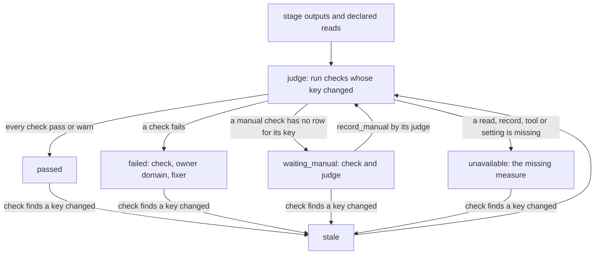

# QC: a stage's outputs to one verdict

Draft for the owner to read, queue item 15 seam 1. This is a rebuild contract, not implemented behavior.

QC owns the verdict, the check catalog, the stage gate the spine runs, the checker seats and their profiles,
manual rows, the hear-back of delivered words, the attention and cadence audit, final delivery completeness, and
how a dated rule warns or refuses. It owns no other domain's rule: a cut plan's checks are item 17's, a rendered
file's measures item 14's, timed captions and their placement item 18's, release copy and platform caption-text
rules item 39's. A catalog entry for those checks reads its owner's check record; QC never runs that check again.

## 1. Checks and verdicts are data

A check declaration is one catalog entry. The catalog is data in the core, loaded and validated once; a check with
an unknown stage, owner domain, checker seat, read binding or setting refuses the load by name.

```json
{
  "id": "delivered-media",
  "stage": "masters",
  "owner": "rendering",
  "checker": "checker-renders",
  "mode": "auto",
  "result": "measure",
  "reads": [
    {"bind": "render:long", "record": "records/render/long.json"},
    {"bind": "render:long-readings", "record": "records/render/long-readings.json"}
  ],
  "setting": {"name": "rendering.settings.loudness", "owner": "rendering"},
  "rule": "delivered-loudness",
  "may_lower": false,
  "fixer": "finisher",
  "version": "sha256:<catalog entry and evaluator source>"
}
```

- `id`: the check's stable name; spine stage `check` lists name these IDs, and Board tasks and owner catches cite it.
- `stage`: the spine stage it gates; one stage per entry, so the stage list alone decides whether it applies.
- `owner`: the domain whose rule this is (`cutting`, `rendering`, `captions`, `release`, `qc`); a failure names it.
- `checker`: the independent seat that answers it (`checker-plans`, `checker-renders`, `checker-copy`, a story
  reader or `owner`); never the stage's maker. A seat's profile is the set of stages its checks gate, not a list.
- `mode`: `auto` (QC evaluates the reads) or `manual` (a named judge records a result with what they saw).
- `result`: `measure` (a value against a setting), `record` (another domain's `check` result), or `judgment`.
- `reads`: every binding the check consumes, a stage input, output, manifest member or another domain's record.
  The verdict key is built from these alone; a check cannot read the recipe name, the job or a file it did not declare.
- `setting`: the one setting that holds its threshold and that setting's owner; the catalog never holds a number.
- `rule`: the dated-rule ID whose mode decides warn or refuse (section 1, "Dated rules"); absent means always refuse.
- `may_lower`: whether a manual row may record a lower result than the evaluator gave, and only with its why.
- `fixer`: the maker role a failure goes to; the spine sends it the failure words.
- `version`: the hash of the entry and its evaluator code; a changed check makes its earlier results stale.

A verdict is one record per video and stage judged, at `records/qc/<stage>.json`:

```json
{
  "schema": 1,
  "stage": "masters",
  "key": "sha256:<every check key below, sorted>",
  "state": "failed",
  "judged_at": "2026-01-01T00:00:00Z",
  "video_started": "2026-01-01T00:00:00Z",
  "checks": [
    {
      "id": "delivered-media",
      "owner": "rendering",
      "key": "sha256:<version, read hashes, resolved setting values, rule mode>",
      "read": [{"bind": "render:long", "sha256": "<hex>"}, {"bind": "render:long-readings", "sha256": "<hex>"}],
      "result": "fail",
      "measured": {"name": "integrated_lufs", "value": -11.2, "unit": "LUFS"},
      "setting": {"name": "rendering.settings.loudness", "owner": "rendering"},
      "rule_mode": "refuse",
      "words": "Long master integrated loudness is outside rendering.settings.loudness.",
      "fixer": "finisher",
      "by": "qc"
    },
    {
      "id": "heard",
      "owner": "qc",
      "key": "sha256:<...>",
      "read": [{"bind": "file:long", "sha256": "<hex>"}, {"bind": "hear", "sha256": "<hex>"},
               {"bind": "plan:clock", "sha256": "<hex>"}],
      "result": "manual-pending",
      "judge": "checker-renders",
      "words": "One CLIPPED flag at a splice waits on its judge: fix it or name it with a why.",
      "by": null,
      "saw": null
    }
  ]
}
```

- `schema`: the record version; an unknown version refuses rather than being read as a pass.
- `stage`: the spine stage judged.
- `key`: the hash of every check key, sorted; equal keys mean the same verdict, so nothing runs again.
- `state`: `passed`, `failed`, `waiting_manual` or `unavailable`, the worst of its checks (failed, then
  unavailable, then waiting_manual); `stale` is never written, `check` computes it (below).
- `judged_at`: when the record was committed; evidence only, never used to decide freshness.
- `video_started`: the video's immutable start from its job record; dated rules compare against it.
- `checks[].id`, `owner`: the catalog entry and its owner domain, copied so a failure names both without a lookup.
- `checks[].key`: that check's own key, so a re-judge reruns only the checks whose key changed.
- `checks[].read`: each declared binding and the content hash read; a producer record's own recorded hash is used
  only after the producer's `check` confirms that record still matches its file.
- `checks[].result`: `pass`, `fail`, `warn` (a failing dated rule in warn mode), `unavailable` (a measure, record,
  tool or setting the check needs is missing or failed to run) or `manual-pending` (a manual check, or an auto
  result needing its judge, not yet recorded for this key).
- `checks[].measured`: the value read, its name and unit; absent for a judgment.
- `checks[].setting`: the setting name and owner the value was held against, never the number restated.
- `checks[].rule_mode`: `refuse` or `warn`, as resolved for this video; recorded so a warn is visible, never a pass.
- `checks[].words`: what to fix, in words the fixer can act on.
- `checks[].fixer`: the maker role the failure is sent to.
- `checks[].by`, `judge`, `saw`: who produced the result (`qc` for auto); for a manual row, the declared judge,
  who recorded it and what they saw (the file, time or record they read, and the why).

**Stale.** A verdict goes stale when any check key it holds differs from the key computed now: a read's bytes
changed, a check's version changed, a resolved setting or rule mode changed, or the catalog for the stage gained or
lost a check. Time, file mtime, size and who ran it last never decide it. A manual row is bound to the key it was
recorded under; when that key changes the row returns to `manual-pending`. Nothing reads a stale verdict as passed.

**Dated rules.** One setting, `qc.rules`, holds each rule ID's `from` date and mode (`refuse` or `warn`); a
check row never carries its own date. A rule whose `from` is after `video_started` resolves to `warn` for that video,
so a video in flight is never refused by a rule added after it started. An unreadable rules setting makes every
check that names a rule `unavailable`; it never quietly warns.

**Shorts-only.** When the owner supplied a finished short, QC judges the file, not his editing choices. The
`short-media` stage gets item 14's check of the supplied bytes (readable, the profile setting, complete audio, the
file unchanged from what he supplied), item 18's caption check of its sidecar and the `heard` check of its captions
against the words heard in that file. No cut, splice, framing, story or attention check is in its catalog, because
the stage list holds none; there is no plan clock, so `heard` compares captions to the file's own transcript only.
`copy` and `release` keep their item 39 checks.

**Required spine.md extension** (its section 1 stage data), reviewed by the owner with spine.md before either is
built: `masters` checks `["delivered-media", "delivered", "heard"]`; `short` checks `["short-media", "captions",
"heard"]` (`captions` is item 18's check of the sidecar); `overlays` checks `["overlay-plan", "attention"]`.
`heard` reads a hear record the stage's maker writes, never QC: speech recognition on the delivered file is a step
of `masters` and `short`, writing `records/hear.json` (the heard words and times, the engine and its model hash,
bound to the file hash), with the engine declared in the stage's `tools` as `asr:<engine>` (preflight.md section 1).
The hear engine must be independent of the captions aligner: a hear record whose engine and model hash equal the
cue record's `aligner` (captions.md section 1) makes `heard` `unavailable` naming both, never a pass.
`masters` already lists `records/hear.json`; `short` gains it as an output. QC writes only its verdicts.

## 2. One API

| Function | Reads | Writes and answer |
|---|---|---|
| `catalog(stage) -> checks` | The validated catalog and the stage ID | Nothing; the stage's entries. Unknown stage refuses. |
| `judge(video, stage) -> verdict` | Each entry's declared reads (hashes), other domains' check records, resolved settings, `qc.rules`, `video_started`, the prior verdict | The verdict record only. Equal key: returns the prior record, writes nothing, runs nothing. Otherwise runs only the checks whose key changed and keeps the rest. |
| `record_manual(video, stage, check, result, by, saw) -> verdict` | The current verdict and its key for that check; the entry's `checker` and `may_lower` | A new verdict with that row set. Allowed on any row in `manual-pending` (a manual check, or an auto result such as a `heard` flag that needs its judge); `may_lower` governs only recording a result lower than the evaluator gave. Refuses a stale verdict, a row not pending, a lower result where `may_lower` is false, a `by` who is not its declared judge or is the stage's maker, and an empty `saw`. |
| `check(verdict) -> {ok, state, next_action, detail}` | The verdict and the keys computed now | Nothing. `ok` only for `passed` on current keys. `state` is the verdict's, or `stale`; `detail` names each failing check, owner, measured value, setting and fixer; `next_action` is the fixer, the judge or `judge`. |

`judge` evaluates checks as pure functions of their reads; a check never writes media or another domain's records,
and the host's scratch copy for writing scripts has no successor. A check whose read is missing, whose owner's record
is absent or stale, whose tool cannot run, or whose setting is unresolved is `unavailable` with that name in
`words`; an unavailable measure is never a pass, a note or a warn. An evaluator exception is `unavailable` naming
the check and the error, never a pass and never a crash of the whole stage.

**Crash-safe.** `judge` writes the verdict to a sibling temporary file on the same volume, flushes it, then renames
it over `records/qc/<stage>.json`. A crash leaves the prior verdict (whose keys `check` will find stale if inputs
moved) or the new one, never a partial record; a leftover temporary file is not a verdict and the next call removes
its own. Two judges of the same stage serialize on that stage's verdict; different stages share nothing.

**Spine gate.** The spine's stage check calls `judge` then `check`, and maps its answer to spine states: `passed` to
pass, `failed` to fail with the words to the fixer, `unavailable` to blocked naming the missing measure,
`waiting_manual` to running for a checker seat or waiting_owner when the judge is the owner, and `stale` to `judge`
again. Promotion of an arc or draft for the owner to see is the spine's on a passed verdict.

## 3. From a stage's outputs to its verdict

The written states are the four verdict states; `stale` is computed by `check` and leads back to judging.



A failed verdict still lists every other check's result, so a fixer sees all the work at once. A warn is shown as
warn inside a passed verdict, with its rule and date; it is never counted as a pass in what the owner sees.

## 4. Host QC checks and gates, and their replacements

Sources are host-relative. Host QC stages map to spine stages: `plan` to plan and overlays, `arc` to arc, `draft`
and `full` to draft, `final` to masters and short, `copy` to titles, copy and release, `post` to posting. Checklist
rows are named by ID prefix; one row covers a group of like checks. The `qc.py run_*` rows the cutting and rendering
specs already map are grouped by pointing at those specs; QC's replacement there is a catalog entry reading that
domain's record.

| Host location | What it judges, stage | Replacement |
|---|---|---|
| `qc.py main`, `run_stage`, `_run_stage` | Runs checklist rows per host stage; writes `records/qc/<stage>.json`, `.findings.json`, `.log` | `judge`; one verdict per spine stage. |
| `qc.py RUNNERS` (every `run_` function by name) | Implicit catalog: a row runs if a function's name matches | Declared catalog; an entry without an evaluator refuses the load. |
| `qc.py` scratch copy-on-write mirror | Lets writing scripts run as checks | None: a check is read-only; a writing script is its domain's step. |
| `qc.py fresh_report`, `FRESH_WAIT`, `qc/<stage>.pid` | Waits for a running pass; re-runs on newer mtime of qc.py, checklist or recipe list | Content keys and one serialized writer per stage; no wait loop, no mtime. |
| `qc.py said`, exit codes | PASS line; a not-run row does not fail the stage | `check` JSON. Disagrees: the host prints PASS with rows not run; here an applicable check not run is unavailable. |
| `qc.py --list`, `list_rows`, `held_words`; `studio.ROW_GATES` | Rows a checker answers by hand, per stage | `catalog(stage)` with `mode` manual. |
| `qc.py release_misses`; `publish.py --release` import | `gate: release` rows for the release write | Item 39's release check; QC holds its catalog entry. Disagrees: a field-reader error is a miss, a runner error a fail. |
| `qc.py _run_stage` early rows, `tell_early`, WOULD REFUSE | Dated rule measured but not refused in flight | `warn` result from `qc.rules`; no separate early path. |
| `qc.py` recipe exemptions, `RECIPE_SKIPS_RUNS`, `recipe_absent`, `shorts_only` | Which rows apply | spine.md section 4 rows; stage-declared checks only. |
| `qc.py` local thresholds (`COVER_TOL`, `CADENCE_MAX`, `BEAT_HOLD`, `CUE_*`, `TAKE_*`, `QUIET_DB` and others) | Numbers held beside the checklist `threshold` | Each moves to its owner domain's setting; the catalog names it. Two measures share the name `CADENCE_MAX`: here the longest a tableau holds with nothing new (scene plans, out of C1 scope with scenes), in `retention.py` the spacing between cutaways (the `attention` check's setting); they get two names. |
| `qc.py --review`, `run_review_lines` | Monthly platform review lines | Out of C1 scope: research cadence, not a video stage. |
| `qc.sp.review-line` (copy stage, run by qc; `rules.json` `core` refuses the `qc.sp.` prefix for every video) | Standards-and-practices rows on release words | Item 39 with the other copy rows; its refuse mode is `qc.rules`'s, not a prefix list. |
| `qc.scripts.tested`, `qc.scripts.clock-python` (arc, draft, final, copy; hand rows for the toolsmith) | Studio scripts tested and on the right interpreter | Out of C1 scope: dev-kit and team machinery, not a judgment of the video. |
| `qc.py --measure-*`, `run_render_*` (except `run_render_caption_onsets`), `render_measure.py`, `render_audio_measure.py` | Rendered measures, draft and final | rendering.md section 4 (item 14); QC reads its readings record. `run_render_caption_onsets` and `heard_stale` are the captions row below. |
| `checklist.json` rows: `by` qc, checker, hand | Auto and manual rows | Catalog entries, `mode` auto or manual; `severity` stop/fix/note becomes refuse or warn from `qc.rules` only. |
| `checklist.json` rows: `by` gate, field, chief; `OFF_VERDICT` | Gate rows, release field rows, chief handoff rows | Gates: spine.md; field rows: item 39; chief rows: out of C1 scope (team handoff machinery). |
| `checklist.json` profiles plans (plan, arc, scenes), renders, copy (copy, post), handoff, studio | Seat to stages | The catalog's `checker` field; profiles are derived. `scenes`: out of C1 scope (animation). handoff and studio profiles: out of C1 scope (team machinery). |
| Checklist row `from` and `rules.json` `from` (e.g. `qc.audio.continuous`, `qc.proof.gaps`) | Dated rules | `qc.rules` alone. Disagrees: one rule has two dates in two files. |
| `qc.vertical.captions-clear`, `vertical.captions-clear`; `qc.vertical.picture-edge`, `vertical.picture-edge` | Same checks at two stages with two dates | Duplicates: one ID each, the caption one item 18's, the edge one item 14's. |
| Checklist `downgrade`; `verdict_rows` false-positive note; renders seat lowering a hear flag; copy seat lowering a chapter time | Four ways to record a lower result | One: `may_lower` plus a manual row with `by` and `saw`. Disagrees: four paths today. |
| `studio.gate_mode`, `rule_early`, `row_early`, `core_row`; `rules.json` since, warn, core | Refuse, warn or off for a dated rule | `qc.rules` (`refuse` or `warn`); the host's `off` (the plan gate with no date) becomes "not in the stage's check list". Disagrees: an unreadable config warns today; here it is unavailable. `core` entries: approve, sent and posted are spine and item 39 decisions, `preflight` is preflight.md's, `qc.sp.` item 39's. |
| `studio.gate_note`, `warn_line`, gates log | Logs a would-refuse; swallows a write error | The `warn` row in the verdict; no side log. |
| `studio.load_checklist`, `check_profiles` | Unreadable file gives no rows and no profiles | Catalog load refuses. Disagrees: today an unreadable checklist asks nothing. |
| `studio.VERDICT_FILES`, `verdict_patterns`, `verdict_files` | Globs of judged files, draft-location rules, measure dependencies | Declared `reads`. An old draft once judged in place of the new one is the case this ends. |
| `studio.light_mark`, `qc_report_state`, `qc_stale` | Size and mtime for large files | Content hashes, or a producer's recorded hash its own `check` confirms. |
| `studio.verdict_rows` | Every row needs a result; a qc fail cannot be recorded passed | `judge` sets auto results; `record_manual` cannot overwrite one. |
| `studio.record_verdict`, `verdict` command, `records/check.json` | Checker writes the stage verdict; an owner-owned stop does not fail it | `judge` and `record_manual`. Disagrees: an owner-owned stop is `manual-pending` for the owner, never passed. |
| `studio.verdict_problem` and its callers (ingest, `approve_gate`, held Board looks, checker done, `handoff_problem`, `checked_draft`, `after_draft_verdict`, `final_passed`) | Gates on missing, failing or stale verdicts | spine.md `verdict_problem` row; each caller asks the spine, which asks `check`. |
| `studio.preflight_problem`, host `preflight/<stage>.json` | Measured-stage gate | preflight.md rows; item 14 measures, QC catalog entries read them; the host file goes at the switch. |
| `studio.escape_cmd`, escapes ledger | Owner catches recorded against a row | Out of C1 scope: team learning ledger. Check IDs stay stable so a catch can name one. |
| `stages.json` checker rows (`qc.py <slug> <stage> --fresh`, `--list`, `verdict`) | Seat steps per stage | The spine calls `judge`; the seat records manual rows. |
| `stages.json` finisher delivered gate (`qc.py final --fresh`) | Delivered files clean, no open hear flag | `masters` catalog: `delivered-media`, `delivered`, `heard`. |
| `stages.qc_first`, `QC_FIRST`, background job line | Starts QC after a build | spine.md row. |
| Checker agent files (plans, renders, copy) | Four steps; tool error is a finding; in-flight WOULD REFUSE is a note; owner stop does not fail; arc pass promotes | Seats in the catalog. Tool error: unavailable. In flight: warn. Owner stop: manual-pending. Promotion: spine. |
| Checker seat rules: `gate-mode scoped-recheck`, `exact-retime` | Re-judge only what changed; exact move notes | Per-check keys do the first; the second is item 17's plan record. |
| Renders seat: `gemini_watch.py`, end-screen zones | Trial watcher; end-screen layout | Out of C1 scope: on trial. End screen: item 39. |
| Copy seat: five-check, `sent` | Studio-wide review; send record | Out of C1 scope: studio scope. Sending: posting (item 11). |
| `qc.py run_splice*`, `_splice`, `qc.splice.*` | Splice checks, plan | cutting.md: item 15 reads this check's record, not a second run. Catalog entry `cut-plan`, owner cutting. |
| `qc.py run_story`, `run_plan_check`, `run_midroll_floor`, `run_last_take`; `qc.story.*`, `qc.plan-check.flags`, `qc.cut.*`, `qc.take-ends.read`, `qc.heads.sound`, `qc.landing.tail` | Cut plan rows, plan | cutting.md section 4 (item 17); catalog entries read its record. |
| `qc.shorts.*` plan rows; `qc.shorts.standalone`, `standalone_open.py` | Short plans and their openings | cutting.md (item 17 `shorts`); the manual copy row goes. |
| `retention.py` audit, `--lulls`, `--shorts`, `named_gap_beats`, `shorts_audit`, `named_why`; cut.md dead-air rules | Attention and cadence of the long and short plans, overlays | QC's own `attention` check at `overlays`, reading item 17's plans, thresholds in `qc` settings. Three specs touch it: spine.md (its `retention.py PLAIN` row) points at item 14, rendering.md (its `retention.py` row) at item 17, cutting.md sends the audit here. This spec takes the attention audit and deletes the recipe predicate; at the build seam those two rows change to point at item 15, and cutting keeps `named` and `shorts`. |
| `check_sheet.py`, `check_sheet_plan.py`, `check_sheet_vertical.py`; `qc.sheet.*`; plan readers including `hear` | Contact sheets of plans and renders | cutting.md "item 14 or 15": plan sheets are item 17's evidence, render sheets item 14's readings; QC reads both, runs neither. |
| `qc.py run_heads_built`, `run_seam_*`, `run_held_face`, `run_same_size`, `run_expressions`, `run_framing_headroom`, `run_full_frames`; `qc.shots.*`, `qc.frames.*`, `qc.moves.scale`, `qc.render.*` (except `qc.render.caption-onsets`), `qc.regrade.*`, `qc.voicepatch.join-clear` | Built frames and seams, draft and final | rendering.md section 4 (item 14). |
| `qc.py run_same_arc`, `run_vertical_opening`, `run_cards_vertical_*`, `run_vertical_hold`; `vhold.py`; `qc.vertical.*`, `vertical.framed-alternation` | Tall outputs, final | rendering.md and spine.md rows (item 14). |
| `qc.py run_preflight`; `preflight.py measure_stage`, `run_stage`, `check_file`; `draft.py measured`; `qc.spec.*`, `qc.av.*`, `qc.encode.*`, `qc.bed.*` | Profile, A/V, encode and bed measures, draft and final | rendering.md and preflight.md: item 14 measures; catalog entries `draft-read` and `delivered-media` read them. Duplicates: `run_preflight` repeats `preflight.py`'s verdict; one read, the dated warn-as-pass removed. |
| `preflight_audio.py` continuity; `qc.audio.loudness`, `qc.audio.continuous` | Delivered sound, final | rendering.md: item 15 consumes item 14's reading for the final verdict (#1510). |
| `hear.py`; `qc.py run_hear_flags`, `run_hear_clipped`, `_hear_row`; `qc.hear.*`; `hear_named.json`; `shorts.listen` | Hear-back of delivered words, final | QC's own `heard` check at masters and short: the actual rendered file against the mapped source clock; a named flag is a manual row with its why; no engine is unavailable; no full-pass fallback. |
| `qc.py run_cue_*`, `run_burned_timing`, `run_split_continuations`; `qc.captions.*`, `captions.one-height`, `captions.bookends-beanie`, `vertical.captions-clear` | Timed captions and placement; also `qc.py run_render_caption_onsets`, `qc.render.caption-onsets` and `heard_stale` (heard words against the current sidecar) | Item 18 (captions.md section 4); catalog entries read its record (`readings.max_onset_off_s`), and `heard_stale` becomes the `hear` binding's hash in `heard`. `run_cue_timing` and `run_burned_timing` run only at the explainer's `full` stage: out of C1 scope. |
| `qc.py run_draft_name`, `run_links`, `run_delivered_names`; `qc.draft.name`, `qc.files.links`, `qc.release.names`; `publish.py place`, `rename_delivered`, `write_manifest`, `probe_delivery` | Names, links and the delivered set | QC's own `delivered` check at masters: every manifest member present, each render record passing, names from item 39's naming setting, and each delivered file isolated (no hard link or shared inode with a mutable file, rendering.md's final-file isolation). rendering.md defers this here. |
| `qc.py run_inks`, `run_cards_*`, `run_page_shot`, `run_archive_*`, `run_overlay_plan`, `run_pushes`, `run_chat_wrap`, `run_coldopen_*`, `run_quotes_audio`; `qc.cards.*`, `qc.archive.*`, `qc.chat.*`, `qc.overlays.*`, `qc.overlay-plan.*`, `qc.pushes.*`, `qc.cold-open.*`, `qc.quotes.audio`; `proof_plan.py run_proof_gaps`, `qc.proof.gaps` | Overlay, card and chat plans; rendered cards | Item 17's `overlay-plan` check for plans; item 14 for rendered card edges. |
| `qc.py run_facts_row_wording`; `qc.facts.*`, `qc.research.*`, `qc.paper.read`, `qc.broll.reads`, `qc.story.*` reader rows | Research and story reads, paper | Spine `paper-read`: a manual entry judged by the story reader. |
| `qc.py run_explainer_gate`, `run_scenes_*`, `run_craft*`, `run_stings`, `run_narration_false_start`, `run_broll_*`, `run_animation_contract`; `qc.scenes.*`, `craft.*`, `qc.broll.*`, `qc.explainer.*`, `shorts.crayon-frame` | Scenes, narration, animation and B-roll | Out of C1 scope: plain drops the animator and B-roll, and scene and narration stages are in neither C1 recipe. |
| `qc.py run_wordcopy_*`, `run_social_search`, `run_search_phrases`, `run_postlint`, `run_textpost_*`, `run_hashtags`, `run_cover_text`, `run_caption_length`, `run_threads_topic`; `qc.copy.*`, `qc.textpost.*`, `qc.sp.*` | Release words and platform caption text, copy | Item 39; spine `captions-read`, `text-plan`, `text-read` entries. |
| `qc.py run_titles_*`, `run_thumbs_*`, `run_testcompare`; `qc.titles.*`, `qc.thumbs.*`, `qc.testcompare.saved`, `qc.brief.subject` | Titles and thumbnails, copy | Item 39 through the spine `titles` entry. |
| `qc.py run_release_complete`, `run_own_urls`, `run_copy_review`, `run_literals`, `run_do_not_say`, `run_as_sent`, `run_chapters`; `qc.release.*`, `qc.chapters.times` | Release completeness and words | Item 39 through the spine `release` entry. |
| `fit.py` and `fit.tiktok.*` | Platform fit of delivered shorts | Item 14 (a fit is a separate measured file); route rules item 39. |
| `qc.posted.arrived` (`done --words-read`) | Posted words read back, post | Spine `posted`, reading posting's receipts (item 11). |
| `qc.handoff.*`, `qc.board.*`, `qc.tabs.closed`, `qc.change.side-by-side`, `qc.studio.answer-acted`, `qc.next5.*`, `qc.pick.not-a-repeat`, `qc.plugin.one-version`, `qc.notes.his-note-kept`, `qc.direction.as-said` | Chief and studio rows | Out of C1 scope: team and Board machinery, not a video stage; owner words on a decision stay in the spine's decision record. |

Tests: `test_qc_audio`, `test_qc_coldopen_pickup`, `test_qc_job_pick`, `test_qc_picture_changes`, `test_hear_*`,
`test_retention`, `test_rules`, `test_studio.Verdict`, `.Checklist`, `.ChecklistRows`, `.QC`, `.HandoffRows`,
`.HearSeamsAndOpens` and `.PublishRenameHear`. Their protections become section 5 contracts; tests of rows owned
elsewhere move with items 14, 17, 18 and 39.

## 5. What the owner expects, as named contract tests

These are required build-seam tests, not tests added or claimed run by this document.

1. `test_pass_means_every_applicable_check_ran_on_these_bytes`: flowchart passed end; a passed verdict holds a
   result for every catalog entry of the stage, each bound to the hashes of the files now on disk; one entry
   missing, not run or bound to another file makes `ok` false.
2. `test_failure_names_check_owner_and_fix`: flowchart failed end; a failing measure gives `failed` with the check
   ID, owner domain, measured value, setting name and owner, and fixer; the spine sends those words to that maker.
3. `test_manual_row_waits_on_its_judge`: flowchart manual end; a manual check with no row, or an auto `heard` flag,
   gives `waiting_manual` naming the judge; its judge can record either; by the maker, another seat, on a row not
   pending, or with empty `saw` refuses.
4. `test_manual_row_records_who_and_what`: a recorded row holds `by`, `saw` and its key; changing a read it covers
   returns it to `manual-pending`; a result lower than the evaluator's is refused unless `may_lower`, which
   governs nothing else.
5. `test_unavailable_measure_is_never_pass`: flowchart unavailable end; a missing reading, a stale owner record, an
   absent speech engine, an evaluator exception and an unreadable `qc.rules` each give `unavailable` naming it; none
   shows as pass, warn or note, and `check` returns `ok` false.
6. `test_stale_verdict_is_rejudged`: flowchart stale end; change a read's bytes keeping size and mtime, then a
   check's version, then a setting value; each makes `check` answer `stale`; `judge` reruns only the changed checks.
7. `test_nothing_shows_passed_on_a_stale_verdict`: every consumer (spine gate, Board view, approval) asks `check`;
   a passed record with a changed key is never shown or used as passed.
8. `test_one_setting_decides_warn_or_refuse`: flipping a rule's mode in `qc.rules` changes that check's result
   between `fail` and `warn` and changes nothing else; no catalog entry or check row carries a date.
9. `test_rule_after_start_never_refuses_in_flight`: a rule dated after `video_started` gives `warn` for that video
   and `fail` for a video started after it; editing the job record's start later does not change it.
10. `test_unchanged_inputs_change_nothing`: a second `judge` on unchanged inputs runs no evaluator and leaves the
    verdict's bytes the same.
11. `test_crash_leaves_no_passing_verdict`: kill `judge` before and after the rename; the record on disk is the
    prior or the new verdict, never partial, and a prior pass over changed inputs is `stale`.
12. `test_reads_other_domains_records_not_rerun`: entries owned by cutting, rendering, captions and release read
    their owner's check record; a spy on those domains' evaluators is never called by `judge`.
13. `test_checks_never_read_the_recipe`: plain and shorts-only fixtures differ only in stage lists; the shorts-only
    catalog holds `short-media`, captions and `heard`, with no cut, framing or attention check.
14. `test_heard_flags_delivered_words`: a clipped word at a splice, removed tape heard again and a caption off the
    heard word each fail `heard` on the actual file; a named flag with a why is a manual row, without one it fails;
    a hear record made by the captions aligner itself is `unavailable`; rewriting the hear record makes it stale.
15. `test_delivered_set_is_complete`: a manifest member missing, misnamed, with a failing render record, or hard
    linked to a mutable file fails `delivered` naming that member.
16. `test_switch_off_is_unchanged`: with the host switch off, the same fixture gives byte-identical host QC
    reports and gates; with it on, the spine calls this API and never the host QC path, with no fallback on error.

Live check: `python3 tools/qc_contract.py run --video "$VIDEO_FOLDER" --out "$QC_PROOF"`

Proposed acceptance command for the build seam, not an existing executable. The Mac lead supplies a real finished
video folder and a separate evidence folder. Judge every C1 stage into the evidence folder only, then judge again
showing no evaluator ran; change one delivered file's bytes in a copy and show the stage `stale`; remove one
reading and show `unavailable`. Owner judgment rows are read, never recorded, by the command.

## 6. One switch, then delete

The host's sole switch is `studio.json` `qc`, initially false. With the spine switched on, the spine's stage
checks call `judge` and `check`, and the checker seats record manual rows through `record_manual`. Off preserves the
host path byte for byte; on cannot fall back to it.

The switch-and-delete landing removes, for C1 stages: `qc.py` (its runner registry, mirror, fresh-report wait,
thresholds, `release_misses` and the CLI), `hear.py` and `retention.py` once `heard` and `attention` pass their
contracts, `checklist.json` rows and profiles for C1 stages, `rules.json` dates now in `qc.rules`, and in
`studio.py` `gate_mode`, `rule_early`, `row_early`, `core_row`, `gate_note`, `warn_line`, `load_checklist`,
`check_profiles`, `VERDICT_FILES`, `verdict_patterns`, `verdict_files`, `light_mark`, `qc_report_state`, `qc_stale`,
`verdict_rows`, `record_verdict`, `verdict_problem`, `preflight_problem` and the `verdict` command; `stages.json`
checker steps; and the section 4 tests. The checker agent files keep their seat and lose the four host steps.

Settings move to their owners: QC keeps `qc.rules` and the attention and hear-back thresholds; every other number
goes to its owner domain's setting, and the duplicate host constant is deleted. Rows out of C1 scope keep their host
path until their own domain switches. Once both C1 recipes run on the core, remove the switch and the old path
together. No deletions occur in this seam.

## 7. Failings this contract ends

- Host #1510, defect `70a66872ff67` in `test_qc_audio.DeliveredAudio`: a delivered audio hole passed final QC.
  Contracts 5 and 12 read item 14's measure of the actual file; a missing reading is unavailable, not a pass.
- The `verdict_patterns` comment records an old draft judged in place of the new one (2026-10-01). Contracts 1 and
  6 bind every result to the hashes of the files judged. The source gives no issue ID.
- The `warn_line` comment records an in-flight WOULD REFUSE read as a task (2026-10-01). Contracts 8 and 9 make
  it a `warn` with its rule and date, one setting deciding. No issue ID.
- `fresh_report` and `light_mark` decide freshness by mtime and size, so a changed file of the same size and time
  passes as fresh. Contracts 6 and 7. No issue ID.
- `load_checklist` and `gate_mode` fail open: an unreadable checklist asks nothing and an unreadable config warns.
  Contract 5 makes both unavailable. No issue ID.
- Tool request `40883180a3d3` (named at `qc.py TAKE_HEAD`, `last_take_misses`): an earlier take kept while its
  ending is said again later. Item 17 owns the check; contract 12 reads its record.
- Tool request `b4c8a658f971` (named in `qc.py` near `run_craft_sync`): out of C1 scope with scenes; listed so the
  scenes switch reads it.

Backlog issues #1134, #1151, #1139 and #1144: **read at the switch**, each. They are closed review reads of
host commits (a contact-sheet change, motion rules and their opt-in, and a live proof-plan run); local sources name
none, so their findings are reconciled with a contract at the switch. The Mac lead reads
each issue at the switch and reconciles it with a contract before claiming it resolved.
This seam changes no runtime behavior. Item 15 remains `building` through implementation, live proof and deletion.
