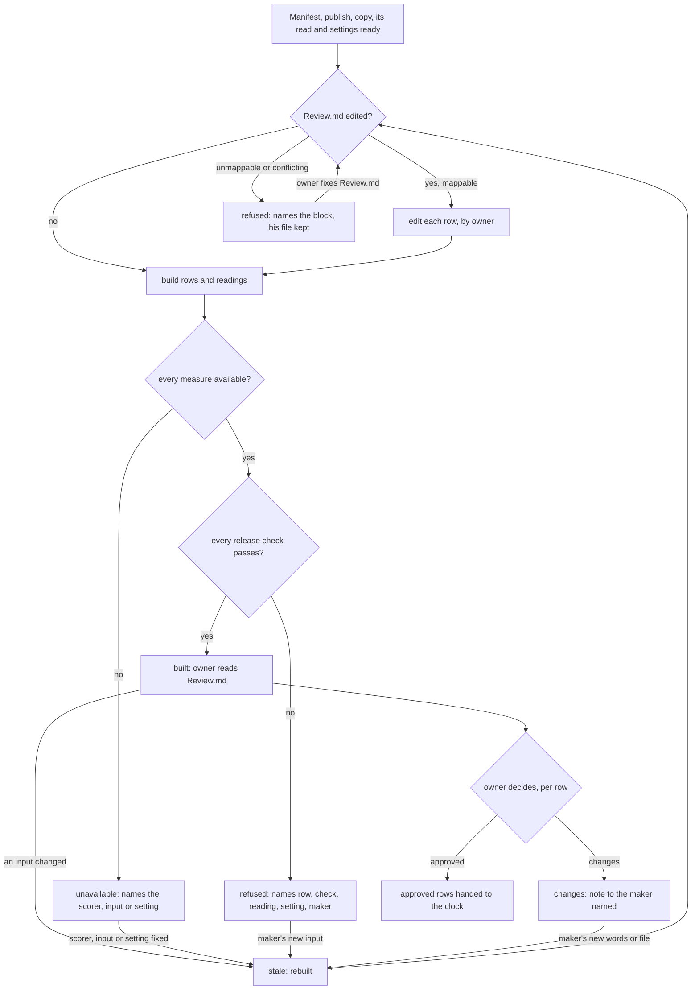

# Release: delivered files to the words that go out with them

Draft for the owner to read, queue item 39 seam 1. This is a rebuild contract, not implemented behavior.
The [spine](spine.md) runs stages declared as recipe data; C1 covers only `plain` and `shorts-only`. Item 14
([rendering](rendering.md)) owns the delivered files and the final manifest, item 18 ([captions](captions.md)) the
timed sidecars, item 15 ([QC](qc.md)) the verdict and the catalog entries that read this domain's checks, and
posting (item 11, already in this repository) sends. Item 39 owns what lies between: the titles, every word that
goes out beside a file (description, chapters, tags, per-platform captions, pinned comment, the text post), the one
release record the posting clock reads, the owner's word edits, and his decision bound to the exact words he read.
Thumbnails are owner-supplied assets in C1 (spine.md section 1); making them is the images domain's, after C1.

## 1. The release is data

Three records, paths relative to the video, hashes abbreviated, values illustrative.

`records/publish.json` and `records/copy.json` stay the packager's maker outputs (spine `titles` and `copy` stages)
in today's shapes, and `records/text_post.md` the writer's; this domain never writes them. The owner's word edits
live in their own record, `records/release_edits.json`: one entry per row ID with `text`, `by`, `at`, the words it
replaced and the `key` of the `Review.md` it came from, appended, never rewritten, so the history of a row is that
list. An edit therefore never stales the packager's copy, the writer's text or their independent reads.
`records/release.json` is built from all of them and never edited by hand:

```json
{
  "version": 2,
  "key": "sha256:4f1c...",
  "manifest": "records/final_manifest.json", "manifest_sha256": "sha256:a01b...",
  "publish": "records/publish.json", "publish_sha256": "sha256:77c2...",
  "copy": "records/copy.json", "copy_sha256": "sha256:9e30...",
  "copy_read": "records/copy_review.md", "copy_read_sha256": "sha256:51d8...",
  "text_post": "records/text_post.md", "text_post_sha256": "sha256:c3a9...",
  "text_read": "records/text_review.md", "text_read_sha256": "sha256:c4b0...",
  "edits": "records/release_edits.json", "edits_sha256": "sha256:e7d1...",
  "settings": "release.settings#sha256:0d2e...",
  "outputs": [
    {"id": "long", "file": "YouTube/main.mp4", "sha256": "sha256:aa10...", "sidecar": {"file": "YouTube/main.srt", "sha256": "sha256:bb20..."},
     "name": "A Title Without Slashes", "title": "A title without slashes", "ab_titles": ["...", "..."],
     "description": {"text": "...", "sha256": "sha256:dd31..."}, "chapters": [{"t": "0:00", "name": "..."}],
     "fields": {"tags": [], "pinned_comment": "...", "end_screen": {"start_s": 512.0, "video": null, "playlist": null},
                "category": "...", "ai_label": false, "thumbnails": [{"file": "thumbs/a.jpg", "sha256": "sha256:ee41..."}]}},
    {"id": "short-excerpt-a", "file": "Shorts/excerpt-a.mp4", "sha256": "sha256:aa11...", "sidecar": {"file": "Shorts/excerpt-a.srt", "sha256": "sha256:bb21..."},
     "name": "...", "title": "...", "cover": {"at_s": 3.2, "text": "...", "why": "..."}}
  ],
  "rows": [
    {"id": "long:youtube", "output": "long", "platform": "youtube", "words_sha256": "sha256:dd31...", "by": "packager"},
    {"id": "short-excerpt-a:tiktok", "output": "short-excerpt-a", "platform": "tiktok", "words": "...", "words_sha256": "sha256:f0a2...", "by": "owner"},
    {"id": "article:linkedin", "output": null, "platform": "linkedin", "words": "...", "words_sha256": "sha256:f1b3...", "by": "writer"}
  ],
  "readings": [{"check": "release.length", "row": "short-excerpt-a:tiktok", "value": 312, "setting": "platforms.tiktok.max_chars", "result": "pass"}],
  "review": {"file": "Review.md", "sha256": "sha256:9a9a..."},
  "state": "built"
}
```

- `key`: SHA-256 over every input's content (manifest and its members' hashes, publish, copy, its independent read,
  the text post and its read, the owner's edits, the words record) and the resolved `release.settings`; stale is
  computed from it, never stored. It records what a decision was given on; posting gates per row (below).
- `manifest`: rendering's final manifest; `outputs` are exactly its members, in its order, never a folder glob.
- `copy_read`: the story editor's independent read of the copy (spine `captions-read`); bound by hash, so a read of
  older copy cannot pass.
- `text_post`, `text_read`: the writer's text post and the story editor's independent read of it (spine `text-read`),
  bound by hash like `copy_read`; both `null` when the stage list has no `text` stage (`shorts-only`).
- `edits`: the owner's edit record; a row's words are its latest edit, else the packager's or writer's words.
- `settings`: the named profile in `release.settings` (naming, description parts and footer, per-platform limits and
  hashtag ranges under `platforms.<p>`, the platform map); each number lives there once.
  `own_urls` is `{"videos": [id], "playlists": [id]}`: end-screen links must name an owned ID of the matching kind.
  Check versions cover code, bundled settings and this host profile, including newly uploaded video IDs.
  An unreadable profile gets an error-digest version and blocks the check naming its cause.
- `outputs[]`: `file` and `sha256` from the manifest; `name` is the lead title through `release.naming`, the name a
  platform or a person is handed (upload file name, download); the delivered files keep rendering's paths. `title` and
  `ab_titles` come from `publish.json` (the lead first); `description` is built from the description parts setting
  (lead, body, steps, chapters, sources, disclosure when a chat is shown, footer, hashtags); `fields` are publish
  fields bound as data; `thumbnails` are owner-supplied files bound by hash; `cover` is a short's cover frame and text.
- `rows[]`: one per output and platform the `map` setting sends it to, plus the text post's platforms; `words` are
  exactly what posting sends (the long YouTube row's words are its `description`), `by` who last wrote them. A row
  missing from a mapped output is a refusal, never a skipped platform.
- `readings`: each check's measured fact against its named setting; a missing reading is absent, never a pass.
- `review`: `Review.md` rendered from this record (section 2); its hash lets `build` see the owner's edits.
- `state`: `built`, `refused` or `unavailable` (section 3).

`records/release_decision.json` is the owner's decision (spine `release-choice`): `release_key` (what he read),
`by`, `at`, and per row its `decision` (`approved` or `changes`), the `words_sha256` and the hashes of its output's
file, sidecar and thumbnails as he read them, and for `changes` his `note` and the `maker` it goes to. Posting reads
only rows whose approved word and file hashes equal the row's current ones, so a later word edit or a re-rendered
file clears that row alone; the send-time byte check (host `approvals.py`) stays posting's and compares against
these file hashes.

For `shorts-only`, the owner made the short: `outputs` is the short alone, the title is the one the spine's `short`
stage writes to `records/publish.json`,
there is no description, end screen, text post or title test, and every other rule is the same rows and checks.

**Required spine.md interface change:** `release` gains `records/words.json` (the his-words check reads it) and
`records/release_edits.json` (optional: absent means no edits) as inputs and `release.settings` as an external
input; `release-choice` reads `records/release.json` and `Review.md` as today, may call `edit` (section 2) before
deciding, and also writes `records/release_edits.json`. `edit` only appends there; the spine then reruns `release`,
the only writer of `records/release.json` and `Review.md`. The `release-choice` decision check binds each row's word,
file, sidecar and thumbnail hashes (`records/release_decision.json`), not the bytes of the whole `release.json`, so a
rebuild leaves every unchanged row approved: for this one decision, row hashes replace spine.md's whole-input
freshness. The engine reads it through `spine_checks.decisions` (the engine's `decisions` adapter): every row approved
on its current hashes passes, a row sent back fails to the release's producer with its note and maker, rows with
no current decision wait on the owner, and a refused, stale or unavailable release blocks.

## 2. One API

| Function | Reads | Writes and returns |
|---|---|---|
| `build(video) -> record` | the stage's declared inputs, `release.settings`, an edited `Review.md` | The `release` stage's run, and the rerun `edit` asks for. Applies the owner's `Review.md` edits through `edit` first, then writes `records/release.json` and `Review.md` beside, then renamed. An unchanged key returns the current record and writes nothing. |
| `edit(video, row, text, by) -> record` | the current release | Appends to `records/release_edits.json` (any row, `article:` rows included) and writes nothing else; the spine reruns `release` (`build`). Only that row's approval clears. |
| `decide(video, rows, by) -> decision` | the current release and its key | `rows` maps each row ID to `approved` or `{changes: note, maker}`; writes `records/release_decision.json` with each row's word and file hashes; refuses a stale or non-`built` release. |
| `check(video) -> {ok, state, next_action, detail}` | the release, the decision, the inputs' current hashes | Read only, per row: `ok` when every row is approved on its current hashes (`approved`); `waiting_owner` listing rows with no current decision; `changes` naming each row's maker and note; the record's own `refused` or `unavailable`, never ok. Posting sends approved rows while others wait. |

`Review.md` names the `key` it was rendered from on its first line and shows every row in a fenced block headed by
its row ID; each render is kept as `records/prev/review-<key>.md`. On `build`, `Review.md` is compared with the render
of the key it names: a block that differs is the owner's edit to that row and goes through `edit(by="owner")`. A
missing or unknown key, a changed block with no row ID, text changed outside the blocks, or an edited row whose
words also changed upstream since that key refuses naming it, and his file stays untouched. Nothing he wrote is
overwritten or dropped. `release.json` is renamed first and `Review.md` second; a crash between them leaves a
`Review.md` naming the older key, whose render is still in `records/prev/`, so no packager words are taken for
his; a rerun completes once.

## 3. From delivered files to a decided release



`refused` and `changes` return to the maker the check or the owner names (packager, writer, or item 14 or 18 for
a file or sidecar). `approved` hands only approved rows to posting's ledger write; a row edited after approval waits
for its own decision while the rest go.

## 4. Host steps and checks, and their replacements

`pirillo_studio/release/spine_checks.py` binds `titles`, `text-read` and `release` to the existing read-only
validators. `text-plan` remains unbound until item 39 provides a plan validator; `captions-read` awaits its
copy-read seam. `posted` remains posting's (item 11), and `decision` the spine's (item 37). The release
completion envelope (`records/checks/release.json`) is a declared `release` output in both recipes. The catalog's
`@outputs` supplies its hash as engine evidence; changing it reopens the check, and a missing or undeclared
envelope blocks by name. A refused build renders `Review.md` from its record and archives that render, replacing a page that is
still its own render; a page the owner edited stays untouched. The engine's verdict and next action therefore carry the refusal's
words to the packager, while missing declared outputs still block for every stage. The host can bind `release`.

Each `release.<name>` check below sits under one spine check id: titles checks under `titles`, the copy and its read
under `captions-read`, the text post and its read under `text-read`, everything else under `release`.

| Host | What it does, where | Replaced by |
|---|---|---|
| `publish.py release_files`, `main --release`, `REL_FIELDS`, `ledger_adds`, `short_cover_at`, `short_broll_count` | Builds description, release fields (tags, card, poll, pillar, thumbnail text and the rest), ledger rows, a short's cover time and B-roll count, `release.json`, `review.md`, `Review.md`, `youtube_ends.json`; gate first, nothing on refusal | `build`; the end screen is an output field, no separate file |
| `publish.py` previous-delivery fallback (release_files) | Reuses the last delivery when nothing new is made | Deleted: outputs are the current manifest's members; a missing member refuses |
| `publish.py description`, `DISCLOSE`, footer file | Fixed-order parts; more than 3 hashtags exits; angle brackets swapped | Description parts and footer in `release.settings`; the hashtag count is `release.hashtags`, once |
| `publish.py clean`, `delivered_name`, `rename_delivered`, `place` | File names from the lead title; renames delivered files | `name` per output through `release.naming`; delivered files are never renamed (rendering's paths) |
| `publish.py release_changes`, `--dry` | Diff of what a rebuild would change | `build` on a copy returns the new record; the Board shows the row diff |
| `publish.json` `vertical_routes`, `publish.py validate_vertical_routes`, `release_routes.py` | Moves a platform's copy from long to vertical; allowed routes | The `map` setting sends each output; a route outside it refuses at build |
| `publish.py tag_arms`; `studio.py TAG_ARMS`, `tag_arm_for`, `arm_tags`, `tests` | Hashtag-count test arms per short | Out of C1 scope: growth tests (item 22); C1 rows carry one count from `platforms.<p>` |
| `studio.py CAPTION_PLATFORMS`, `caption_arm_for`, `full_caption`, `caption_body` | Caption-length test arms | Out of C1 scope: growth tests (item 22) |
| `studio.py ingest`, `ingest_adds`, `release_items`, `map_for`, `release_mark` | Ledger rows from the release; long YouTube `desc_sig` | `rows`; posting's ledger write reads approved rows; every row's hash replaces `desc_sig` |
| `studio.py check_words`, `sent_words`, `sent_problems`, `sent_report`, gate `sent` | His words and as-sent re-checked at ingest | Gone: the row's words are what is sent and were checked at build |
| `studio.py approve_video`, `approve_part`, `approve_gate`; the ledger's `approved_sha256s` | Approval on ledger rows after `final` and `copy` verdicts | `decide`, per row, bound to word and file hashes; the verdicts are spine checks before `release` |
| `approvals.py` (`check`, `opened`, `send_block`, `revoke`, fit receipts) | Bytes leaving the studio must be bytes he approved | Posting (item 11) keeps the send-time check, reading the decision's file hashes; a fit is rendering's measured file with its parent hash |
| `studio.py done --words-read`, posted receipts, send records | What was sent and read back | Posting (item 11) owns sends and receipts (spine.md section 2); this domain owns only the words and the decision |
| `studio.py release_behind`, `copy_ready`, `copy_waits`, `MILESTONES` release | Whether copy or the release is behind | Spine `next` from stage records and `key` |
| `studio.py text_post`, `COPY_FROM`, `map.article`, `article_own_words`, `article_after_days` | Text-post fallback chain; one platform's copy reused for another | Text post rows from `text_post.md` only, no fallback chain; `COPY_FROM` becomes explicit rows (a copied row says `by`); day offset is posting's |
| `studio.py cover_words`, `COVER_TEXT_WORDS`, `cover_text_problem`, `cover_hold` | Cover text word count and hold | `release.cover` check against `release.settings` |
| `studio.py prepare_release_media` | Platform fits after the release is written | Rendering (item 14); fits are measured files it declares |
| `studio.py chrome_jobs` pinned comment, `youtube_extras`, `captions_due`; core `youtube_posts.py`, `scheduling.py` | Read `release.json` long fields, sidecar, shorts' cover and B-roll flag | The same fields from version 2 by output ID; posting keeps reading through `release_path` |
| `review_titles.py`, `Review.md` writer, `write_review_calendar` markers | The three titles block, post package, every post word for word | `Review.md` rendered from the record with row blocks; the calendar block stays posting's |
| Pipeline skill: diff `Review.md` against `review.generated.md`, route edits by hand | The owner's edits come back by hand | `build` reads edited blocks through `edit` |
| `publish.py release_gate`; `qc.py release_misses`, `release_notes`; `checklist.json` `gate: release` | Release gate; a field-reader error a miss, a runner error a fail | Release checks in the record; QC's catalog entry reads it (qc.md); every error is `unavailable` |
| `qc.copy.his-words`, `qc.copy.same` (`run_wordcopy_check`); `wordcopy.py check`, `same`, `not_his`, `copy_problems`; `studio.py check_copy`, `copy_captions` (each caption with the published captions it was picked from) | Copy is his words, not repeated across platforms; run three times | `release.his-words`, `release.same` once at build, reading `words.json` |
| `qc.copy.do-not-say`, `qc.copy.literals`, `qc.release.own-urls` | Banned phrases, placeholders, own links | `release.do-not-say` (phrases in settings), `release.literals`, `release.own-urls` |
| `qc.copy.hashtags`, `qc.copy.length`; `wordcopy.py LIMITS`, `POST_MAX`, `LINK_ROOM`; `platforms.<p>` | Per-platform limits in three places | `release.hashtags`, `release.length` against `platforms.<p>` alone; the other copies deleted |
| `qc.copy.threads-topic`; `wordcopy.py topic_problems` | One topic tag, fresh | `release.topic` |
| `qc.copy.search-phrase` (`run_social_search`, `run_search_phrases`); `wordcopy.py phrase_report` | A searched phrase present | `release.search-phrase`, warn per `qc.rules` |
| `qc.copy.cover-text`, `qc.copy.cover-text-read` | Cover text rules; a checker reads it | `release.cover`; the read is a QC manual row |
| `qc.copy.review` (`run_copy_review`) | The read is newer than copy and has no "DOESN'T READ" row; not release-gated | `copy_read` and `text_read` bound by hash; any "DOESN'T READ" row refuses at build |
| `qc.copy.as-sent` (`run_as_sent`) | Words as they will send | `rows[].words` are the sent words; check gone |
| `qc.chapters.times` (`run_chapters`) | Chapter times near a cue | `release.chapters` reads item 18's long cue record |
| `qc.release.complete` (`run_release_complete`) with `shorts_only`, `recipe_absent` | Every required asset and copy present, exempting by recipe | `release.complete` over manifest members and the `map` setting; no recipe branch |
| `qc.release.names` (`run_delivered_names`) | Delivered names follow the spec | QC's delivered check reads `outputs[].name` (qc.md) |
| `qc.titles.three`, `signals`, `why`, `howto`; `studio.py TITLE_SET`, `why_problems` | Three titles, length, a why with evidence, a how-to shape | `release.titles` at the `titles` stage, reading `publish.json` |
| `qc.titles.scored`, `qc.titles.research`; `title_score_problems`, `title_research_problems` | External title score and search research, at titles and again at release | `release.titles` once, at `titles`; a scorer that cannot be reached is `unavailable` |
| `qc.titles.proof`, `qc.copy.claims`, `slop`, `hashtags-product`, `qc.textpost.his` | Checker judgments | QC manual rows bound to this record's key |
| `qc.copy.long-url` | A hand check of the long video's link | `release.own-urls` with posting's `{long_url}` fill |
| `qc.textpost.lint`, `length`, `reads`; `wordcopy.py headline_problems`, `HEADLINE_GATE`; writer's length rule | Text post lint, LinkedIn length, its read | `release.text` at the `text` stage and in `rows`; length from `platforms.linkedin` |
| `qc.textpost.still`, `still-read` | A generated still for the text post | Out of C1 scope: images; spine.md's retained text path needs no generated still |
| `qc.sp.ai-label`, `paid-link`, `browser-route`, `review-line` | Standards-and-practices rows on release words | `fields.ai_label` and a disclosure part in settings, checked by `release.disclosure`; route rows are posting's; review-line a QC manual row |
| `qc.sp.wrong-post`, `fact-wrong` (stage post) | After posting | Posting (item 11) |
| `qc.titles.*` thumbs rows, `run_thumbs_*`, `run_testcompare`, `brief_problems`, `brief_held`, packager brief stage | Thumbnails made from a brief, title test | Out of C1 scope: images (item 19) and growth tests (item 22); C1 binds owner-supplied thumbnail files |
| `recipe_never.py RECIPE_SKIPS_RUNS`, `stages.py less()` waits on `shorts_spec.json` | Recipe exemptions | Deleted: the stage list is the recipe (spine.md) |

## 5. What the owner expects, as named contract tests

These are required build-seam tests, not tests added or claimed run by this document.

1. `test_every_mapped_platform_has_its_row`: flowchart built end: each manifest member gets one row per platform the
   `map` setting names; a missing row refuses naming output and platform; nothing is skipped silently.
2. `test_rows_are_what_is_sent`: posting's ledger write receives each approved row's words byte for byte; the long
   YouTube row's words are its description; no other copy is consulted.
3. `test_words_are_his_and_within_limits`: his-words, same, do-not-say, literals, own-urls, hashtags, length,
   topic and cover readings each compare to one named setting; one failing refuses naming row, check, reading,
   setting and maker (flowchart refused end).
4. `test_a_missing_scorer_is_unavailable`: the title scorer or a setting missing gives `unavailable` naming it;
   `check` is never ok; no default number is used (flowchart unavailable end).
5. `test_review_edits_come_back`: an edited row block in `Review.md` becomes that row's words with `by: owner` in
   `release_edits.json`, the replaced words kept; the rebuilt `Review.md` shows it; copy.json is unchanged.
6. `test_unmappable_edit_refuses_and_keeps_his_file`: an edited block without a row ID, or on a row changed upstream,
   refuses naming it and nothing he wrote is overwritten (flowchart refused end, edit branch).
7. `test_an_edit_clears_only_its_row`: after approval, editing one row clears that row's approval; posting sends
   the other approved rows and holds the edited one for its own decision.
8. `test_decision_binds_what_was_read`: `decide` on a stale release refuses; posting reads no row whose words,
   file, sidecar or thumbnail hash differs from the approved one; a re-rendered file with the same words waits for
   a new decision (flowchart approved end).
9. `test_stale_read_cannot_pass`: a `copy_review.md` or `text_review.md` bound to older words, or one with a
   "DOESN'T READ" row, refuses; an owner edit leaves both reads current.
10. `test_unchanged_inputs_write_nothing`: a second `build` on the same content writes nothing; changing one input
    or setting makes the release stale and the rebuilt record differs only there (flowchart stale end).
11. `test_owner_short_release`: `shorts-only`: one output, the title the `short` stage writes to `publish.json`, no description, end screen, text
    post or title test, every row rule the same.
12. `test_delivered_files_are_never_renamed`: `build` leaves every manifest member's path and bytes unchanged;
    `name` follows `release.naming`.
13. `test_crash_leaves_nothing_finished`: kill between `release.json` and `Review.md`; no reader sees a half release,
    the next `build` reads `Review.md` against the key it names and takes no packager words as his, and a rerun
    completes once.
14. `test_changes_go_to_the_maker`: flowchart changes end: a row decided `changes` records the note and maker,
    `check` names them, and posting sends nothing for that row while the approved rows go.
15. `test_switch_off_is_unchanged`: with the host switch off a committed fixture gives a byte-identical host
    release; on, every C1 release calls this API and never the host writer on an error.

Live check: `python3 tools/release_contract.py run --video "$VIDEO_FOLDER" --out "$RELEASE_PROOF"`

Proposed acceptance command for the build seam, not an existing executable. The Mac lead supplies the owner's
chosen real video folder (one `plain`, one `shorts-only`) and a separate evidence folder. Build the release into
evidence only, check contracts 1 to 3 and 12 on it, apply one edit through `Review.md` on the copy, then a second
unchanged build showing nothing written. Nothing is sent.

## 6. One switch, then delete

The host's sole switch is the video's adoption onto the spine (the host's `spine` switch and its per-video adopt;
the host's `release` key holds its release profile, not a switch). On an adopted video the spine's `titles`, `copy`,
`text`, `release` and `release-choice` stages call this API (the release stage's run is the host's
`spine_host.py release <slug>`, which builds and prints the envelope) and the clock ingests `rows`; every other video
keeps the host path byte for byte; on cannot fall back.

The switch-and-delete landing removes, for C1 paths: in `publish.py` `release_files`, `release_gate`,
`release_changes`, `description`, `clean`, `delivered_name`, `rename_delivered`, `place`, `vertical_routes`,
`tag_arms`, `text_post`, `shorts_list`, `SHORTS_ONLY` and `--release`, `--rename` and `--dry`; `release_routes.py`;
`review_titles.py`; in `studio.py` `ingest`, `ingest_adds`, `release_items`, `map_for`, `release_mark`,
`release_behind`, `copy_ready`, `copy_waits`, `check_words`, `sent_words`, `sent_problems`, `sent_report`,
`check_copy`, `copy_captions`, `approve_video`, `approve_part`, `approve_gate`, `COPY_FROM`, `text_post`,
`cover_words`, `COVER_TEXT_WORDS`, `cover_text_problem`, `TITLE_SET`, `why_problems`; `wordcopy.py`'s checks and
`LIMITS`, `POST_MAX`, `LINK_ROOM`; `recipe_never.py`; the release and copy rows of `checklist.json` and `qc.py`
named in section 4; and their tests. `wordcopy.py`'s sentence and phrase finders stay the packager's tool.
Growth-test arms keep their host path until item 22 switches. No deletions occur in this seam.

## 7. Failings this contract ends

- The owner's edits to `Review.md` come back only when someone diffs it against `review.generated.md` and routes
  them by hand (pipeline skill, APPROVED step). Contracts 5 to 7. The source names no issue.
- `--release` writes a release while `copy_review.md` still has a "DOESN'T READ" row: `qc.copy.review` has no
  release gate. Contract 9. No issue ID.
- His words are checked three times (qc row, packager done, ingest) and the hashtag count four times (description
  writer, qc row, ingest, test arms), with three homes for platform limits. Contract 3, one setting each.
- A word change after approval is caught only on the long YouTube row (`desc_sig`). Contracts 7 and 8, every row,
  words and files.
- Recipe exemptions live inside runners (`shorts_only`, `recipe_absent`, `RECIPE_SKIPS_RUNS` applied in `run_stage`
  but not `release_misses`), and several title and link rows have none. Contract 11; the stage list decides.
- The release falls back to a previous delivery when nothing new was made, and a field-reader error counts
  differently from a runner error. Contracts 1 and 4.
- Delivered files are renamed after the manifest is written, so every reader follows a moving name. Contract 12.
- #898 (named at the host's live title and thumbnail change and in posting): out of C1 scope; posting's.

This seam changes no runtime behavior. Item 39 stays `building` through implementation, live proof and deletion.
