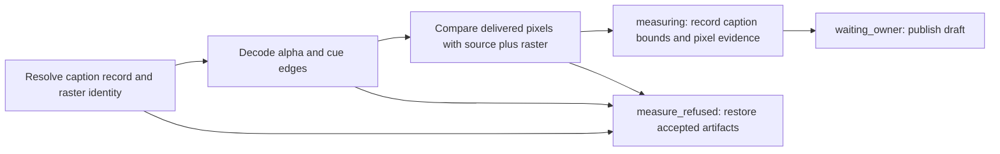

# Caption rasters and accepted artifact recovery

## Native tall burns (2h part 10)

Native arc/draft renders with a tall profile now consume the same supplied raster binding as wide renders.
The raster is already on the output's tall pixel grid; it is never cropped or scaled with the source.
The compositor applies source color conversion, approved grades and tall crop/scale first, then composites
the straight-alpha caption pixels. The existing raster contract below owns identity, cue edges, alpha,
safe bounds and every-frame pixel proof. Failed or interrupted burns use the same accepted-artifact recovery.

This is a rendering capability, not a new caption layout or glyph rasterizer. Item 18 chooses its layout
from output identity: arc/draft generates wide sidecars; a provider supplies the burn and native-size raster
on that current caption record. See [master composition](rendering-correspondence.md) and [card layers](rendering-cards.md) for their supported scope.
The `shorts-only` recipe imports supplied finished media through `measure_existing`, preserving its bytes;
it does not require or authorize a new native burn. This part does not change that recipe.

Contracts decode a tall graded output and independently compute every RGB channel's straight-alpha blend,
including partially transparent pixels at the safe rectangle's edges and transparent frames around cues.
They also check the existing grade oracle, current raster reuse, missing/stale/aliased assets, wrong dimensions,
missing alpha, non-finite safe bounds, unsafe pixels, cue-edge errors and accepted-artifact recovery.

## Bound rasters and recovery (2e and 2f)

Built: one public item 18 artifact-name helper, clocks derived once from integer frames, sample-based
voice trimming at fractional frame rates, and recovery of accepted voice/caption/SRT bytes with the video.
`previous.artifacts` records generated paths and their accepted hashes (including optional burn);
`artifact_work` records an interrupted artifact backup for recovery. Backups use the existing content-addressed
render lifecycle, are restored on failure/retry, and retired on success. `previous.current` saves attempt-start
hashes separately: drifted bytes are backed up under their own identity; only initially absent files are removed.
Cached re-measurement makes no generated backup copies. Committed restart retires pending backups without rolling back accepted output.
Caption-record restoration holds the same writer lock as caption generation.
Caption burns supplied by a renderer adapter are measured against their bound raster, including its alpha
edges and the profile's safe rectangle. Native wide/tall arc/draft composition accepts provider-supplied burns;
item 18 still owns cue generation and caption layout.

A burning adapter supplies `caption_binding.raster = {file, sha256, burn_sha256}` beside the existing
caption `record` and `sha256`. `burn_sha256` names that caption record's exact ASS burn. The raster is a
full-output, straight-alpha video on the output frame grid, with one frame per output frame and no scaling.
It includes transparent frames outside cue intervals. Its colors and alpha are trusted resolved glyph pixels,
not a claim that rendering can independently shape text from ASS. All assets enter the request identity.
A burning profile must supply `caption_safe: [x, y, width, height]` in output pixels; no safe area is inferred.
Every nonzero-alpha pixel must be inside it. Visible raster frames must exactly match cue intervals on the
output grid (a frame is active when its timestamp is at or after cue start and before cue end).
Readings retain `captions.value.raster` with the raster hash, safe rectangle, and coalesced alpha-bound
intervals: `bounds: [{frames: [start, end], box: [x, y, width, height] | null}]`. Intervals are half-open
output frame ranges covering the output; equal adjacent boxes share one interval. Cue-time errors name
the cue time field rather than `video.fps`.
Every delivered RGB frame is compared to the bound source/cover plus that raster, proving burn presence,
placement and timing. ASS-only burns, missing/unbound/stale rasters, missing alpha, unsafe pixels and
mismatched cue edges refuse by the `captions` reading. Missing or unsupported coverage never passes.

The production compositor accepts a caption record with `raster: {file, sha256, burn_sha256}` when
that record has a burn. A provider adds the burn and raster metadata to the current caption record after
initial sidecar generation; it preserves the caption key and supplies matching file hashes. Re-rendering
binds this asset as `caption_binding.raster`, overlays the raster
and verifies the delivered composite. It does not generate glyph pixels from ASS. Native tall crops/grades
are specified in [part 9](rendering-grade.md); card and master scope is defined in [cards](rendering-cards.md) and [master composition](rendering-correspondence.md).
Missing raster data or stale identity refuses by name. Publication and
reuse revalidate the generated caption record plus its referenced burn/raster bytes before accepting them.

The current seam inventory and remaining named refusals live in [rendering](rendering.md).
Default profiles retain every required check; this seam does not claim complete plain-recipe delivery.

Recovery keeps a `retiring` marker in the committed record until its predecessor backups are retired.
An interruption before that marker is cleared repeats retirement safely; committed media is never restored.

