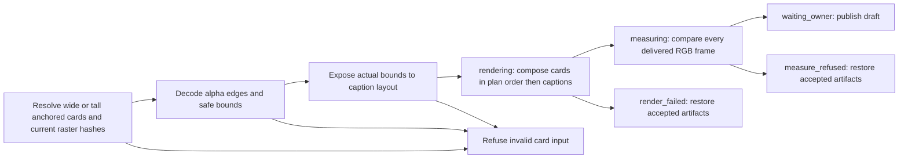
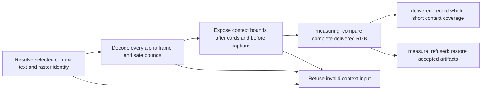

# Card and whole-short context rasters (2h parts 11, 12 and 16)

The plain recipe resolves overlays before arc and draft review. This seam supplies its
wide (part 11) and tall (part 12) layers before master correspondence/composition.
Item 17 owns the words and anchors; rendering never invents text, duration or layout.

An overlay-plan card has `id`, `kind` (`instruction` or `context`), `text`,
`anchor: [first_word, last_word]`, and `raster: {file, sha256}`. Covers keep their
existing opaque-asset contract. Non-cover rasters are full-output straight-alpha
videos, one frame per output frame at the profile rate, in output RGB coordinates.
The supplied hash must match the bound input bytes. A profile with these cards must
supply `cards_safe: [x, y, width, height]`; every nonzero-alpha pixel must fit.
No scaling, cropping, inferred safe area or text rasterization is performed on these layers.
Tall rasters use the native tall output dimensions and the same voice-clock anchors,
including fractional edges, J-cuts and repeated cold opens. Source crop/push and grade
run first, then cards in plan order, then captions. A wide raster cannot stand in for
a tall one. Opaque hidden-picture covers retain their existing asset/frame-hold
contract in both shapes. Tall covers must match `video.sizes.tall` exactly; mismatched
dimensions refuse by name. Wide covers retain scaling. Every hidden frame is compared
with its cover, and only those frames are excluded from subject coverage.

Anchors use the first word start and last word end on the source clock, mapped to
each kept occurrence on the voice frame map. A frame is active at or after the
start and before the end (ceil both edges). Repeated cold opens repeat the card.
An anchor crossing a kept piece, missing an occurrence, collapsing on the grid,
or using patch/retimed speech refuses by name. J-cuts retain the voice anchor even
while the picture clock differs. Rasters are transparent outside these intervals;
missing alpha, wrong dimensions/rate/count and unsafe or mistimed pixels refuse.

Readings retain each card's identity, hash, safe rectangle and coalesced alpha bounds
under `cards.value.rasters`. The frame comparison includes cards and captions in
that order. Card acceptance covers the complete output, including transparent gaps,
so omitted, shifted or lingering pixels fail. Resolved `elements` expose actual
visible bounds to item 18 before cue layout; measurement recomputes them.
A context card is an anchored layer in either shape, not proof of whole-short context or text
readability. Supplied glyph pixels and text remain authored inputs.

Part 16 adds whole-short context below, reused by native individual shorts in part 17.
[Native long/full vertical composition and split-clock correspondence](rendering-correspondence.md) reuse this seam separately.
Extra whole-short timing/layout fields refuse in the anchored-card contract; supplied-short encoding remains unsupported.
Existing grade, crop, caption, voice and rollback guarantees stay in their owning modules.

Part 12 contracts decode tall outputs against an independent per-pixel alpha
calculation, including overlapping layers/captions after grading, push/J-cut and
cold-open timing, native opaque cover holds, stale/missing identities, symlinks,
non-finite/missing safe areas and interrupted publication. Missing layers fail
delivered-frame measurement; unchanged requests reuse their accepted bytes.

## Whole-short context (part 16)

A selected excerpt's `stands_alone` is either `{opens_on_subject: true}` or
`{context: <exact settled line>, raster: {file, sha256}}`. The latter supplies a
full-output straight-alpha raster, visible from frame zero through the last output
frame. The text remains unchanged in the request and reading; rendering neither
invents nor truncates it. The provider owns glyph accuracy and readability, as for
anchored cards. Decoded pixels prove raster placement and persistence, not spelling.

This layer follows overlay-plan cards and precedes captions. Its identity is
`short-context:<short-id>`; duplicate layer identities refuse. The shared card
contract requires the current raster hash, output dimensions/rate/count, nonempty
alpha on every frame and `cards_safe` bounds. Its decoded bounds join `elements`
before caption layout. A whole-short flag on an overlay-plan card remains refused:
the selected short owns the context, not a word anchor shared by other outputs.

The context reading contains the exact settled text, raster hash, safe rectangle,
actual alpha bounds and complete frame count; it passes only with the delivered
picture comparison. Omitted or altered output layers fail. Missing/stale hashes,
symlinks, non-finite safe bounds, transparent gaps, missing text or contradictory
opening declarations refuse by name. The subject-opening alternative needs no
context raster. The renderer version changes so old coverage cannot be reused.

The shorts-only recipe still measures supplied media unchanged and has no settled
short context input. This seam supplies context for the [native individual-short compositor](rendering-correspondence.md);
final-manifest integration remains queued.
Contracts decode every delivered frame against an independent alpha calculation,
check content identity/reuse, named refusals and interrupted-publication recovery.
