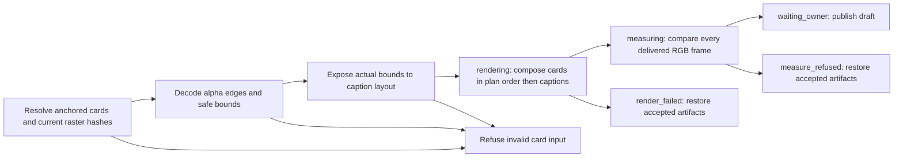

# Wide anchored card rasters (2h part 11)

The plain recipe resolves overlays before arc and draft review. This seam supplies its
wide non-cover layers before tall cards and master correspondence/composition.
Item 17 owns the words and anchors; rendering never invents text, duration or layout.

An overlay-plan card has `id`, `kind` (`instruction` or `context`), `text`,
`anchor: [first_word, last_word]`, and `raster: {file, sha256}`. Covers keep their
existing opaque-asset contract. Non-cover rasters are full-output straight-alpha
videos, one frame per output frame at the profile rate, in output RGB coordinates.
The supplied hash must match the bound input bytes. A profile with these cards must
supply `cards_safe: [x, y, width, height]`; every nonzero-alpha pixel must fit.
No scaling, cropping, inferred safe area or text rasterization is performed.

Anchors use the first word start and last word end on the source clock, mapped to
each kept occurrence on the voice frame map. A frame is active at or after the
start and before the end (ceil both edges). Repeated cold opens repeat the card.
An anchor crossing a kept piece, missing an occurrence, collapsing on the grid,
or using patch/retimed speech refuses by name. J-cuts retain the voice anchor even
while the picture clock differs. Rasters are transparent outside these intervals;
missing alpha, wrong dimensions/rate/count and unsafe or mistimed pixels refuse.

Readings retain each card's identity, hash, safe rectangle and coalesced alpha bounds
under `cards.value.rasters`. The frame comparison includes cards and captions in
that order. Card acceptance covers the complete output, including transparent gaps,
so omitted, shifted or lingering pixels fail. Resolved `elements` expose actual
visible bounds to item 18 before cue layout; measurement recomputes them.
A context card is an anchored wide layer, not proof of whole-short context or text
readability. Supplied glyph pixels and text remain authored inputs.

Native tall cards, whole-short context, split-clock master correspondence and
native masters remain outside this seam and refused. Existing grade, crop, caption,
voice and rollback guarantees stay in their owning modules.
