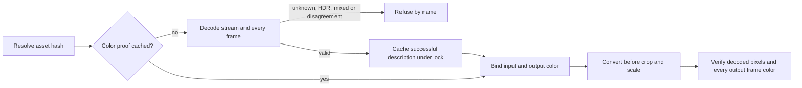

# Decoded color conversion

Seam 2h part 7: each native picture row binds `color_conversion: {input, output}`,
with `color_primaries`, `color_transfer`, `color_space` (matrix), and `color_range`.
`color.inspect` reads the selected video stream AND every decoded frame. All four
fields must be present, supported, constant across frames and equal to the stream's
declared description. Container tags alone never establish color. Successful proofs
are memoized by asset SHA-256 under the compositor's probe lock; refusals are not.
Input hashes and the renderer version bind this declaration into the request identity.

Supported input primaries and matrices: BT.709, SMPTE170M and BT470BG (BT.601).
Supported transfers: BT.709, SMPTE170M (the same transfer curve), and BT470BG (gamma 2.8).
Supported ranges: `tv` (limited) and `pc` (full). Output primaries, transfer and matrix
must be BT.709; either output range is supported. The profile's pixel format must
match the decoded output (for example `yuvj420p` for full-range H.264).
One explicit FFmpeg `colorspace` operation converts transfer, primaries, matrix and
range before cropping/scaling, without its fast approximation; equal descriptions
leave pixels untouched. Covers use the same binding. Odd-sized conversions refuse
by name because this filter requires even dimensions. Unknown/unspecified values,
mixed frame colors, decoded/declared disagreement and unsupported profiles refuse.
PQ (`smpte2084`) and HLG (`arib-std-b67`) refuse as HDR requiring tone mapping.
Grades and tone mapping remain outside this seam and refuse.

Pixel verification rechecks decoded source color against the binding and applies its
conversion before comparison. The existing `color` frame check verifies output tags,
pixel format and SAR on every delivered frame. Contract fixtures decode source and
output YUV independently: inverse YCbCr matrix/range, inverse transfer, D65 primary
conversion, then BT.709 transfer predict RGB. Flat patch interiors on every frame
must be within 3/255 per channel, allowing 8-bit YUV quantization and integer filter
rounding without hiding matrix or range mistakes; chroma boundaries are excluded.

