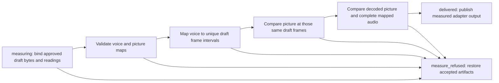

# Split-clock master correspondence (2h part 13)

The plain recipe approves a draft before masters. Correspondence is the measurement
prerequisite for that delivery: an adapter-supplied long, full vertical or short
must preserve the approved voice and picture independently. Native master composition
remains refused; shorts-only still measures its supplied media without encoding it.

Full outputs preserve every voice frame, including patch identity and silent
expressions. Picture identity follows actual sampled source indices, opaque cover
identity and timing, independently of voice boundaries. Different push crop-run
partitions are compared frame by frame. Long outputs also preserve crops; vertical
outputs retain their own independently measured native crops and subject coverage.

Shorts require one unambiguous approved voice occurrence per kept piece. Integer
output-frame offsets locate the draft intervals used for both picture and sound.
A J-cut cannot borrow a picture occurrence from another part of the draft, and a
repeated cold open cannot silently choose between two voice occurrences. Silent
retimed short correspondence refuses by name because its local zero-based voice
clock cannot identify an excerpt. Full silent expressions remain supported.
Existing partial-patch and partial incoming J-cut refusals remain in the clock owner.

Draft media, readings and request identities must agree. Long correspondence compares
the decoded output with the viewed draft; tall correspondence combines the accepted
draft frame proof with every output frame's independently measured source mapping.
The complete output sound is compared with the same approved draft intervals. Missing,
stale or failed evidence never substitutes for a pass. No correspondence helper writes
media or records; publication and interrupted-write recovery remain lifecycle-owned.

Whole-short context and native master composition are the remaining 2h delivery pieces.

Contracts independently encode the J-cut fixture, decode every delivered frame and
check the expected source indices. A changing-gray source proves 60-to-30 sampling
and wide/tall pushes against independently decoded RGB, including different crop-run
partitions. They also exercise short offsets, repeated-occurrence refusal, altered
picture/audio, stale identities, symlinks, non-finite input and interrupted publication.
