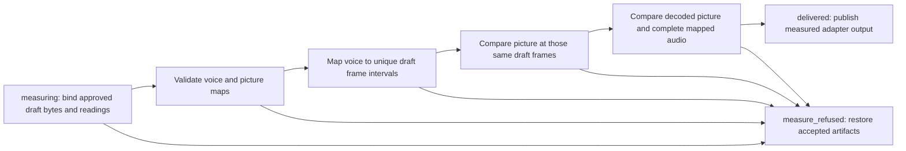
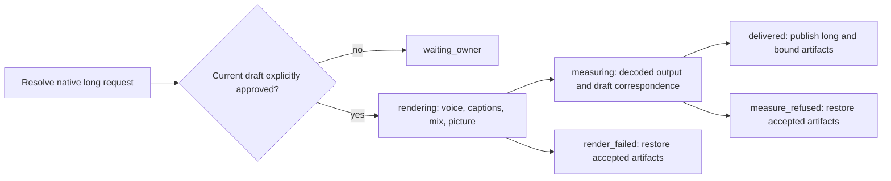
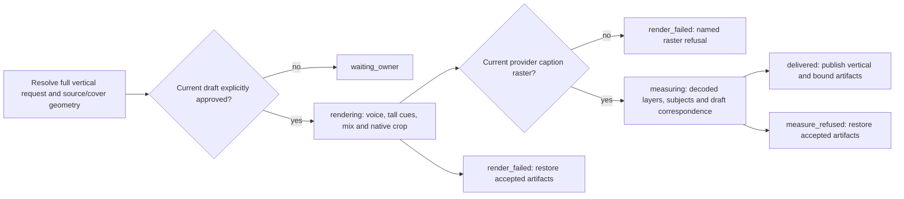
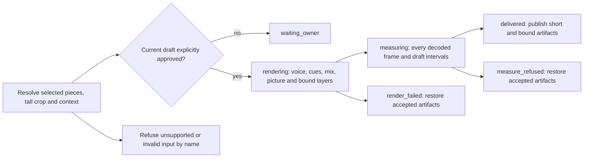
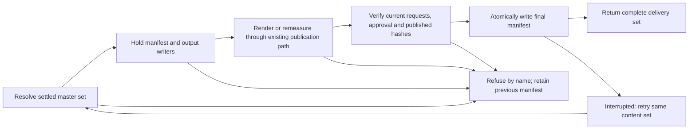

# Master correspondence and native master composition (2h parts 13/14/15/17/18)

The plain recipe approves a draft before masters. Correspondence is the measurement
prerequisite for that delivery: an adapter-supplied long, full vertical or short
must preserve the approved voice and picture independently. Native long, full vertical and individual short composition use that same proof; shorts-only still measures its supplied media without encoding it.

Full outputs preserve every voice frame, including patch identity and silent
expressions. Picture identity follows actual sampled source indices, opaque cover
identity and timing, independently of voice boundaries. Different push crop-run
partitions are compared frame by frame. Long outputs also preserve crops; vertical
outputs retain their own independently measured native crops and subject coverage.

Shorts require one unambiguous approved voice occurrence per kept piece. Integer
output-frame offsets locate the draft intervals used for both picture and sound.
A J-cut cannot borrow a picture occurrence from another part of the draft, and a
repeated cold open cannot silently choose between two voice occurrences. Silent
retimed short correspondence refuses by name because its local zero-based voice
clock cannot identify an excerpt. Full silent expressions remain supported.
Existing partial-patch and partial incoming J-cut refusals remain in the clock owner.

Draft media, readings and request identities must agree. Long correspondence compares
the decoded output with the viewed draft; tall correspondence combines the accepted
draft frame proof with every output frame's independently measured source mapping.
The complete output sound is compared with the same approved draft intervals. Missing,
stale or failed evidence never substitutes for a pass. No correspondence helper writes
media or records; publication and interrupted-write recovery remain lifecycle-owned.

## Native long composition (part 14)

The plain recipe's first master output is the long file. Its native compositor now
runs the same voice, captions, bed, card and picture pipeline used by the approved
draft. The lifecycle permits encoding only after an explicit current draft approval;
complete decoded voice/picture correspondence is required before publication.
Long-specific encoding settings remain content-bound. Generated voice, mix, caption
record and sidecar use the long output's identity and existing recovery transaction.

Part 15 adds native full vertical masters below. Whole-short context is built in [part 16](rendering-cards.md). Part 17 adds native individual short masters below; unsupported master outputs keep their named
refusal. Shorts-only continues to measure supplied media unchanged. Part 18 below integrates these outputs into the final manifest; the host switch remains separate.

The renderer identity advances to invalidate earlier cached requests. Contracts
independently decode every frame of a changing-gray source at 60/30 and
60000/1001-to-30000/1001 rates, calculate the J-cut's expected source indices and
compare complete prepared voice samples with independent source slices. They also
check negative approval choices, sidecar delivery, reuse, named refusals and recovery.

Contracts independently encode the J-cut fixture, decode every delivered frame and
check the expected source indices. A changing-gray source proves 60-to-30 sampling
and wide/tall pushes against independently decoded RGB, including different crop-run
partitions. They also exercise short offsets, repeated-occurrence refusal, altered
picture/audio, stale identities, symlinks, non-finite input and interrupted publication.

## Native full vertical composition (part 15)

The plain recipe needs its full vertical master after the long master. It now uses the
same native pipeline, approval gate, independent split-clock correspondence and recovery.
The unique `full: true` shorts-spec entry selects the complete locked plan; it never
substitutes individual short pieces. Tall crop/subject, card and caption checks remain
required. The renderer identity advances so earlier cached requests cannot be reused.

Item 18 generates tall cues and ASS; its provider supplies resolved glyph pixels through
the existing [caption raster contract](rendering-captions.md). A first attempt without
that raster refuses after retaining the generated cues. The provider binds a raster to
the current burn hash, then retries. ASS-only output never passes. No automatic font or
text rasterizer is introduced. Every delivered frame includes the native crop followed
by the bound layers, with source/cover and caption identities checked again on reuse.

Source and cover rows now share one geometry check before stored dimensions become crop
coordinates. Known non-square sample aspect ratios and display rotation refuse by name;
the compositor does not silently stretch or auto-rotate them. Missing and `0:1`
sample aspect ratios mean unspecified square pixels, as in FFmpeg. Tall covers still
must match the native output dimensions. Existing unrotated square-pixel input retains
its crop. Part 17 adds individual native shorts; supplied-short encoding remains
unsupported; shorts-only still measures its supplied media unchanged.

The vertical contract independently computes the J-cut crop intervals, decodes all 24
frames of a spatially varying source through those explicit crops, and computes caption
alpha blending per pixel. It compares the full prepared voice against independent source
sample slices and checks negative approvals, stale identity, non-finite settings, symlink
refusal, reuse, interrupted publication and restoration of accepted artifacts. Separate
real-media fixtures prove rotated/non-square source and cover refusals. The long contract
now also proves that changed draft settings invalidate an earlier owner approval for
both long and vertical masters. A real `setsar=0` fixture with no stored SAR proves
source and cover acceptance; the geometry check also accepts explicit `0:1` metadata.

## Native individual short composition (part 17)

A selected short now enters the same native compositor as long and full vertical
masters. Its settled pieces keep their order, source offsets and trims; rendering
only snaps them to the output grid. Native tall crops, prepared voice, bed, cues,
provider caption rasters and whole-short context use the existing shared owners.
The output and generated artifacts use the selected short's identity. Each piece
must still have one unambiguous approved-draft occurrence, and picture and sound
must correspond to those same draft intervals before publication.

The caption provider supplies glyph pixels bound to the current short burn, as for
full vertical output. Context uses the authored whole-short raster described in
[part 16](rendering-cards.md); a subject-opening short has no context layer. The
cutting contract owns which opening declaration is valid. No raster writer is
added to cutting. Cache identity advances with this compositor change.

Partial incoming J-cuts, partial patches, silent retimed short correspondence and
ambiguous repeated draft occurrences retain their named refusals. Supplied shorts
remain measurement-only. Part 18 integrates the native masters into the final manifest.

## Final-manifest integration (part 18)

`rendering.delivery.finalize(video)` completes the `masters` stage's native delivery set.
It derives long, full vertical and every individual short from the settled shorts spec,
never from a filename scan or a second edit clock. It holds the existing output writers
while running the same render, coverage and publication transaction for each output.
A refusal names the output and original reason; no partial final manifest is published.
The current draft approval and every request are rechecked after the entire set finishes.

The existing readers require `members: [{path, sha256}]` containing only each delivered
MP4 and SRT, in long, vertical, then settled short order. `release.rows.outputs` consumes
that shape; spine hashing and QC validate its actual bytes. The spec previously left the
binding shape open. The smallest addition is `outputs`, with one entry per output:
`{output, key, record, record_sha256, readings, readings_sha256}`. The hashed render record
contains the measured request and published media hash; its hashed readings include the
passed `draft-match` correspondence. Frame maps, voice clocks and measurements stay in
their existing records, with no duplicated timing or new clock. Evidence files are not
media members, because the release reader deliberately refuses non-media members.

The manifest uses the existing atomic record writer. Repeating the same set leaves its
bytes and modification time unchanged. A crash before its replacement leaves the earlier
manifest (or none); a crash after replacement retries the same complete set. A later media
replacement makes an older manifest stale by hash until finalization succeeds again.
No previous render bytes or request identity change in this seam, so no renderer-version
bump is needed. Unsupported composition and coverage retain their existing named refusals.
The host switch must call this entry point after supplying the required caption rasters.
