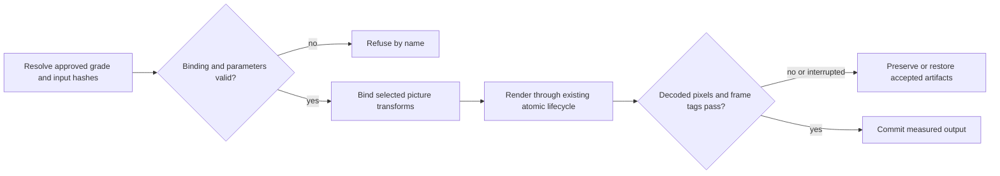
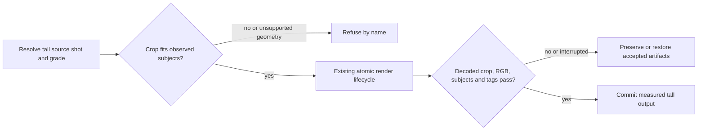

# Approved SDR grades

Seam 2h part 8 applies declared transforms, never an automatic exposure decision.
`records/job.json.grade` is an optional finish: `{decision, source_sha256, lut,
parameters, sha256}`. `lut` is `{file, sha256}`, a relative, nonsymlink .cube with
unit domain and tetrahedral interpolation. Parameters are `skin_target`, `knee`,
`max_stop`, `n`; they must match `rendering/settings.json shared.grade` (unset by
default), and `n` must match the cube size. These record the approved LUT's recipe;
the core applies its supplied bytes, it does not solve skin exposure or create LUTs.

A plan span's optional `grade` is `{decision, source_sha256, parameters, sha256}`.
Parameters are `exposure: [start, end]` in stops, `contrast: [start, end]`, and
`space: "rgb" | "luma"`. Its approval payload also includes the owning span's `src`.
For both forms, `decision` must be exactly `approve`, and `sha256` is the canonical
JSON digest of all fields except `decision` and `sha256`. It binds the source hash,
LUT bytes and parameters, preventing stale approval after an edit. Missing, unbound,
non-finite, contradictory or unsupported inputs refuse by name. Removing the
optional grade removes the transform on the next render; the existing accepted
artifact recovery owns rollback after failed or interrupted replacement.

Order: explicit SDR color conversion, finish LUT, local correction, crop/scale,
caption composite, output matrix/range conversion and frame tags. Local exposure is
linear between the approved span edges at the selected decoded source instant,
clamped at its endpoints for outgoing holds. The host's endpoint-preserving curve
is `clip(contrast * (signal - .5) + .5, 0, 1) ** (1 - exposure / 2.4)`;
RGB applies it per channel; luma applies it to expanded Y and preserves chroma.
No ease, saturation or overlapping separate corrections are inferred. Unsupported
parameters refuse. Picture bindings carry the same transform in every occurrence,
including selected pieces, retiming and pushes; wide covers are unchanged.
Native tall arc/draft geometry is specified below.
Custom encoders without `prepare` refuse grades on selected source spans or finishes;
preparation must bind every applied transform before its output identity is accepted.
Only selected local grades enter the output identity. Finish grades affect outputs
showing source. Generated artifacts retain the existing transactional lifecycle.

Synthetic contracts decode every frame independently to RGB and evaluate an affine
cube and the exposure curve in Python, allowing 5/255 per channel in flat interiors
for YUV/filter quantization. Every delivered frame's tags are checked separately.
Pixel correspondence revalidates approval, inputs and row bindings before decoding.
PQ/HLG tone mapping and the skin/gain solver remain unsupported; native master correspondence/composition remains the existing later seam.

## Native tall crops and grades (2h part 9)

Tall arc/draft outputs use the configured tall aspect (9:16), with sidecar captions.
An explicit med/close shot and nonempty source-frame subject observations supply
its crop. Wide/full-frame tall requests refuse as `tall crop source required`, so a
16:9 source is never squashed or letterboxed into tall. Tall cards and burns remain
named refusals, as do masters, landmark face/mouth shots, partial patches and
ambiguous outgoing J-cuts.

For tall, the base width is `min(source_width, floor(source_height * output_width /
output_height))`; the requested shot fraction scales that width, rounded to an
integer, and height is `round(width * output_height / output_width)`. Wide sizing
is unchanged. The existing subject-union placement and push interpolation own
coordinates, holds and source clocks. An empty/oversized crop or a subject that
cannot fit refuses by span; no widening, padding or alternate framing is inferred.

Grade order and approval are unchanged. Native decoded verification rederives each
fixed tall crop from actual source dimensions and observations; push maps rederive their
runs and bind source size. Every output frame proves source pixel correspondence,
subject containment and color tags. Synthetic RGB oracles independently apply the
approved LUT/curve to distinct source channels and crop locations. The renderer
version changes, invalidating previously cached request identities.

