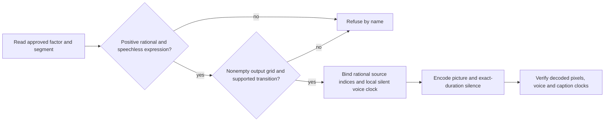

# Approved expression retiming

Seam 2h part 6: an approved segment may carry `speed` (or `retime`, never both), a positive
integer or integer-ratio string such as `"3/2"`. Floats, booleans, zero, negative, non-finite
and non-rational factors refuse by name. Omission keeps the existing normal-speed behavior.
Only speechless `pop` expressions with empty `words`, no overlapping transcript words and no
patch are supported. A retimed segment with voice refuses; no pitch shifting is built here.
A J-cut immediately after a retimed expression refuses because its outgoing hold is not built.
Declared grades use the sampled source instant; see [rendering-grade.md](rendering-grade.md). The existing approved plan and input hashes bind the factor.

Round source edges to the output-rate source-time grid as before. For those edges `[a,b]`,
output rate `F`, decoded source rate `R` and exact factor `s`, output length is
`round((b-a)/s)` frames (ties to even); a collapsed interval refuses. Output offset `n` selects
`floor((a+n*s)*R/F)`. Source grid edges and seconds remain the approved source interval;
`source_indices` records every sample and `source_frames` bounds them. Sampling uses rational
arithmetic and holds/drops frames without blending. Mapping rederives the selection from the
approved span, subject coverage follows the indices, and pixels checks decoded frames.

The expression's voice row has `silent: true` and a local silence clock `[0, output_length)`;
its bound source asset remains part of the identity. The compositor generates exactly that
many output frames of silence. Picture and voice output intervals agree; later speech keeps
its source clock and moves by the expression's new duration. Captions select no words from
expressions and keep their existing equal-length voice-clock contract. Explicit split maps
are required; legacy combined maps cannot represent this retiming.

