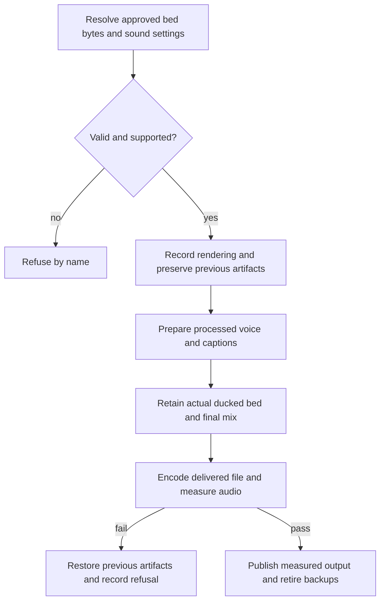

### Seam 2g: bound sound for native wide arc and draft

The compositor prepares versioned processed voice before caption alignment, then `mix.py` produces one final
mix and retains its actual ducked bed stem. Both audio artifacts join the existing generated-artifact
preserve/restore/retire lifecycle. Measurement decodes the delivered file against the retained final mix and
actual stem; a missing stem cannot be reconstructed for approval. A brief naming no assets records voice-only.

`records/bed.json` keeps cutting's `plan`, `request` and `tempo_from`. Native composition accepts
`assets: [path | {file, sha256}]`, with at most one approved audio asset, `decision: "approve"`, and optional
`tacets: [[start_s, end_s], ...]` on the output clock. Every named file is hashed transitively; an explicit
hash must match. The raw brief hash participates in the request key, including metadata edits.
Absent or empty assets means `bed_binding.mode: voice_only`. Missing assets, invalid approvals, unknown fields,
overlapping tacets, inadequate audio coverage and unsupported multiple assets refuse by name.

`rendering/settings.json` `shared.mix` is the single home for `version`, `voice_chain`, `bed_eq`,
`bed_loudness_lufs`, `duck` and `pin`. Profiles select this group. `voice_chain` and `bed_eq` are ordered
unlabelled FFmpeg audio filters; empty chains mean unchanged audio. The processed voice keeps the planned
sample count and is what captions align. `voice_binding.processing_chain` and `settings_version` bind it.
`duck` declares the sidechain compressor options; `pin` declares the retained bed's limiter options.
Bed loudness is measured after EQ and adjusted to `bed_loudness_lufs` before ducking and limiting.
The final mix adds prepared voice and that actual bed contribution without normalization.

`generated` owns the caption artifacts plus `records/render/<output>-bed.wav` and `<output>-mix.wav`.
Voice-only uses the prepared voice as its final mix; both extra audio artifact hashes are null. `bed_binding` records the brief and approved asset hashes;
`audio_binding` names the actual ducked/limited/tacet stem with unity gain on the output clock;
`mix_binding` names the retained pre-encode mix. Decoded delivery comparison uses that mix, then the
existing speech-band bed windows check the retained contribution after subtracting the separately bound processed voice. Nothing recreates a missing stem.
Seam 2e/2f artifact sets remain recoverable through the existing preserve, restore and retire functions.
