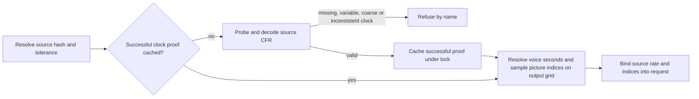

# Source clocks and picture sampling

Seam 2h part 5: source-rate conversion built in `source_rate`: the native request binds a positive
rational `source_rate` from the decoded source stream, independently of output `video.fps`. Every
timestamp and duration must match that declared constant clock (within container timestamp
quantization or configured grid tolerance); missing/non-finite rates, variable-frame-rate sources
and disagreeing decoded clocks refuse by name. No media probe record is rewritten.

Picture rows retain `src` in source seconds and `source_grid_frames` on the output-rate source-time
grid. Output offset `n` selects `floor((source_grid_frames[0] + n) * source_rate / video.fps)`, the
source frame covering that instant; `source_indices` records every selection and `source_frames`
bounds those indices. Mapping rederives them, subject coverage uses them, and decoded pixels verify
them. FFmpeg stamps rational source instants and holds/drops frames onto the output grid without
blending. Voice, captions and audio trims retain their existing source-seconds clock. Push phase
remains on that clock, with source-frame subject unions and outgoing J-cut holds. Legacy injected
combined maps still require equal rates; converters supply the explicit split-clock binding. Span
retime/speed/grade remain unsupported.

Source subject observations are `faces_data.frames: [{frame, boxes: [[x,y,width,height], ...]}]`; item 6 must
supply native decoded source frame indices. Every uncovered mapped frame needs nonempty observations inside
its decoded crop. Duplicate/missing observations refuse. Full opaque covers are excluded from subject checks.

Clock slack is the configured grid tolerance when a frame period is a whole number of time-base ticks
(timestamps are then exact, as in AVI or y4m at time base 1/fps), otherwise the greater of that tolerance and one
container time-base tick. A clock with twice that slack greater than or equal to a frame period refuses as
`time base too coarse to prove the source clock`: a missing frame must never fit within the proof.
Successful probes are memoized by source content hash under a lock. A changed tolerance requires a new
proof; refusals are never memoized. Decoded pixel verification still checks the bound source clock.

