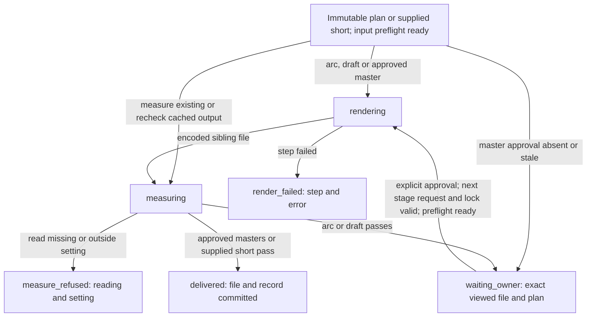

# Rendering: locked plans to measured files

Draft for the owner to read, queue item 14 seam 1. This is a rebuild contract, not implemented behavior.
The [spine](spine.md) runs stages declared as recipe data; rendering makes their files and supplies readings.
A check declares its inputs, never a recipe name. C1 covers only `plain` and `shorts-only`.
Item 17 owns kept words, order, cuts, framing intent, retime, cards' timing and which moments become shorts.
Item 14 materializes those decisions: arc, draft, final long cut, full vertical and individual short files.
The [input preflight](preflight.md) runs before expensive work; its probes are not duplicated here.

## 1. Requests and records are data

Paths are relative to the video; hashes below are abbreviated examples, readings are illustrative, not targets.
The request reads item 17's settled fields below, never the maker's plans or invented cut/shot-window tables.
An arc consumes an immutable candidate plan, before the owner's arc choice locks the cut; it cannot require
`story_map.json` from the later `locked` stage. Draft and masters require that lock. An arc is never a final approval.

```json
{
  "video": "records/job.json",
  "stage": "masters",
  "output": "short:excerpt-a",
  "mode": "render",
  "source": "source.mp4",
  "source_sha256": "sha256:51c2...",
  "plan": "records/cut_plan2.json",
  "plan_sha256": "sha256:77aa...",
  "lock": "records/story_map.json",
  "spans": "records/cut_plan2.json#spans",
  "cold_open": "records/cut_plan2.json#cold_open",
  "end_hold_s": "records/cut_plan2.json#end_hold_s",
  "cards": "records/overlay_plan.json#cards",
  "bed_brief": "records/bed.json",
  "shorts_plan": "records/shorts_spec.json",
  "short_id": "excerpt-a",
  "words": "records/words.json",
  "faces": "records/faces.json",
  "captions": "records/captions/short-excerpt-a.json",
  "approval": "records/draft_decision.json",
  "settings": "rendering.settings#short",
  "key": "sha256:ef12..."
}
```

- `video`: job identity and relative-path root; no settings are written into the job by the renderer.
- `stage`: engine stage ID; `output`: stable kind plus clip identity, never an output filename used as identity.
- `mode`: `render` for a plan or `measure_existing` for an owner-supplied finished file.
- `source`, `source_sha256`: exact media bytes; a changed source cannot reuse a plan-bound result.
- `plan`, `plan_sha256`: item 17's immutable settled plan and its exact bytes; inconsistent fields refuse.
- `lock`: `records/story_map.json`; its `plan`, `check`, `arc_decision` and `reads` bind the approved revisions;
  `blocks` order span IDs and `tail` names the last. Required for draft/masters, absent for the earlier arc.
- `spans`: the settled `cut_plan2.json` array, retaining each entry's fields rather than flattening to seconds.
- `spans[].id`: stable span identity used by the lock, covers and output evidence.
- `spans[].src`: kept source interval on the measured source clock; snapping cannot change the editorial interval.
- `spans[].order`: story order, consistent with the lock's blocks; rendering cannot choose another edit.
- `spans[].enter`: `open|jump|jcut|push|pop`, exactly cutting's values; no separate cut-kind vocabulary.
- `spans[].lead_s`: approved voice lead for a `jcut`; realized on the output frame grid.
- `spans[].lead_from`: the settled J-cut lead's source evidence; no new lead chosen while rendering.
- `spans[].shot`: requested shot size; rendering computes the crop from the subject observations.
- `spans[].push`: requested `to` shot and `s` duration; rendering realizes the approved movement.
- `spans[].expression`: the held expression's `after_word` anchor and `seen` description, not a new cut decision.
- `spans[].patch`: approved voice replacement's `record`, `sha` and `words`; hash and read its actual audio.
- `spans[].hide_picture`: never expose this span's picture; burn its opaque cover card end to end, even in arc.
- `cold_open`: the settled tease's `span` and `words`; build those words, never pick a new tease.
- `end_hold_s`: the maker's requested live tail; realize it on the frame grid without a new default or freeze.
- `cards`: `records/overlay_plan.json` cards; resolve word anchors and `covers` span IDs, including hidden-picture
  covers. `callouts_plan.json` holds research facts, not these cards. Hash the resolved card assets too.
- `bed_brief`: `records/bed.json` request keyed to the plan; rendering owns its levels, gaps, notes and mix.
- `shorts_plan`: settled `records/shorts_spec.json`, bound to the cut by `plan`; never re-tighten its pieces.
- `short_id`: the selected entry's `id`; its word spans and opening/ending anchors remain cutting's decisions.
- `shorts[].pieces`: settled source ranges after pause splits and edge trims; here only frame snapping remains.
- `shorts[].point`: what the short proves; carry through for review, never choose a new moment from it.
- `shorts[].stands_alone`: pin its `context` line or honor `opens_on_subject`; no invented or truncated context.
- `shorts[].full`: the full-vertical variant uses every span in story order; it has no excerpt pieces/context.
- `words`: measured word IDs/times for card and tease anchors; patch words come from the declared patch record.
- `faces`: item 6's subject observations; `captions`: item 18's words, timings and placement bound to this sound.
- `approval`: explicit owner decision bound to the viewed draft hash and plan; absent for arc/draft creation.
- `settings`: named resolved profile; every asset, setting value and tool version actually read enters `key`.
- `key`: SHA-256 of normalized request, transitive input contents, renderer version and resolved settings/tools.
  It excludes paths that only relocate identical content, display titles and unrelated clips. Changes to a card's
  pixels, a bed stem, the grade or a cut invalidate affected outputs even when names and timestamps stay the same.

**Required spine.md interface change** (spine.md section 1's stage list): declare the following additions before
either domain is built. Every stage binds `rendering.settings` and the current input-preflight result as declared
external inputs. Arc/draft/masters also declare the transitive patch audio, card assets, grade and bed assets read
by the request. A stage calls rendering's voice preparation, item 18's cue generation, then rendering's burn/measure
in that order; internally produced artifacts are outputs, never prerequisites on the stage that produces them.

| Stage | Inputs gained | Outputs gained |
|---|---|---|
| `arc` | `records/job.json`, `records/words.json`; candidate cut/overlay/bed/faces/source already declared, no story lock | `records/render/arc.json`, `records/render/arc-readings.json`, `records/render/arc-voice.wav`, `records/captions/arc.json` |
| `draft` | `records/job.json`, `records/words.json`, `records/shorts_spec.json`; lock and cut/overlay/bed/faces/source already declared | `records/render/draft.json`, `records/render/draft-readings.json`, `records/render/draft-voice.wav`, `records/captions/draft.json` |
| `masters` | `records/job.json`, `records/words.json`, `Draft/draft.mp4`, `records/render/draft.json`, `records/render/draft-readings.json`; existing draft decision and locked inputs bind these bytes | For each long, vertical and short output: `records/render/<output-id>.json`, `records/render/<output-id>-readings.json`, `records/render/<output-id>-voice.wav`, `records/captions/<output-id>.json`; also `Vertical/main.srt` |
| `short` | Supplied short identity and delivery profile from the existing job/source inputs; no cutting prerequisites | `records/render/short-<id>.json`, `records/render/short-<id>-readings.json`, `records/render/short-<id>-voice.wav`, `records/captions/short-<id>.json`; item 18 aligns words and cues to the unchanged supplied sound |

For `masters` and `short`, replace `Shorts/short.mp4` and `Shorts/short.srt` with one `Shorts/<id>.mp4` and
`Shorts/<id>.srt` per short, enumerated by the final manifest, never a literal wildcard output. `<output-id>` is
`arc`, `draft`, `long`, `vertical` or `short-<id>`; `full: true` maps to `Vertical/main.mp4`, not another excerpt.
The `short` voice artifact is an extraction for item 18, never a replacement of the supplied file's sound or a burn
into that file. Tall master cues are burned after voice preparation; every sidecar, arc and draft included, comes
from the same cues ([captions](captions.md)).
Extend `arc-read`, `draft-read`, `delivered-media` and `short-media` reads to their matching render records/readings,
voice and caption artifacts. The owner reviews this interface change with spine.md before either is built.

Each output has its own record at `records/render/<output-id>.json`; this array illustrates five separate records.
`file_sha256` binds measurements to output bytes; `readings` holds full measurements and coverage for every check.

```json
[
  {
    "output": "arc",
    "key": "sha256:ac10...",
    "file": "Draft/arc.mp4",
    "file_sha256": "sha256:a001...",
    "encode_settings": "rendering.settings#arc",
    "duration_s": 16.8,
    "fps": "30/1",
    "loudness_lufs": -14.1,
    "true_peak_dbtp": -1.7,
    "frame_checks": ["count", "clock", "decode", "edges", "color"],
    "readings": "records/render/arc-readings.json",
    "state": "waiting_owner"
  },
  {
    "output": "draft",
    "key": "sha256:df10...",
    "file": "Draft/draft.mp4",
    "file_sha256": "sha256:d001...",
    "encode_settings": "rendering.settings#draft",
    "duration_s": 16.8,
    "fps": "30/1",
    "loudness_lufs": -14.1,
    "true_peak_dbtp": -1.7,
    "frame_checks": ["count", "clock", "decode", "edges", "color", "cards"],
    "readings": "records/render/draft-readings.json",
    "state": "waiting_owner"
  },
  {
    "output": "long",
    "key": "sha256:fa10...",
    "file": "YouTube/main.mp4",
    "file_sha256": "sha256:f001...",
    "encode_settings": "rendering.settings#long",
    "duration_s": 16.8,
    "fps": "30/1",
    "loudness_lufs": -14.1,
    "true_peak_dbtp": -1.7,
    "frame_checks": ["count", "clock", "decode", "edges", "color", "draft-match"],
    "readings": "records/render/long-readings.json",
    "state": "delivered"
  },
  {
    "output": "vertical",
    "key": "sha256:be10...",
    "file": "Vertical/main.mp4",
    "file_sha256": "sha256:b001...",
    "encode_settings": "rendering.settings#vertical",
    "duration_s": 16.8,
    "fps": "30/1",
    "loudness_lufs": -14.1,
    "true_peak_dbtp": -1.7,
    "frame_checks": ["count", "clock", "decode", "edges", "color", "subject"],
    "readings": "records/render/vertical-readings.json",
    "state": "delivered"
  },
  {
    "output": "short:excerpt-a",
    "key": "sha256:ab10...",
    "file": "Shorts/excerpt-a.mp4",
    "file_sha256": "sha256:c001...",
    "encode_settings": "rendering.settings#short",
    "duration_s": 7.2,
    "fps": "30/1",
    "loudness_lufs": -14.2,
    "true_peak_dbtp": -1.8,
    "frame_checks": ["count", "clock", "decode", "edges", "color", "subject", "word-ends"],
    "readings": "records/render/short-excerpt-a-readings.json",
    "state": "delivered"
  }
]
```

`duration_s` is measured from actual streams; `fps` includes measured packet cadence, not merely a header claim.
Each named frame check has its result, coverage, evidence and threshold reference in `readings`; names alone do
not mean pass. Missing readings are explicit, never zero. Record resolved settings and tool versions there too.
Loudness comes from the finished mix. Bed comparisons name its actual stem and alignment evidence, never a
reconstructed mix passed off as delivered audio. Separate video/audio start/end readings and decoded frame counts
must agree with the plan's cumulative frame map. Subject coverage names every unseen or covered interval.

`rendering.settings` is the proposed single core settings owner, supplied by the settings domain (item 5).
At the switch it absorbs `delivery_spec.json` common/kind rules; `studio.json.delivery` loudness and bed targets;
`encoder.py` engine/quality profiles; `job.py FPS`/size policy; and the grade, bed and measurement settings named below.
Profiles refer to shared settings, not copies of their values. The request records resolved values and their hash
for reproducibility; this document deliberately defines no replacement numeric policy.

For `shorts-only`, `measure_existing` requires the supplied short, its identity and delivery profile, with no
cut plan, lock, bed brief, faces or shorts spec fabricated to satisfy the renderer. Preserve its bytes and sound;
measure/decode it, obtain captions through item 18 and return the short record for the final manifest. The spine's
`short` stage coordinates those domain calls. It creates no arc, draft, long cut or full vertical. A requested
platform fit is a separate derived output with its own record; a refused original is never silently re-edited.

## 2. The engine calls one API

| Function | Reads | Writes and answer |
|---|---|---|
| `render(video, output) -> record` | The stage's resolved request, item 17 plan or supplied file, settings, assets, approvals and current preflight result | Only output-owned work files and its render record; returns current record on unchanged content. `measure_existing` does not encode. |
| `measure(file) -> readings` | Exact file bytes plus declared plan, caption, subject and actual stem bindings from its record | Hash-bound readings, frame/edge evidence and coverage; never changes media or chooses an edit. |
| `check(record) -> {ok, state, next_action, detail}` | Current hashes, readings, acceptance settings and approval bindings | No media writes; names file, failed reading, measured value, setting owner and corrective actor. Item 15 uses this same result. |

Each call refuses missing, unsafe or contradictory inputs by name. No implicit encoder, target, frame rate or
recipe fallback. The engine owns preflight blocks and decision tasks, with their spine/Board states; this domain
owns only the states in section 3. A tool failure identifies the step and stderr; an unavailable measurement
refuses with its reading and required tool. `ok` is true only for a checked delivered result, not for waiting.

Render to a unique sibling work file on the destination volume, close it, measure it and check the current input
hashes again before atomic rename. Commit the hash-bound record last. Readers require both matching record and
file; a crash between rename and record cannot look finished. Preserve the prior accepted file under its content
identity until the new record is committed. Never overwrite the supplied source or mutate a hardlinked owner file.
Same-output attempts serialize their final publication; independent outputs do not share that lock. Restart reuses
only complete validated pieces, cleans its own incomplete work, and does not treat existence as completion.
A reused output still verifies its file hash and current acceptance dependencies. A changed approval invalidates
eligibility, not necessarily cached pixels. The spine publishes the final manifest only after all declared outputs
and item 18 sidecars pass; item 39 owns release packaging and posting remains outside rendering.

## 3. From plan to delivered files

The engine admits the immutable arc candidate, locked draft/master plan or supplied short only after preflight.
These are all persisted rendering states; branching conditions and preflight/owner decisions are engine inputs.



`waiting_owner` is an end for this invocation: the engine asks the owner to look, never self-approves. Rejection
returns to item 17 or the named rendering correction, invalidates the affected decision and requests a new draft.
A master request with no matching explicit approval waits before encoding, using the same `waiting_owner` state.
`delivered` means usable media for the next stage, not released or posted. Failure leaves accepted files intact.

## 4. Host steps and checks, and their replacements

Sources are host-relative. Stages use spine IDs: arc, draft, masters and short. In each row, the last column is the
new owner; grouped symbols perform the single step or check named. Host checks are evidence of requirements, not
code to copy. `preflight.py` below measures outputs; it is not the input preflight in item 6.

| Host location | Step/check and stage | Replacement or boundary |
|---|---|---|
| `stages.json` finisher draft | Faces, grade, bed, grind and tall preparation on locked cut | `draft` recipe maker calls `render`; media-in owns face observations. |
| `stages.json` finisher youtube | Approved full draft to long master | `masters`, approval bound to exact draft; spine owns gate/order. |
| `stages.json` finisher delivered | Full vertical, shorts, measured files and hear-back | `masters` records plus item 15 verdict; no rerender to make timestamps newer. |
| `stages.json` finisher fix | Card, mix or encode correction | Same affected output/key, no separate rendering implementation. |
| `stages.json` shorts-only; `test_shorts_only_recipe`, `test_shorts_only` | Supplied finished short; host drops draft/youtube/delivered | `short` measures/imports, no long-plan prerequisites. |
| `draft.py render/run/main` | Arc/full draft orchestration, repeated subprocess passes | One render operation; engine owns retries/status, not stdout or mtime parsing. |
| `draft.py plan_gate/paper_gate/stumble_gate`, `draft_preflight.py` | Cut readiness before arc/draft | Item 17 owns plan decisions; item 6 owns tool/media/disk probes. |
| `draft.py overlays`; `foil.py plan/build/assemble` | Simple cards in full draft/master; arc review stills, with hidden-picture covers burned | C1 card compositor only. `plain` forbids foil/chat data, not the shared simple-card compositor. |
| `vo_cover.py spans/uncovered/hides/cover` | Opaque coverage of hidden picture, including VO/patch spans; arc/draft/masters | Item 17 owns `hide_picture` and cover-plan validity; item 14 burns the cover and proves every hidden frame stays covered, including edges/fades. |
| `cutaway_timing.py fades/fields/check/filters` | Card fades and fully opaque reading time; arc/draft/masters | Item 17 owns card timing intent; item 14 uses one frame grid for fade filters and measured opacity. Host check and filters disagree by up to a frame; check decoded coverage, not duration arithmetic alone. |
| `draft.py measured` | Draft flash shots, loudness and music checks | One `measure/check`; duplicates `preflight.check_file` and bed checks are removed. Planned short shots belong item 17. |
| `draft.py place_draft/retire_other_names`; `studio.py` draft promotion/status | Checked draft placement, latest draft and changed explanation | Spine/Board bind review and promotion to bytes; rendering supplies candidate record. |
| `grade.py main/skin_samples/solve_gain/write_lut` | HDR transform from source/faces; SDR branch; draft/masters | Grade step; `SKIN_TARGET`, `KNEE`, `MAX_STOP`, `N` migrate to settings. |
| `grade.py lut_path/chain/SETPARAMS/TAGS` | Missing LUT refusal; finish color and frame metadata | One finish transform for wide/tall, tags checked on every decoded frame. |
| `regrade.py parse/chain`, render reference | Requested local exposure correction; draft/masters | Same approved source-span transform in all affected outputs; before/after owner look. |
| `bed.py main/master_timeline/clip_timelines` | Compose music to each output's approved clock | Bed step reads item 17 brief; source/order/short decisions remain item 17. |
| `bed.py locked/fits/write/feature_gain` | Preserve approved music, duration fit, normalize and feature | Settings own `BED_LUFS_BASE`, `FEATURE_DB`, `FEATURE_FADE`, `FIT_S`; missing locked music refuses. |
| `bed.py _selftest/repetition/check_ledger/tacet_peaks` | Composition validity, repetition and tacet diagnostics | Bed preparation evidence; cannot substitute for finished-mix measurement. |
| `refresh.py wanted/signature/ensure` | Regenerate cut-dependent cards/bed only when changed | Transitive content keys and fail-before-stamp, no separate refresh cache. |
| `voice.py prepared_audio/chain`; `audio_segments.py`; `grind.py _audio_task` | Source/patch preparation, conform and complete voice track | Shared audio step; preserve approved chain, delay compensation and whole-track loudness. No voice retuning. |
| `grind.py _mix_task`; `bed.py duck_graph`; `sound_effects.py mix_graph` | Mix voice, approved bed and declared cues, retain actual stem | Shared final mix for draft/master; settings own `BED_EQ`, `DUCK`, `PIN`. |
| `grind.py plan_tasks/_frame_maps/_take_frames/_framing`; `zoom.py` | Render kept source frames, holds, pushes and cumulative frame grid | Materialize item 17 plan; never rotate framing or choose cuts here. |
| `job.py splice_frame/_end_hold/video_end` | Frame snapping, live end hold and measured master length; draft/masters | Item 14 realizes item 17's `end_hold_s` and fixed source spans; measure actual frames, no plan-length fallback. `src_fps` remains item 6; hold/snap settings have one rendering owner. |
| `picture_frames.py jcut_group_errors` | Incoming/outgoing picture groups and lead-frame counts before master build | Item 17 settles J-cut validity using `jcut.MIN_AFTER`; item 14 verifies materialized groups honor that verdict. Missing groups refuse; never silently drop a J-cut as host `vplan.py` can. |
| `grind.py valid/_short/source_holes/_lead_ok` | Incomplete pieces, source holes and J-cut lead frames | Require exact decode/count and declared source-gap treatment; item 6 detects source holes before work. |
| `grind.py decode_delay/concat/_join_is_this/_assemble_master` | B-frame decode offsets, exact joins and current audio | One join step validates grid/count and A/V clocks; header duration alone is insufficient. |
| `pieces.py`; grind/foil/vrender signatures and cache checks | Piece reuse, including card bytes and per-piece framing | Content keys; piece order changes reassemble without re-encoding unchanged pieces. |
| `encoder.py spec/flags/engine_of/quality/keys_at/own_keys` | Codec, profile, quality, real keyframes and compatible joins | One resolved profile from settings; record actual encoder and keyframes. |
| `encoder.py fallback/run`; `foil.py copy_wrong/soft_keys/valid` | Hardware failure and unsafe copied GOP boundaries | Fail naming encoder/join; explicit new request for a different profile, never silently change encoder. |
| `ffrun.py`; `together.py` | Child failure/stall, bounded concurrency and interrupted writes | Renderer execution detail with owned scratch and named failure, not another engine loop. |
| `publish.py story_body/cut_frames/one_track/mux/package/signoff` | Materialize planned story/open/close and one audio clock | Arc/draft/masters assembly; item 17 supplies all editorial decisions. |
| `publish.py off_grid/grid_or_stop/verify_blocks/copied_right` | Actual frame grid, source-frame correspondence and copied seams | Shared encoded-output checks; compare boundary/interior pixels and packet timing. |
| `publish.py check_shots/check_clip_shots`; `vplan.py check_pieces/check_src_matches` | Planned shot length and source span correspondence | Item 17; one reference here. `vplan.MIN_SHOT` duplicates `publish.MIN_SHOT`: one settings owner after switch. |
| `shorts.py resolve` and story/short compilation | Short spans and full vertical order on the conformed clock | Item 17 owns decisions/resolution; rendering consumes resolved spans, never restores deleted tape. |
| `shorts.py tighten` and its render-time caller | Pause splits, head/tail trims and tiny-piece removal before shorts render | Move these decisions to item 17's `settle`; item 14 consumes settled `pieces` with frame snapping only, never another tighten pass. |
| `publish.py cold_sound`, tease assembly, `COLD_LEN`, `BRIDGE_S` | Build cold-open picture/sound and declared bridge; masters | Item 17 selects/validates `cold_open` against the named length policy; item 14 builds that tease and bridge on the output grid. Settings retain their named owners until switch, no restated values. |
| `vplan.py crop_for/parts_of`; `vhold.py check/follow` | Fit/track subject and hold-ups; planned coverage | Item 17 owns framing intent/plan; item 14 realizes it and validates actual output coverage. |
| `vrender.py vf/piece_cmd/_make/nframes` | Native source crop, grade, J-cut held frames and exact count | Tall render step; declared letterbox for otherwise impossible hold-ups, no silent face crop. |
| `vjoin.py copy_join/encode_join/off_grid/joins_wrong` | Join tall picture and mux complete audio separately | Shared join checks; no automatic re-encode fallback, no truncated last words. |
| `vaudio.py build`; `bed.py on_story/timeline_tacet` | Each clip's own voice, contiguous spans and bed order | Tall audio step on supplied clock, no fade inside continuous speech. |
| `vburn.py plan_burn/burn_cmd/_join_parts` | Burn declared caption/card layers; count and sound tail | Tall finish step, independent complete-file checks before promotion. |
| `vburn.py captions_fresh/cut_captions`; `short_context.py write_ass` | Timed captions and whole-short excerpt context inside safe zone | Item 18 supplies checked layout/cues; renderer burns exact artifact and measures file. No context truncation. |
| `capzone.py`; `cutstack.py write_ass/write_srt/check_no_overlap`; `aligner.py` | Stable placement, glyph fit, overlap and aligned words | Item 18, shared safe-zone setting; rendering checks the burned result and sidecar binding. |
| `instruct.py render/check/measure`; `callouts.py build/review/clip_callouts` | Simple full-screen cards and review stills | C1 declared card assets, geometry/readability evidence; authored timing belongs item 17. |
| `cover_words.py stamp`; `fit.py fit/current/refusal/quality` | Requested stamped/platform-size derivatives of delivered short | Separate output records, cap/quality policy owned by settings (host `fit.PLATFORMS`); original untouched. Release route choice is item 39. |
| `render_measure.py validate/dependencies/measure/run` | Hash-bound optional card/seam/caption requests; no report over media | Shared readings; stale/missing points or mutation refuse, never artistic approval. |
| `render_frame_measure.py frame_differences/card_measure` | Decoded frames, packet correspondence, card edges/hold | Frame evidence with coverage; detected edge is not proof of readable text. |
| `render_audio_measure.py decode/envelope/seam_measure` | File-clock sound and seam quiet/high-band energy | Audio readings; named measurement settings (`SR`, `HOP`, windows) migrate once. |
| `render_audio_measure.py caption_measure/align_stem/recognize_join` | Onset candidates, stem correlation and selected-join listening | Caption alignment remains item 18; low correlation/missing recognizer stays unavailable, not pass. |
| `check_sheet_vertical.py read`; `sheet.py --cuts/--edges` | Bind rendered tall file, faces, layers/captions and edge sheets | Actual-output evidence; preserve missing/covered subject and unmeasured glyph/contrast intervals. |
| `preflight.py probe/scan/judge_file`: resolution, codec | Actual size, container, streams, codec/profile/pixel format | `measure/check` reads kind/common delivery settings. |
| Same: frame-rate, starts, ends, encode.one | Measured cadence, A/V starts/ends, last frame, per-frame tags/SAR | One frame/clock check; no tagged-rate or first-header-only acceptance. |
| Same: `drawn_steps/flashes/static_runs` | Actual flash/held shots versus movement/dissolve | One rendered-edge check; item 17 owns minimum planned shot decision. |
| Same: audio.loudness; `preflight_audio.py continuity` | EBU loudness/true peak, packets, decoded gaps and approved audio clock | One audio acceptance check; item 15 consumes it for final QC. |
| Same: captions.fresh/files.links; `publish.py probe_delivery` | Current sidecars, cues within file, no shared mutable output inode | Item 18 caption contract plus item 15 final-file isolation; record measured facts once. |
| `preflight.py bed_misses/measure_beds`; `bed.py measure_data/held_to_band` | Delivered bed level, speech band, file/stem mismatch and undeclared gaps | One mix check; reconstructed-stem evidence cannot approve delivered sound. |
| `preflight.py measure_stage/run_stage/check_file`; `qc.py run_preflight` | Aggregate output readings and current hashes | Item 14 measurement, item 15 verdict. Remove duplicate thresholds and dated warn-as-pass behavior. |
| `jcut.py built_main/seam`; `qc.py run_heads_built/run_seam_flash/run_seam_frames/run_held_face` | Built splice/flash/repeated-frame/held-face evidence from `jcut --built`; draft/masters | Item 14 owns built-file measures on the actual cold-open offset and file clock; item 17 owns plan splice validity. Missing evidence refuses, no inferred offset. |
| `qc.py run_same_size/run_expressions/run_framing_headroom/run_vertical_hold` | Framing/subject checks, including planned tall holds | Item 17 owns decision; output subject proof belongs here and cannot be inferred from plan alone. |
| `qc.py run_cards_vertical_face/run_cards_vertical_headline` | Actual card coverage of face or clipped headline | C1 rendered-card acceptance with missing evidence refused. |
| `qc.py run_same_arc/run_vertical_opening`; `test_vertical_story_clock` | Long/tall story, opening and ending correspondence | Item 17 owns order/opening; item 14 proves files follow it. |
| `qc.py _render_measure/run_render_*` | Stage-specific current measurement requests | Same API; checks declare reads, no recipe branches. |
| `publish.py place/rename_delivered/write_manifest`; QC naming/link rows | Delivery names, sidecars and final manifest | Spine composes outputs; item 15 verifies delivery completeness; item 39 owns release naming/package. |
| `publish.py release_gate`; `release_routes.py`, `status.py`, `studio.py` | Release routing, milestones/currentness and approvals | Item 39 or spine; not renderer decisions. |
| `hear.py`; `qc.py` hear-back rows | Listen to delivered words and resolve open flags | Item 15 uses actual rendered file and mapped source clock; renderer never clears flags itself. |
| `retention.py`, `splice_check.py`, `jcut.py resolve` and plan checks, `plan_check.py`, `refine.py`, `take_ends.py` | Editorial pacing, boundaries and plan validity | Item 17; built J-cut measures are the item 14 row above. |
| `job.py _load/src_fps` and source probes; `source_join.py`, `asr.py`, `faces.py`, `env.sh` | Source/probe/transcript/face/tool/disk readiness | Item 6 media-in/preflight; frame snapping, end hold and master length are the item 14 row above. |
| `foil.py` chat path; `chat.py`, `anchor.py`, `handles.py`, `vburn.py` chat gates | Chat art, anchors, faces and rendered chat counts | out of C1 scope: both C1 recipes exclude chat, while simple-card compositing above stays. |
| `broll.py`, `broll_review.py`, `wardrobe.py`, `archive.py`, `tableau.py`, `style_reference.py`, `craft_check.py` | Generated/archival insert acquisition and visual production | out of C1 scope: plain's simple-card path needs no insert production; add a recipe declaration before expansion. |
| `assemble.py`, `explainer.py`, `explainer_shorts.py`, `narration.py`, `speech.py`, `score.py` | Narration-clock animation, cues and wide/tall assembly | out of C1 scope: animated-explainer recipe; likewise QC cue/burned-timing/sting/full-frame rows. |
| `claymation*.py`, `podcast/`, `parked/stinger.py`, `sound_effects_live.py` | Other recipe cuts, scores and experimental effects | out of C1 scope: neither C1 recipe requests them. Shared mix helper above remains. |
| `voicepatch.py`, `quiet.py`, `voice.py` audition/model paths | New voice synthesis and voice tuning | out of C1 scope: consume approved patches/chain only; tuning is paused. |
| `board*.py`, `oracle.py`, `substack_notes.py`, `vault.py`, `thumbs.py`, `image_crop.py`, `machine_budget.py` | Board/media links, images or host scheduling matched by search | Other domains/host, not render steps; out of C1 scope for this domain. |
| `facts.py`, `wordcopy.py`, `carry_over.py`, `layouts.py`, `updates.py`; docs/assets/examples/fixtures hits | Content checks, delivery layout, documentation or sample values | Retain with their owner; no independent rendering step. Non-C1 art/examples remain out of C1 scope. |

The finisher agent's run order and `references/render.md`, `verticals.md`, `music.md`, `qa.md`, `overlays.md` and
`runtime.md` supply the contracts above: same draft sound, no refine on lock, look at edits, complete tall sound,
measured fit, stable captions and owner judgment. Special effects/chat/animation instructions stay out of C1 scope.
Existing tests record the failures, not a suite to copy: `test_studio.FinisherRenders`, `GrindSourceHole`,
`GrindInnerCut`, `GrindJoinOrder`, `BedSpeechBand`, `BedLevel`, `DraftProfile`, `Preflight`, `FrameMeasurers`,
`SoundMeasurers`, `StartsAtZero`, `DraftsPromote`, `DraftStatus`; `test_render_measure`, `test_render_audio_measure`,
`test_check_sheet_vertical`, `test_qc_audio`, `test_short_context`, `test_short_remap`, `test_draft_check`,
`test_draft_preflight`, `test_bed_opening_fade`, `test_insert_source_frames`, `test_jcut_frame_grid` and
`test_cutstack_render`. Their relevant protections become section 5 contracts; editorial/caption tests stay with
items 17/18, and non-C1 test branches remain until their own domain switches.

## 5. What the owner expects, as named contract tests

These are required build-seam tests, not tests added or claimed run by this document.

1. `test_locked_plan_is_the_viewed_draft`: decoded draft edges/order/holds/cards match item 17's lock; arc uses
   its earlier candidate; neither path changes the plan or reruns framing decisions. Every `hide_picture` span's
   cover is burned fully opaque end to end in every output containing it, including arc: no hidden picture shows,
   including the first/last frame, a fade or a J-cut hold. Measure decoded coverage against the settled span IDs.
2. `test_masters_match_approved_draft`: compare source-frame mapping, card timing and complete sound across draft
   and final; only declared resolution/profile and explicitly approved changes differ. New creative changes wait.
3. `test_waits_for_exact_owner_choice`: flowchart waiting end; reject, redo, missing/stale decisions and wrong file
   hashes never authorize masters; an explicit matching choice does. It files one spine/Board task for that file.
4. `test_delivered_files_meet_named_profiles`: flowchart delivered end; decode each output and its sidecars, compare
   size, codec, color/SAR, measured FPS, frame count, loudness, peak and file cap to the single resolved settings.
5. `test_measure_refusal_names_reading_and_setting`: flowchart refusal end; unknown tools/values, partial decode,
   off-grid frames, A/V gap/drift, held tails, flash frames, stale captions or missing subject evidence refuse by name.
6. `test_vertical_keeps_subject_every_frame`: render moving faces/hold-ups and J-cut holds; every visible subject
   stays inside the declared window or explicitly approved letterbox; unknown coverage cannot pass. Inspect edges.
7. `test_each_short_has_its_own_complete_ends`: item 17 short plan becomes exact frames and complete audio; own
   opening/end words survive join/mux, cut spans never reinstate discarded tape; full vertical preserves long order.
8. `test_unchanged_inputs_do_not_render_again`: identical content performs no encode; relocation/title/unrelated
   clip edits preserve reuse; changing asset bytes, plan, audio, grade or profile invalidates exactly its dependents.
9. `test_failed_render_preserves_owner_files`: flowchart failure end; kill during piece, join and publication,
   inject encoder failure and concurrent same-output attempts; no partial file passes, source/accepted bytes survive,
   retry completes once, and the record names the failed step. No silent hardware-to-software switch.
10. `test_delivered_mix_is_the_measured_mix`: use actual finished audio and bound stem, detect gaps outside tacets,
    wrong speech-band units, absent bed and wrong alignment; missing stem cannot become a reconstructed green result.
11. `test_short_import_preserves_finished_media`: supplied short without long-plan records is measured byte-for-byte;
    requested fit/stamp is a separate measured file, failures leave original intact and no long output is invented.
12. `test_evidence_and_layers_follow_output_bytes`: changed media/request/tools invalidate readings; incomplete
    measurements refuse; card/context/caption edges and safe bounds are checked on rendered output, not logs alone.
13. `test_switch_off_is_unchanged`: same committed fixture, host switch off produces byte-identical files/status;
    switch on calls this API for every C1 output and never the replaced host renderer/check on an error.

Live check: `python3 tools/rendering_contract.py run --video "$VIDEO_FOLDER" --out "$RENDER_PROOF"`

Proposed acceptance command for the build seam, not an existing executable. The Mac lead supplies the owner's
chosen real video folder and separate evidence folder. Render into evidence only, compare decoded draft/final/tall
edges and sound to the plan and owner-approved draft; measure an owner-supplied short unchanged. Record file/input
hashes and a second unchanged call showing no encode. The owner judges look and sound; measurements do not prove taste.

## 6. One switch, then delete

The host's sole switch is `studio.json` `rendering`, initially false. With spine and input preflight enabled,
C1 finisher draft/youtube/delivered/fix and the editor's arc render request call this API; the short stage measures
the supplied file. Off preserves the host path byte for byte. On cannot fall back. Owner-visible look/sound changes
are shown before/after for the owner's choice, never approved by the renderer.

The switch-and-delete landing removes the replaced C1 orchestration in `draft.py`, `grind.py`, `foil.py`,
`vrender.py`, `vjoin.py`, `vaudio.py`, `vburn.py`, render portions of `publish.py`, grade/bed/encoder/refresh paths,
output probes in `preflight.py`/`preflight_audio.py`, render measurers and duplicate QC wrappers named in section 4.
Remove their C1 tests only when the new output contracts cover the same failures; shared tests are split by owning
domain, never dropped wholesale. Item 17 retains plan/short selection; item 18 retains caption generation; item 15
retains final verdict/hear-back; item 39 retains release and route code. Shared non-C1 consumers keep only their
still-needed branch until their recipe switches, not a fallback from the C1 API.

Move the named delivery/encoder/grade/bed/measurement settings to the single core settings owner and delete the
host's duplicate constants/tables and dated warning switches for replaced paths. Preserve owner overrides as
injected settings data, not public defaults. Remove recipe-specific render skip lists in favor of spine inputs.
Once both C1 videos run on the core, remove the switch and old C1 path together. No deletions occur in this seam.

## 7. Failings this contract ends

- Host #1510, defect `70a66872ff67` in `test_qc_audio.DeliveredAudio`: a delivered audio hole passed final QC.
  Contracts 4, 5 and 10 measure the actual file and its mapped source, including gaps and shifted/silent audio.
- `grind.py sig` records an old-plan voice track reused beneath a new cut; `foil.py`/render reference record stale
  card pixels cached by command alone. Contract 8 hashes every content dependency. Sources give no issue ID.
- `grind.py concat/_even_delays`, `vjoin.py encode_join` and `test_studio.GrindJoinOrder` record lost/reordered
  frames, decode-clock drift and clipped ending audio. Contracts 4, 5, 7 and 9 cover actual joins and complete tails;
  no issue ID is supplied in those incident comments.
- `test_studio.GrindSourceHole` names tool request `7fb36d8399f0`: source holes repeatedly left a piece short.
  Item 6 detects the hole; contracts 5 and 9 forbid treating incomplete output as finished or silently changing time.
- `test_studio.FinisherRenders` names tool request `0e8c0cfc757f`: rounding the last full-vertical block past the cut
  refused the build. Item 17 owns boundary resolution; contracts 1 and 7 prove the rendered cumulative clock.
- `vplan.py`/`vrender.py` record a tall window losing the face during motion/hold-ups; grade comments record HDR or
  unknown tags after finishing. Contracts 4 and 6 check every-frame coverage/tags; these sources give no issue ID.
- `bed.py speech_band` and `test_studio.BedSpeechBand` record the wrong filter-width unit measuring a tiny frequency
  slice; bed locks/fits record changed approved music and wrong-cut duration. Contracts 8 and 10 bind actual sound.
- `encoder.py spec/_fps/fallback`, `draft.py measured` and `preflight.py ask_gate` contain defaults, unheld targets or
  dated warnings when evidence is missing. Contracts 5, 9 and 10 refuse instead. No issue attribution is present.

Backlog issues #1058, #1135, #1132, #357, #1133 and #1136: **read at the switch**, each. Local source/reference
searches found no explicit attribution for any of them; numeric fixture matches do not establish their subject.
The Mac lead reads each issue at the switch and reconciles it with a contract before claiming it resolved.
This seam changes no runtime behavior. Item 14 remains `building` through implementation, live proof and deletion.
