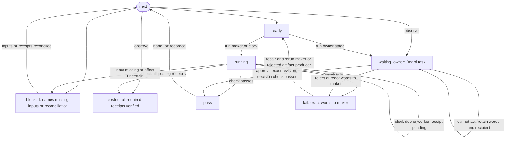

# The spine: recipes and one engine

Draft for the owner to read, queue item 37 seam 1. This is a rebuild contract, not an implementation or a claim
that the host already meets it. Inputs are a video's job, recipe, files, decisions and posting receipts; outputs
are one next action, checked stage results and source-backed Board tasks. C1 covers `plain` and `shorts-only`.
The video domains build the artifacts; this engine owns their order, freshness, holds and handoff.

## 1. A recipe is data

The host's `tools/stages.json` `recipes.plain` and `recipes.shorts-only` are subtraction lists over `rows`.
`stages.recipe_rows/less` also remove dependencies and handoffs to dropped stages and never-made files.
The examples below instead spell out the intended C1 path. They are new data, not a copy of that interpreter.
Paths are relative to the video; `source.mp4` is a generic example input, resolved from the job at intake.
`records/` replaces the host's `data:` record aliases. Output manifests enumerate exact media paths and hashes;
checks read those members too. Check and role names below are proposed domain interfaces, not existing commands.

```json
{
  "plain": {
    "stages": [
      {"id":"media","inputs":["source.mp4","records/job.json"],"run":{"role":"editor"},"check":["media"],"outputs":["records/words.json","records/probe.json","records/faces.json"],"next_actor":"editor"},
      {"id":"plan","inputs":["records/words.json","records/probe.json"],"run":{"role":"editor"},"check":["cut-plan"],"outputs":["records/cut_plan.json","records/cut_plan2.json","records/paper.md"],"next_actor":"story-editor"},
      {"id":"paper","inputs":["records/paper.md","records/cut_plan2.json"],"run":{"role":"story-editor"},"check":["paper-read"],"outputs":["records/story_review.json"],"next_actor":"editor"},
      {"id":"overlays","inputs":["records/cut_plan2.json","records/story_review.json"],"run":{"role":"editor"},"check":["overlay-plan"],"outputs":["records/callouts_plan.json","records/overlay_plan.json","records/shorts_spec.json","records/bed.json"],"next_actor":"editor"},
      {"id":"arc","inputs":["records/cut_plan2.json","records/overlay_plan.json","records/callouts_plan.json","records/bed.json","source.mp4","records/faces.json"],"run":{"role":"editor"},"check":["arc-read"],"outputs":["Draft/arc.mp4","records/arc_review.json"],"next_actor":"owner"},
      {"id":"arc-choice","inputs":["Draft/arc.mp4","records/arc_review.json"],"run":{"role":"owner"},"check":["decision"],"outputs":["records/arc_decision.json"],"next_actor":"editor"},
      {"id":"locked","inputs":["records/arc_decision.json","records/cut_plan2.json"],"run":{"role":"editor"},"check":["locked-cut"],"outputs":["records/story_map.json"],"next_actor":"finisher"},
      {"id":"draft","inputs":["source.mp4","records/cut_plan2.json","records/story_map.json","records/overlay_plan.json","records/bed.json","records/faces.json","records/callouts_plan.json"],"run":{"role":"finisher"},"check":["draft-read"],"outputs":["Draft/draft.mp4","records/draft_review.json","records/vplan.json"],"next_actor":"owner"},
      {"id":"draft-choice","inputs":["Draft/draft.mp4","records/draft_review.json"],"run":{"role":"owner"},"check":["decision"],"outputs":["records/draft_decision.json"],"next_actor":"finisher"},
      {"id":"masters","inputs":["records/draft_decision.json","records/cut_plan2.json","records/shorts_spec.json","records/faces.json","source.mp4","records/story_map.json","records/overlay_plan.json","records/callouts_plan.json","records/bed.json","records/vplan.json"],"run":{"role":"finisher"},"check":["delivered-media"],"outputs":["YouTube/main.mp4","YouTube/main.srt","Vertical/main.mp4","Shorts/short.mp4","Shorts/short.srt","records/final_manifest.json","records/hear.json"],"next_actor":"packager"},
      {"id":"titles","inputs":["records/words.json","records/final_manifest.json"],"run":{"role":"packager"},"check":["titles"],"outputs":["records/publish.json"],"next_actor":"packager"},
      {"id":"copy","inputs":["records/final_manifest.json","records/publish.json","records/words.json"],"run":{"role":"packager"},"check":["captions-read"],"outputs":["records/copy.json","records/copy_review.md"],"next_actor":"story-editor"},
      {"id":"text-plan","inputs":["records/words.json","records/final_manifest.json"],"run":{"role":"story-editor"},"check":["text-plan"],"outputs":["records/text_plan.md"],"next_actor":"writer"},
      {"id":"text","inputs":["records/text_plan.md","records/words.json"],"run":{"role":"writer"},"check":["text-read"],"outputs":["records/text_post.md","records/text_review.md"],"next_actor":"packager"},
      {"id":"release","inputs":["records/final_manifest.json","records/publish.json","records/copy.json","records/copy_review.md","records/text_post.md","records/text_review.md"],"run":{"role":"packager"},"check":["release"],"outputs":["records/release.json","Review.md"],"next_actor":"owner"},
      {"id":"release-choice","inputs":["records/release.json","Review.md"],"run":{"role":"owner"},"check":["decision"],"outputs":["records/release_decision.json"],"next_actor":"clock"},
      {"id":"posting","inputs":["records/release.json","records/release_decision.json"],"run":{"role":"clock"},"check":["posted"],"outputs":["records/posting.json"],"next_actor":"clock"}
    ]
  },
  "shorts-only": {
    "stages": [
      {"id":"short","inputs":["source.mp4","records/job.json"],"run":{"role":"finisher"},"check":["short-media"],"outputs":["Shorts/short.mp4","Shorts/short.srt","records/words.json","records/final_manifest.json","records/publish.json"],"next_actor":"packager"},
      {"id":"copy","inputs":["records/final_manifest.json","records/publish.json","records/words.json"],"run":{"role":"packager"},"check":["captions-read"],"outputs":["records/copy.json","records/copy_review.md"],"next_actor":"packager"},
      {"id":"release","inputs":["records/final_manifest.json","records/copy.json","records/copy_review.md","records/publish.json"],"run":{"role":"packager"},"check":["release"],"outputs":["records/release.json","Review.md"],"next_actor":"owner"},
      {"id":"release-choice","inputs":["records/release.json","Review.md"],"run":{"role":"owner"},"check":["decision"],"outputs":["records/release_decision.json"],"next_actor":"clock"},
      {"id":"posting","inputs":["records/release.json","records/release_decision.json"],"run":{"role":"clock"},"check":["posted"],"outputs":["records/posting.json"],"next_actor":"clock"}
    ]
  }
}
```

- Recipe key: the exact `job.json` recipe name; missing, unknown or malformed data refuses with its location.
- `stages`: ordered stages; the first unfinished stage is the one answer. Producers precede consumers; external
  inputs are explicit. The loader rejects duplicate IDs, unknown roles/checks, unsafe paths and unresolved producers.
- `id`: stable identity inside the recipe, also the identity used for rerun, evidence and Board source links.
- `inputs`: required files before the maker starts, including any manifest's members. Missing is blocked, never skipped.
- `run`: one registered role as shown, or `{"command":["registered-tool","argument"]}` as data, never shell text
  evaluated by the engine. A role resolves through the host's registry; no model, account or team routing in recipes.
- `check`: check IDs, all required. Each check declares `reads` (bindings to stage inputs/outputs or manifest members),
  its independent checker role and maker recipient for failure; it cannot read the recipe name or load the job to infer it.
- `outputs`: files whose existence, content hashes and check results define completion, including check-produced
  review evidence. Only maker outputs are required before check starts; review records are produced by its
  independent checker and required before pass. A maker's message is not proof.
- `next_actor`: the role, `owner` or `clock` receiving the successful handoff; it must agree with the next stage's
  `run` actor. The terminal clock observes posted receipts; it does not send again.

Checks declare only the evidence they use. For these examples: `media` reads source, probe, words and faces;
`cut-plan` reads words, both cut plans and paper; `paper-read` reads paper, cut and story review; `overlay-plan`
reads cut, callouts, overlay, shorts and bed plans; `arc-read` reads the arc and its independent story/craft review;
`locked-cut` reads the approved arc decision, cut and story map; `draft-read` reads draft and independent sound/frame
review; `delivered-media` reads final manifest and members, cut, shorts/vertical plans and hear report; `short-media` reads source,
short manifest and members, words and short publish metadata. `titles` reads words, publish and delivered media;
`captions-read` reads words, manifest members, copy and its independent read. `text-plan` reads words and plan;
`text-read` reads words, text and its independent read. `release` reads release, its declared assets and copy, and any
text explicitly bound by the stage. `decision` reads the judged content and its revision-bound decision output;
`posted` reads the approved release and external posting receipts. Bindings live in the check catalog, not in code
branches on recipe names. Missing source evidence blocks; an executed judgment failing sends its exact words to
its maker. Review records in the reads above are checked for content binding after the independent checker creates
them, not required before that checker starts. The stage stays running while the review is in progress. Owner and independent checker records cannot be authored by the maker on their behalf.

Derivation and intentional changes from the host:

- Plain keeps transcribe, plan, paper/look/overlay reads, arc, lock, draft, masters, titles/copy, captions and text.
  Read/check rows become checks on their producer, with an independent checker where judgment is needed; look is
  included in `arc-read`. YouTube and delivered collapse to one masters stage. Repairs and retime rerun their owner
  stage, not separate catch-all stages. No chat, drawn/rendered B-roll or animation read, matching plain's drops/never.
- The table retains thumbnail brief/still and studio-wide research/growth rows. C1 excludes the image and research
  domains per architecture.md: no new image generation or research pipeline here; release claim verification still
  requires source evidence when a claim needs it, and owner-supplied assets may be bound in the release. The retained
  text path needs no generated still. This is a visible scope difference from legacy, for the owner to read.
- Shorts-only's host table assumes an already finished short; it drops long-cut production/checks, titles,
  thumbnails, paper reads, animation and text. Its release fixture supplies final manifest, publish and copy.
  The new `short` stage closes C1's footage-to-posted gap using the rendering/captions domains; an owner-made short
  can satisfy it only through the same artifact checks. It does not restore a long-cut or final-verdict requirement.
- “Skipped by this recipe” means absent from its stage list: never dispatched, checked, held or shown on the Board,
  even if an unrelated old file happens to exist. There is no persisted skipped state and no `never` exception table.

## 2. Four engine answers and one video record

The public API takes a video context through the core host boundary, never imports host tools, and uses one
validated recipe revision. Built in `pirillo_studio/spine/` (seam 2): `recipes.json` holds both recipes, each with
its explicit `external` inputs; `catalog.json` the roles, tools and each check's `reads` (stage paths, `@inputs`,
`@outputs`), `checker` and the review records it `produces`; `engine.py` the four answers, where `next` also
returns the stage's `state`. Holds are `records/holds.json` rows `{stage, why, by}`; an owner decision is the
stage's output `{task, verb, words}`, its verb one of approve, reject, redo, not-this, try-again, cant or undo.
The video is keyed by `records/job.json` `id` (a non-empty string; missing refuses), never its folder, so a moved
video keeps its send, task and handoff keys. A review record binds to the content it judged by containing that
check's `judged` digest (sha256 over the check's other evidence hashes, which `check` names while it waits); a
review without the current digest is still awaited. Whether every release row has its receipt is the `posted`
check's answer, owned by the posting domain ("The release and posting domains own send receipts", below); the
engine accepts `posted` only from that check and `waiting_owner` only from its own decision check. Paths that fold
to one name on a case- and form-insensitive disk are one path, and no path under the video may pass a symlink.

| Answer | Contract |
|---|---|
| `next(video) -> {stage, actor, why, inputs_missing}` | Read only. One earliest unfinished stage and actionable reason, with exact missing input paths. A failed stage names its maker; an owner wait names owner; an active run names its current actor; a scheduled send names clock and due time. A posted video returns `stage: null`, `actor: null`, `why: "posted"`, `inputs_missing: []`. Unknown recipe is an explicit error, never plain by default. |
| `run(video, stage) -> record` | Revalidate recipe, dependencies, holds and exact input revisions before starting a registered maker. An arbitrary dispatch cannot bypass next's decision. For a previously passed stage, explicit rerun invalidates only its dependent results and approvals, retaining history. Return a record reference and current state, including an already running or completed attempt. |
| `check(video, stage) -> {ok, state, next_action, detail}` | `ok` is true only for pass or verified posted; states are those below. Missing source inputs or maker outputs are blocked with their paths; independent review outputs are required at pass; check failure is fail with original check words, evidence and maker. Owner decision outstanding is waiting_owner. A check tool error never becomes a pass. Freshness binds the check implementation and all input/output bytes. |
| `hand_off(video, stage) -> {actor, told, record}` | Only current pass can hand off. `actor` is `next_actor`; `told` is the durable role inbox/Board source/posting-clock work key, not a claim someone read it; `record` locates its receipt in the video record. Retries reconcile that same key, never send a duplicate. Owner decisions use the Board task contract below. |

`records/run.json` is the one per-video stage record, keyed by video, recipe revision, stage and attempt identity.
It retains an append-only history of transitions inside that record: state, input/output hashes, check-version and
verdict evidence, maker/checker, exact failure words, owner decision/task revision, and handoff/external receipt keys.
An explicit rerun creates a new attempt; retrying that attempt after a crash does not. Writes are atomic under the
video's single writer. Record an operation key before an effect; after a crash reconcile the maker or posting
adapter receipt using that key before attempting it again. An uncertain external send stays blocked for receipt
reconciliation, never presumed unsent. Two calls or a crash reach one result; a stale or unreadable record refuses.

Changed inputs invalidate consuming checks and downstream approvals by content, not log time. Failed checks retain
artifact evidence for their maker. The release and posting domains own send receipts and reversibility; the spine
references them rather than inventing another posting ledger. Posting is done only when every required release
row has a verified external receipt, not when approved, queued or first partially posted.

## 3. One video's path

These boxes are the complete persisted engine state vocabulary. `next` and `hand_off` are operations, not extra
states. Arrows from read-only `next` select or observe state, never write it. `run` records readiness and starts
the selected work (or records blocked inputs); for an owner stage it writes waiting_owner and creates the task.
`check` records fail/blocked/pass or terminal posted; handoff progress is evidence on the passing record.



A `next` call observing running, fail or waiting_owner returns that state's actor and reason without rewriting it.
`run` creates an owner stage's one task using [the Board model](board.md): stable revision `id`, `kind: ask`, `what`, `why`,
`source.record` pointing to the stage attempt and `source.filed_by` to its maker, a served `judge` for exact content,
`actions` with inverse/limit, `cant.words` and `cant.goes_to`, and the Board's own `loop`. Board loop states remain
Board states, not extra engine states. Approval is explicit and bound to content; reject/redo/not-this/try-again
never approve. A rejected owner stage invalidates that decision and reopens the producer of its judged artifact; its new pass
returns to a fresh owner task revision, never a retry asking owner to be the maker.
Undo before downstream work invalidates that decision and reopens the task; after an irreversible effect the
receipt explains the limit. No source stage means no task. Waiting for the clock is running with its due time.

## 4. Host deciders and their replacements

Source paths here are relative to the host at `38cd63db108006459097933a16f3685338e9a635`. This inventory is not permission to copy
its code. “None” means no literal recipe name; such a decider can still depend on recipe-sensitive helpers.

| Host decider | What it decides; recipe names | Spine replacement or C1 boundary |
|---|---|---|
| `tools/stages.json rows, recipes` | Base rows, drops, never files, shares and custom rows; plain, shorts-only, op-ed and other recipes | Explicit stage lists; other recipes out of C1 scope |
| `tools/recipe_stages.py install` | Milestone output ownership; none | Stage outputs, unique IDs |
| `recipe_stages.current` | Dynamic freshness callback; none | Check declared reads and version |
| `tools/recipe_never.py RECIPE_NEVER_MAKES` | Absent record blacklist; animated-explainer | Out of C1 scope: animation recipe |
| `recipe_never._table_never` | Loads never files, failure becomes empty map; all recipes by data | Validated recipe stages, no absent-stage asks |
| `recipe_never.RECIPE_SKIPS_RUNS` | Removes title/thumbnail runners; shorts-only | Only stage-declared checks |
| `recipe_never.wordless/wordless_job` | Spoken-word exemptions; none | Out of C1 scope: wordless extension; future output declarations |
| `tools/qc.py shorts_only` | Recipe identity predicate; shorts-only | Delete; use declared output kinds |
| `qc.recipe_absent` | Missing-record exemption; all recipes via map | Delete. Disagrees with stage absence: an old stray file currently enables the check |
| `qc._splice` | Cut-plan absence exemption; none | Splice check reads cut plan |
| `qc._built` | Built-cut absence exemption; none | Declared cut plan and render |
| `qc.run_same_size` | Cut/framing applicability; none | Declared cut plan and render |
| `qc.run_framing_headroom` | Headroom applicability; none | Declared cut plan and render |
| `qc.run_plan_check` | Overlay applicability; none | Declared cut/overlay records |
| `qc._hear_row` | Hearing report exemption; none | Declared hearing report and render |
| `qc.run_titles_research` | Skips short title research; shorts-only through helper | No title check on absent title stage |
| `qc.run_titles_scored` | Skips short title scoring; shorts-only through helper | Same stage selection |
| `qc.run_release_complete` | Long description/article exemptions; shorts-only through helper, wordless flag | Required assets/copy declared in release, no recipe-aware checker |
| `qc` runner selection (line 4365) | RECIPE_SKIPS_RUNS bypass; shorts-only via map | Engine selects stage check IDs |
| `tools/check_sheet.py` QC adapter (line 194) | Orientation selects vplan/cut plan then recipe_absent; none | Check binds render to its declared plan |
| `tools/proof_plan.py run_proof_gaps` | Overlay-plan absence exemption; none | Overlay check declares its reads |
| `qc.run_vertical_hold` | No plan becomes not-run; none | Selected check with missing plan is blocked |
| `tools/vhold.py signature` | Geometry fingerprint; none | Rendering check input/version identity |
| `vhold.stopped` | Missing/stale/bad report becomes no stops; none | Require current evidence; conflicts with main's missing-plan refusal |
| `vhold.measure` | Geometry stop, manual look or pass; none | Recipe-neutral check; declared owner review where needed |
| `vhold.check` | Writes vertical check report; none | Output evidence of rendering stage |
| `vhold.main` | Missing plan refuses, JSON mode exits zero even for stop; none | Read structured verdict; exit zero alone never means pass |
| `tools/stages.py load_table` | Resolves table and named recipe; op-ed default | Recipe validation |
| `stages.recipe_rows` | Shares/drops/styles/custom rows; all names via data | Explicit recipe list |
| `stages.less` | Removes stages, dependencies and handoffs; none | No absent stages or edges |
| `stages.video_recipe` | Bad/missing job defaults; op-ed | Invalid recipe reference blocks |
| `stages.recipe_wait` | Pending recipe dependencies; none | Recipe availability validation; pending non-C1 recipes out of scope |
| `stages.rows_for` | Selects recipe, refuses pending; op-ed default | Same engine resolver for every entry point |
| `stages.draft_decision_required` | Owner gate before finishing; none | Owner decision dependency |
| `stages.plan_gate_required` | Dated plan-verdict gate; none | Declared plan check |
| `stages.Video.__init__` | Open, interrupted and stalled roles; none | Attempt record and recovery |
| `Video.idle` | Inactivity escalation; none | Clock observation; host notification policy |
| `Video.stale` | Input freshness, errors become not stale; none | Hash-bound evidence; unreadable evidence blocks |
| `Video.fresh_rule` | Whether freshness applies; none | Every stage declares reads |
| `Video.until` | Later stage bounds earlier done; none | Stage attempt identity |
| `Video.first` | Done after timestamp; none | Current stage result |
| `Video.ups` | Upstream completion times; none | Declared dependencies and hashes |
| `Video.own` | Verdict/milestone/read establishes done; animation-read special case | Current checked result; animation out of C1 scope |
| `Video.read_stands` | Paper-read freshness, exception returns true; none | Declared check reads; error cannot establish pass |
| `Video.behind` | Later completion implies earlier done; none | Explicit stage result, no inference |
| `Video.left` | Remaining role stages; none | `next` |
| `Video.settled` | Own or inferred done; none | Current passing result |
| `Video.ready` | Separate copy readiness; none | `next` release requirements |
| `Video.matches` | File presence, exception becomes absence; none | Input resolution with explicit error |
| `Video.holds` | Parses intake/done/verdict/file/stop/tool/paper/look/release predicates; none | Stage inputs, checks and owner dependencies |
| `Video.stops` | Routes failed findings; none | `check` words and maker |
| `Video.requests` | Tool request extraction; none | Out of C1 scope: host tool-work queue |
| `Video.answer` | Script-name overlap resolves tool request; none | Out of C1 scope: host tool-work queue |
| `Video.unanswered` | Remaining tool requests; none | Out of C1 scope: host tool-work queue |
| `Video.tool` | Tool response unblocks role; none | Out of C1 scope: tool queue; engine needs explicit resolution evidence |
| `Video.asked` | Role request label; none | Out of C1 scope: tool-work queue |
| `Video.held` | Later done/note releases hold; none | Named block resolution, not unrelated later activity |
| `Video.his_last` | Latest owner-directed note; none | Revision-bound Board decision source |
| `Video.draft_coming` | Draft build vs check in flight; none | Stage state |
| `Video.tonight` | End-of-day notice; none | Clock actor and host notifier |
| `Video.state` | Open/blocked overrides readiness; none | `next` |
| `Video._state` | Done/wait/decide/start; none | `next`, same prerequisites as `run` |
| `stages.qc_first` | QC starts for stale report/new build; none | `check` with exact current evidence |
| `stages.old_flow` | Pre-table video detection; none | Out of C1 scope: explicit legacy migration adapter |
| `stages.old_done` | Old completion inference; none | Out of C1 scope: migrate evidence, never guess in engine |
| `stages.approved_line` | Suppresses work after approval; none | Approval advances toward posting; explicit rerun retained |
| `stages.first_lines` | Interruptions/tool requests take priority; none | Engine recovery; tool queue out of C1 scope |
| `stages.next_lines` | Single-video next and ingest; none | `next`; today applies approved/old-flow rules absent from next_all |
| `stages.next_all` | Overview eligible work/holds; none | Iterate identical `next(video)` answers; fixes disagreement above |
| `stages.find_row` | Role/stage resolution; none | Resolve stage ID from selected recipe |
| `stages.dispatch_lines` | Brief and selected hold/draft/plan gates; none | `run` checks all next prerequisites; today named dispatch bypasses Video.state |
| `stages.receipt_gate` | Non-video scheduled receipts/leases; none | Out of C1 scope: host team/work queue |
| `stages.open_for` | Actionable stop/log context; none | Handoff retains check words and actor |
| `stages.list_lines` | Recipe row list; none | Recipe introspection |
| `stages.main` | next/dispatch/list routing; none | Thin adapters to engine |
| `tools/studio.py` next/dispatch commands (line 29083) | Delegates to stages and annotates tool blockers; none | Both use one switch and same engine |
| `studio.load_holds` | Bad record becomes no holds; none | Invalid hold input blocks |
| `studio.hold_waits` | Owner or other-video dependency; none | Explicit engine block/owner wait |
| `studio.hold_low` | Overview ordering; none | Host list order only; never changes per-video answer |
| `studio.hold_cmd` | Set/clear hold; none | Validated hold input with recorded resolution |
| `studio.cover_hold` | Missing cover words or explicit none; none | Posting check declares cover metadata |
| `studio.dispatch_repairs` | Optional scheduler behavior; none | Engine scheduling replaces video branch; team repair dispatch out of C1 scope |
| `studio.holds_refresh` | Calls image-hold refresh; none | Shared decision invalidation; image production out of C1 scope |
| `studio.missing_files` | Removes never-made milestone requirements; none | Recipe outputs |
| `studio.recipe_never_makes` | Reuses QC blacklist; none | Delete on migrated paths |
| `studio.asset_srts` | Manifest-free caption lookup; animated-explainer in source | Out of C1 scope: animation exception |
| `studio.verdict_problem` | Drops verdicts by recipe checker-row drops; none | Selected stage checks only |
| `studio.copy_waits` | Text-post exemption via never/wordless; none | Declared release assets |
| `tools/image_holds.py refresh` | Missing still vs approval vs clear; none | Image domain out of C1 scope; owner-supplied release assets still require current evidence |
| `image_holds.swap` | Replacement revokes approval on unsent posts; none | Shared revision-bound decision invalidation; story/vault behavior out of C1 scope |
| `image_holds.withdraw` | Reject hash removes approval; none | Decision dependency invalidation; no stale approval survives |
| `tools/recipe_feature_checks.py` style test | Style reaches dispatch without changing other recipes; animated-explainer via fixture | Out of C1 scope: styled animation; retain data isolation contract |
| `recipe_feature_checks` pending test | next and dispatch refuse pending recipe; proof-on-screen | Out of C1 scope: recipe itself; common resolver must still refuse unknown/unavailable recipes |
| `tools/test_shorts_only_recipe.py ShortsOnlyRecipe` | No long title, paper, thumbnails; still needs manifest/copy/words/publish; shorts-only | Stage/output contracts; long release still requires its declared words |
| `test_shorts_only_recipe.WordlessVideo` | No spoken words/article; wordless job | Out of C1 scope: wordless extension |
| `test_shorts_only_recipe.FreshReportAfterACodeChange` | Old checker report must not survive code change; none | Check-version fingerprint |
| `test_shorts_only_recipe.ShortsOnlyHasNoTextPost` | Never waits on text; shorts-only | Absent stage contract |
| `test_shorts_only_recipe.ShortsOnlyHasNoFinalCheck` | Dropped final verdict cannot block ingest; shorts-only, op-ed | Only declared stage checks |
| `tools/publish.py release_files, shorts_list, main` | `SHORTS_ONLY` drops long title set, description, end screen and text post; reads shorts from final_manifest rather than shorts_spec; refuses non-release operations and exempts long-title refusal. `NO_SHORTS_RECIPES` permits a missing shorts_spec for animated-explainer | Release rows and required titles declared in the recipe; release domain consumes declared outputs (item 39). Unlike `qc.recipe_absent`, these shorts-only decisions follow identity even with stray long files; the no-shorts exemption depends on file absence. Animation remains out of C1 scope |
| `tools/status.py never_made, plan` | Third reader of stages.json never files; read failure becomes an empty set. `PLAIN`/plain selects the overlay plan label; never-made proof paths remove plan/progress steps | Plan and progress display come from the recipe's stage list. Like `recipe_never._table_never`, unreadable data silently restores requirements; unlike `qc.recipe_absent`, a never-made path stays hidden even if a stray file exists. Invalid recipe data blocks |
| `tools/job.py PLAIN` | Shared recipe == plain flag drives rendering, preflight, retention and status exceptions | Remove identity flag after callers consume declared stage inputs/outputs; stage selection belongs to the engine, rendering contracts to item 14 |
| `tools/chat.py` module guard | `PLAIN` refuses chat before drawing; plain | Absent chat stage is never dispatched; rendering accepts only declared chat inputs (item 14) |
| `tools/broll.py main` | `PLAIN` refuses B-roll before rendering; plain | Absent B-roll stage is never dispatched; rendering accepts declared B-roll inputs (item 14) |
| `tools/draft.py overlays, main` | `PLAIN` excludes foil/broll plans, changes absence messages and skips anchor resolution in --check; plain | Compose only declared overlay outputs (item 14); unlike `qc.recipe_absent`, stray files never re-enable excluded work |
| `tools/draft_preflight.py check` | `job.PLAIN` skips prospective anchor resolution and passes no foil cards to plan_check; plain | Preflight checks the declared overlay records (item 14); agrees with draft exclusion, unlike QC's file-presence exemption |
| `tools/retention.py` attention/cadence checks | `PLAIN` counts cuts/reframes as fresh attention and downgrades cadence fixes to notes; plain | Recipe-neutral check reads declared cut and overlay records with their attention/cadence contract (item 14); neither event counting nor severity reads recipe identity |
| `tools/textstill.py Post.module` | Supplies `PLAIN=False` in its synthetic job module for reused B-roll/anchor code; no video recipe | Out of C1 scope: standalone post stills; rendering's declared inputs replace the fake recipe dependency when that consumer is rebuilt (item 14) |
| `tools/stages.py PLAIN` and dependency validation | Unrelated constant: names argument-free after predicates, not the plain recipe; none | Recipe dependency schema validates declared inputs/edges; remove the legacy predicate grammar with the scheduler, not as a recipe-identity branch |

Inventory searches: `rg -n '^def |^    def '`, `rg -n 'recipe_absent|RECIPE_NEVER_MAKES|RECIPE_SKIPS_RUNS|shorts-only'`,
`rg -n 'recipe|hold|dispatch|next'`, and `rg -n 'plain|shorts-only|recipe|#[0-9]+'` on the named files and
`plugin/pirillo-studio/skills/content-pipeline/references/`; also `rg -n '\bPLAIN\b|SHORTS_ONLY|NO_SHORTS_RECIPES' studio/tools`;
then bounded reads around matches. `stages.py` was added
because the host command delegates there. `references/crew.md` Start/Done and `references/approvals.md` supply the
stage-record, failure-routing and exact-content approval requirements; they do not supply invented issue numbers.

## 5. Owner expectations as contract tests

These named tests are obligations for the implementation seam, not tests written or run by this document change.

1. `test_next_is_one_reasoned_answer`: identical video state yields one stage, actor, reason and exact missing
   inputs; overview and single-video commands agree, including approved and already posted videos.
2. `test_recipe_edit_changes_data_only`: changing stage order/inputs/checks in valid recipe data changes execution
   without modifying engine or checks; invalid names, cycles, paths or unresolved dependencies refuse explicitly.
3. `test_check_never_reads_recipe`: invoke a check with only its declared evidence bindings; no recipe identity is
   available. Its verdict is identical for identical evidence in either recipe.
4. `test_absent_stage_never_asks`: a skipped stage produces no plan or progress row and no Board task, even with
   stray old files; shorts-only asks for no paper/text/title/thumbnail/long-final check, plain no animation/chat
   work. Required present-stage files still block.
5. `test_every_stage_reruns`: explicitly rerun every stage, retain history, invalidate dependent checks/approvals,
   preserve unrelated current outputs and reconcile external receipts without reposting.
6. `test_failure_returns_exact_words_to_maker`: a failed check retains evidence, words and responsible maker;
   owner rejection routes to the producer, never silently advances or asks the owner to repair code.
7. `test_new_recipe_needs_no_engine_code`: compose a third recipe from registered stages/checks using only data;
   no added recipe branch. A novel capability may need a new domain tool, not a recipe exception in the engine.
8. `test_pass_hands_off_once`: pass writes evidence and one durable handoff; retry or crash before/after recording
   the effect reaches the same receipt. Pass without recorded handoff remains recoverable, never loses the next actor.
9. `test_block_names_inputs`: missing/unreadable inputs, stale check evidence or an uncertain send yields blocked
   with exact paths/receipt key and resolution owner; no not-run-as-pass or empty-holds fallback.
10. `test_owner_wait_is_one_board_task`: correct judge/content, source, actions, reply and undo on one task; old
    revisions refuse, cannot-act retains words/recipient. Test reject/redo/not-this/try-again before approve.
11. `test_posted_needs_all_receipts`: only every required external posting receipt ends at posted; approval,
    queueing, one platform out, failed or ambiguous send does not. Posted next returns no stage.
12. `test_run_uses_next_guards`: named dispatch cannot bypass missing input, hold, check or owner approval; a running
    attempt is resumed, not duplicated. An explicit rerun also respects current dependencies.
13. `test_check_revision_invalidates_result`: changing a checker or any declared input/output invalidates its old
    pass and downstream approvals even when timestamps would previously have considered it fresh.
14. `test_off_is_unchanged`: with the switch off, existing command outputs and persisted artifacts are byte-identical
    on the same fixture; on, next/dispatch/holds all read the same engine result, never mixed schedulers.

Tests 8, 6, 9, 10 and 11 cover the flow ends pass/handoff, fail, blocked, waits on owner and posted respectively;
12 covers ready/running and recovery. They inspect produced record/task/receipt files, not a command's own success
message. The implementation also needs one real-video run for each C1 recipe with no legacy module on its path.

Live check: `python3 tools/spine_contract.py run --video "$VIDEO_FOLDER" --out "$SPINE_PROOF"`

This is the proposed host acceptance command for the implementation seam, not an existing executable or proof of
this draft. The Mac lead supplies an actual video folder and evidence destination through those variables, runs it
for each C1 recipe, and inspects generated stage/Board records and actual posting receipts. It must exercise the four
answers and resume an interrupted attempt; sending remains subject to the owner's ordinary approval. The lead owns
building that command and its evidence-based assertions before claiming C1, not a simulated posted mark.

## 6. One switch, then delete

The single host setting is `studio.json` `spine`, a boolean, initially false. Behind it the host's video next,
dispatch, stage completion and holds all use the four core answers and the same persisted state. Off preserves the
legacy path byte for byte; on cannot fall back to legacy on any error. The host registry/Board/posting adapters
transport data and effects; they do not answer next again. The public core gets merged configuration as data.

Before enabling it for the two C1 recipes, compare owner-visible next/hold/Board behavior side by side, implement
all contract tests, and reconcile existing stage/approval receipts into explicit current evidence. Keep a video on
one engine until that reconciliation; never let both write its record. No automatic inference from later milestones.

The final switch-and-delete landing removes the applicable `stages.py` video scheduler/brief decision paths,
`recipe_stages` dynamic freshness registration, `recipe_never`/`qc.recipe_absent` and their migrated callers,
`RECIPE_SKIPS_RUNS`, recipe-aware release/title gates, and host milestone/hold/verdict/copy readiness exceptions
listed above. Delete their superseded tests/settings only when their guarantees are covered by the named contracts.
Specifically delete `status.py never_made` and its plain plan label in favor of the recipe's stage list, and
`job.py PLAIN` after migrating its callers: status to that list; chat.py, broll.py, draft.py, draft_preflight.py and
retention.py moved to its domain's declared outputs (item 14). Remove textstill.py's synthetic PLAIN binding when
its standalone-still consumer is rebuilt there; it remains out of C1 scope. The publish.py shorts-only release
branches, manifest/shorts-list selection and long-title refusal are moved to its domain's declared outputs (item 39).
The unrelated stages.py PLAIN dependency grammar goes with the scheduler, not the rendering recipe flag.
Retain rendering geometry checks, posting/approval protections and host-only team queue logic at their owners.
Other recipes remain out of C1 scope; any legacy entry point needed solely by them is explicitly isolated from the
C1 call graph until its own rebuild. Once both C1 videos finish on core and the owner accepts the Board, remove the
switch and the old C1 path together; never maintain two permanent sources of truth.

## 7. Failings this contract ends

- Host `toolreq 2095a91279e5`, cited by `status.py plan`: a plain video's plan showed an absent step as Next and
  B-roll as Skipped. Contract 4 requires no plan or progress row and no Board task for a skipped stage.
- Host #1109 and #1110, recorded in `test_shorts_only_recipe.ShortsOnlyRecipe` with defect commit
  `bef815930265665f0bc6eac1d6e001f5eb8fd96f`: a finished short hit a missing long-title lookup and an unwanted
  paper read. Explicit short output/check selection ends the class; contracts 3, 4 and 9 preserve required evidence.
- Host commit `430b641fc`, cited by `FreshReportAfterACodeChange`: `--fresh` reused a report from before the checker
  changed. Check implementation identity is part of the stage result; contract 13 rejects stale evidence.
- `ShortsOnlyHasNoTextPost` and `ShortsOnlyHasNoFinalCheck` at the inspected host revision: release/ingest waited
  for a text post or final verdict the recipe drops. No issue number is supplied by these guards; contract 4 covers
  their actual attacks, rather than adding another recipe exception to each downstream gate.
- Host #88 and `toolreq b4c8a658f971`, cited beside QC's recipe exceptions: narration-clock checks encountered
  cut-plan records the animation recipe never makes. Animation is out of C1 scope, but check-declared inputs and
  contract 3 prevent carrying that failure mechanism into this engine; this seam does not claim that issue fixed.
- Host image-hold #1142, #1210 and #1266 are cited in `image_holds.py`: refresh, missing-still preservation and
  withdrawn approval must remain distinct. Image production is out of C1 scope; revision-bound decisions preserve
  the applicable release-asset protection, covered by contracts 9 and 10, without importing an image scheduler.
- At the inspected host baseline, `next_lines/next_all`, named `dispatch_lines`, `recipe_absent`,
  `Video.read_stands/stale/held` and `vhold.stopped` disagree as recorded in the map. No issue IDs are invented for
  these source observations. Contracts 1, 4, 9, 12 and 13 make the engine's answer, input and evidence rules shared.

This seam changes no runtime behavior. The queue remains building through engine implementation, host integration,
owner review and verified C1 cutover; a drafted spec is not a completed migration.
